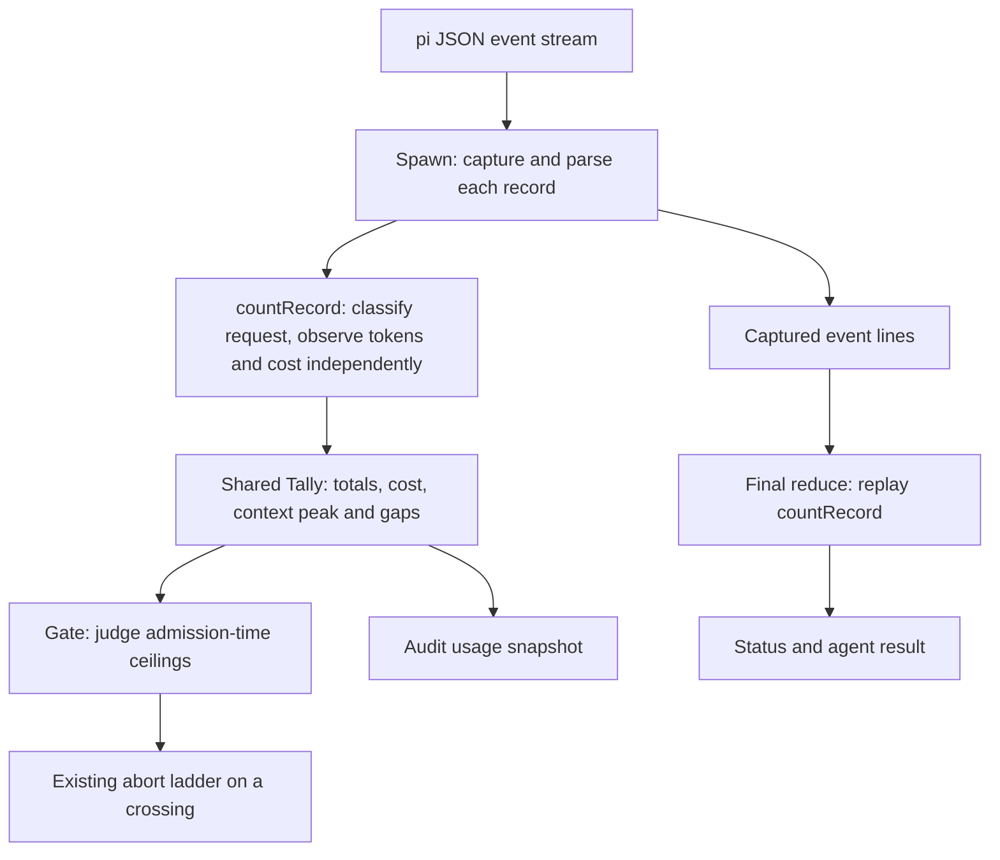

<!-- doctrine:section sec-1 -->
## 1. Design Problem

Quotient delegates work to pi under operator-defined limits. Its current token ceiling adds usage across every provider request in a run. Because later requests resend conversation history, a long run can exhaust that cumulative budget while each individual request occupies only a small part of the model's context window.

Release 0.2.0 replaces this proxy with an explicit `context_tokens` ceiling. The server checks the footprint of each measured request when its final usage record arrives. It reports the largest observed footprint so callers can see the context pressure reached during the run. Cumulative token totals remain available for accounting and reporting.

For one request, the footprint is:

```text
context_tokens = input + cacheRead + cacheWrite + output
```

These are pi's normalized usage components. Output belongs in the footprint because generation occupies context alongside the prompt. A previous response retained in the conversation becomes input on a later request; taking the maximum across requests avoids summing that history repeatedly. Do not add reasoning or one-hour cache-write breakdowns again: pi defines them as subsets of output and cacheWrite.

The gate stops when a measured footprint is strictly greater than the run's fixed admission-time ceiling. Equality is allowed. Checking the running peak is equivalent to checking each footprint when observed: the first crossing stops the run, before any later compaction can rescue it. Assistant requests and compaction-summary requests both contribute when measured. Missing context measurements are disclosed and do not independently stop the run.

### Boundary and outcomes

This change covers the shared stream accumulator, live gate, policy and per-call ceiling contracts, status and result documents, audit usage snapshots, user-facing documentation, and package release metadata. It does not implement a live harness context estimator or predict the next request's size. Enforcement remains retrospective and can exceed the threshold by the request that reveals the crossing.

The new release requires explicit policy migration to `quotient-policy/2`: `maxima.context_tokens` replaces `maxima.tokens`, with the corresponding caller ceiling renamed. Old policy versions and old ceiling names are refused with migration guidance. Operators choose a context threshold explicitly; a cumulative budget has no equivalent value to convert automatically. Result and nested status versions become `pi-agent-result/2` and `pi-run-status/3`.

Request-count, cost, wall-clock and transcript limits retain their existing semantics. Context measurement gaps are separate from cost validity. Valid reported cost permits continuation when token fields are missing or invalid; missing or invalid cost on an ordinary response retains the accounting stop. Existing failed-send and retry exceptions remain. Other ceilings are unaffected. Malebolge scheduling and session-resumption policy are outside this slice.

### Governing decisions and evidence

DEC-001 defines the full request footprint and peak reporting; DEC-002 permits continuation with disclosed measurement gaps; DEC-003 replaces cumulative enforcement; DEC-004 requires explicit policy migration; DEC-005 defines reporting and schema versions; CON-001 requires version 0.2.0. DEC-006 separates cost validity from token/context validity so an unknown context alone cannot trigger the accounting stop.

The completed evidence artifact is `research/research.md`. Load-bearing source observations were checked against `src/reduce/reduce.ts:439-516`, `src/server/gate.ts:98-151`, pi's `packages/ai/src/types.ts:459-477`, and its provider normalization code. The inspected pi source is ahead of installed pi 1.3.0; exact runtime parity remains unverified. Later sections must preserve that limit on the evidence.
<!-- doctrine:section sec-2 -->
## 2. Measurement and Enforcement

### Shared ownership and data flow

The reducer remains the sole owner of request classification and usage arithmetic. Extend its existing `Tally` and `Status` with the same `context` shape:

```ts
type ContextUsage = {
  peak_tokens: number | null;
  requests_unmeasured: number;
};
```

`createTally()` initializes `context` to `{ peak_tokens: null, requests_unmeasured: 0 }`. The live spawn reader and the final reducer both drive `countRecord()`; the gate reads the resulting tally, and the result embeds the reduced status. No second accumulator, provider client or harness estimator is introduced.

The following flow shows where measurement occurs and which consumers share it:



Live enforcement and replay must yield identical accounting facts for the same event prefix. Audit snapshots copy the context values so later mutations cannot rewrite prior evidence.

### One request, one context observation

Keep the existing request-classification table: each assistant `message_end` counts once; `compaction_end` counts only when it carries a result object; `summarization_retry_scheduled` counts a request without usage. Streaming `message_update`, `agent_end` replays, `auto_retry_start`, non-assistant messages and result-less compaction events add no request or observation.

For every counted request, record exactly one valid context measurement or increment `context.requests_unmeasured` once. A valid measurement requires all four normalized token components to be finite, nonnegative numbers and their sum to be finite. Do not infer missing components from `totalTokens`, which is provider-dependent. Do not add nested token breakdowns.

Update the peak with `Math.max(previousPeak ?? footprint, footprint)`. The peak never decreases during a run. It starts afresh on every quotient call, including a resumed session. Measure each reported request's actual usage without adding historical usage from session files. This relies on pi emitting assistant message_end only for sends in the current process, rather than replaying historical assistant messages as new sends. That resumed-session event shape is an unverified assumption for the installed runtime, not a claim established by fixture tests; retain it beside the source/runtime parity caveat.

For an ordinary successful response or compaction result, an explicit complete all-zero token vector is a measured zero. For failed/aborted assistant messages, absent or all-zero token vectors are treated conservatively as unmeasured placeholders; a complete vector with positive token evidence is measured even though the request failed. A failed request's valid context can cross the context ceiling without changing the existing rule that failed sends do not accrue cumulative token totals.

A summarization retry without usage increments the context gap count and preserves its existing accounting exception. Later retries are separate requests and do not erase that gap.

### Independent token and cost validity

DEC-006 replaces the coupled validity check in the current `readUsage()`. Read token components independently of `usage.cost.total`; use the existing finite/nonnegative numeric validation seam rather than introduce provider-specific parsing.

| Observation | Context effect | Cost/accounting effect |
|---|---|---|
| Valid tokens and cost | Measure footprint and update peak | Accrue cost |
| Invalid/missing tokens, valid cost | Increment context gap count | Accrue cost; no accounting stop solely for the token gap |
| Valid tokens, invalid/missing cost on ordinary response | Measure footprint and update peak | Mark accounting unknown |
| Missing usage on ordinary response or compaction result | Increment context gap count | Mark accounting unknown |
| Failed/aborted send with absent/placeholder usage | Increment context gap count | Preserve existing disclosed-unmeasured retry behavior |
| Summarization retry without usage | Increment context gap count | Preserve existing disclosed-unmeasured retry behavior |

Cumulative token totals keep their four existing fields and accumulate complete valid token vectors on ordinary responses and compaction results. Their observation no longer depends on cost being available; failed/aborted assistant messages retain their existing exclusion from cumulative token totals. Missing vectors add no invented zeros. The context gap count discloses incomplete token observation; the peak remains an observed lower bound when any gaps exist.

Under `pi-run-status/3`, `accounting` reports cost validity, with the existing failed-send and retry exceptions retained. The top-level `requests_unmeasured` counts the existing tolerated cost-observation gaps only: failed/aborted assistant sends whose cost is absent, invalid or placeholder under countFailedSend, and summarization_retry_scheduled records. Increment it once for either case. An ordinary response or compaction result with missing/invalid cost marks accounting unknown without incrementing that legacy counter. `context.requests_unmeasured` instead counts every counted request lacking a valid context measurement. Each count is between zero and requests inclusive; their populations may overlap, and their sum is not a partition of requests and may exceed it. Either count may exceed the other: a failed send with valid tokens but missing price contributes only to the top-level counter; an ordinary response with valid cost but missing tokens contributes only to the context counter. Known accounting means no disallowed cost observation failure, not that every counted request had a measured cost; tolerated gaps remain visible in the top-level counter. Valid zero cost is an observation; placeholder failed-send zeros are not proof of measured spend.

### Gate semantics

Replace the cumulative token comparison with `ceiling('context_tokens', tally.context.peak_tokens, ceilings.context_tokens)` at the same position in the existing order: requests, context, cost, wall clock, switch, accounting sanity. A null peak cannot establish a crossing and does not independently abort.

The peak comparison is the implementation of immediate per-request enforcement: with a fixed limit and a tick after each record, the first footprint above the limit is also the first peak above it. Keep strict `>` comparison, first-trigger behavior, idle polling, the admission-time ceiling snapshot and the existing abort ladder.

A crossing emits `{ cause: 'ceiling', unit: 'context_tokens', observed, limit }`. If the same record reveals both a context crossing and invalid cost, the existing ceiling-before-accounting precedence applies. The abort record freezes the crossing value and tally at the triggering event prefix. Already buffered or subsequently drained records may still be counted after the gate stops, so the final status peak can be greater than the abort observed value; require equality only for observations of the same prefix. Unknown context alone never causes an accounting abort. An ordinary response with missing cost can still stop for accounting, independently of its context gap.

### Required evidence

Focused tests must cover equality versus crossing; many small requests whose cumulative total exceeds the context bound; output/cache inclusion; duplicate streaming/replay events; compaction requests; a smaller post-compaction request; resumed-call fixture accounting under the stated event-shape assumption; placeholder failures and measured failures; known-cost/missing-context continuation; known-context/missing-cost accounting failure; null versus measured-zero peaks; and equality of live-tally, replay-status and audit observations for the same event prefix, including a larger post-crossing buffered/drained record. These are verification obligations for implementation, not claims of runtime acceptance in this design session.
<!-- doctrine:section sec-3 -->
## 3. Contracts, Migration and Release

### Policy and caller interface

Quotient 0.2.0 accepts `quotient-policy/2` only. Its required maxima are `requests`, `context_tokens`, `cost_usd` and `wall_clock_s`. The new context maximum must be a positive finite number. All other policy fields, closed-field validation, form selection and location rules retain their current meanings.

```json
{
  "requests": 20,
  "context_tokens": 180000,
  "cost_usd": 1,
  "wall_clock_s": 600
}
```

This fragment illustrates a maxima object, not a complete policy or a recommended universal context threshold. The operator chooses the threshold for its workloads and models. There is no dependency on model metadata, and this slice does not calculate a context-window percentage.

The MCP input schema, request type, closed caller-field list and clamping logic replace `ceilings.tokens` with `ceilings.context_tokens`. When omitted, the context ceiling inherits the policy maximum. An accepted caller value may only narrow that maximum; a value above it keeps the existing `ceiling-above-maximum` refusal. Numeric validation and narrowing behavior for the other caller bounds do not change.

Admission freezes the effective ceilings for the run. The policy switch continues to re-read the policy file, but a later maximum cannot alter the frozen context bound. A policy that becomes unreadable or invalid still stops an active run through the existing switch behavior.

### Migration and refusal behavior

| Input | Required behavior in 0.2.0 |
|---|---|
| `quotient-policy/1` | Refuse `policy-invalid`; explain that /2 requires choosing `maxima.context_tokens` and removing `maxima.tokens` |
| /2 policy containing `maxima.tokens`, alone or beside the new field | Refuse `policy-invalid` with the same field-specific migration guidance |
| /2 policy missing `maxima.context_tokens` | Refuse `policy-invalid` and name the required field |
| Caller containing `ceilings.tokens`, alone or beside the new field | Refuse `request-invalid`; direct the caller to `ceilings.context_tokens` |
| Other unknown keys or unsupported schema tags | Retain closed-field/schema refusal behavior; do not guess an intended schema |

Do not copy the old cumulative budget into the new context threshold automatically. Update `examples/policy.json`, current README examples and rendered policy/setup help together. Document operator steps: choose the context threshold; change the schema and field name; update saved caller templates and consumers; restart the server to run the new package. The existing policy location is unchanged.

Add `docs/contract/quotient-policy-2.md` as the active contract and retain `quotient-policy-1.md` as historical documentation. Current help must resolve to /2; historical /1 examples are not inputs that the new binary promises to accept.

### Status and result documents

The standalone reducer and nested server status both emit `pi-run-status/3`. Add a required `context` object to every non-null status:

```json
{
  "context": {
    "peak_tokens": 105000,
    "requests_unmeasured": 1
  }
}
```

`peak_tokens` is nullable: null means no valid context observation exists, whereas zero is an observed zero. `requests_unmeasured` is a nonnegative count of requests lacking valid context measurements. A positive count means the peak may understate actual usage; it does not imply an accounting failure. With no counted requests, the context object is `{ "peak_tokens": null, "requests_unmeasured": 0 }`.

Keep the existing cumulative `tokens.input`, `tokens.output`, `tokens.cached` and `tokens.cache_write` names. State their cumulative nature and the failed-send exclusion explicitly. Their arithmetic and independence from cost validity are defined in section 2. Keep cost, context completeness and the existing top-level accounting disclosure distinct.

The enclosing result emits `pi-agent-result/2` for every verdict, including admission refusals. It embeds status /3 when a run exists; refusals continue to carry null status and artifacts. Preserve the existing state and termination vocabularies, cause ordering, answer withholding, finality predicate and MCP error behavior. Known accounting now means cost validity under DEC-006. A run can be `completed` with `final: true` and a positive context gap count when its terminal answer, settling, exit status and cost-accounting conditions otherwise satisfy the success predicate. Context completeness is not an additional success requirement.

Add `docs/contract/pi-agent-result-2.md` and retain the /1 contract unchanged as the description of the older payload. The active /2 contract must fully define nested /3 status fields and revised accounting/completion meanings; a reader must not need the historical document or this design transcript. Sweep the envelope success predicate, status.accounting and top-level requests_unmeasured descriptions, States entries for accounting_unknown and ceiling_exceeded, Terminations entries for accounting and ceiling, and the policy-invalid refusal's schema reference. State cost validity with the explicit failed-send/retry exceptions, context rather than cumulative-token crossings, and policy /2. Do not carry forward the old promise that every request's usage was measured. Define both unmeasured counters exactly as section 2 does, including their overlap and the fact that known accounting can coexist with tolerated cost gaps. Contract verification must review this prose as well as the mechanically checked keys and enum tables.

Contract drift checks switch their active policy/result paths to the new documents and compare actual produced fixtures against every nested field and type. Historical documents remain shipped references, not active input fixtures for the new schema.

### Audit and human-readable reporting

Audit usage snapshots include the same `context` object as status. Abort records use the existing crossing shape with `unit: "context_tokens"`, the peak at the triggering event prefix and the effective limit. Final status includes all captured records, including buffered or shutdown-drain records, so its peak may be higher. An abort record is crossing-time evidence, not a claim to be the final run peak. Keep `cause: "ceiling"` and the `ceiling_exceeded` result state; introduce no separate context failure cause.

The reducer's status line adds `context_peak=<number|n/a>` and `context_unmeasured=<count>`, retaining cumulative token and cost reporting. Help explains that `n/a` means unobserved, not zero or unlimited. Update callers' result-reading guidance so they can distinguish completion from context measurement completeness.

### Package release

CON-001 requires version 0.2.0. Update `package.json.version`, the top-level lockfile version metadata for the package, and `package-lock.json.packages[""].version` consistently without unrelated dependency upgrades. The lockfile format version itself does not change.

The CLI and MCP initialization already obtain their package version through `packageVersion()`; retain that single source rather than add another version constant. Release verification must confirm those surfaces report 0.2.0 and that the emitted result/status tags and served policy contract match the release. The user will publish after audit and before reconciliation; the agent must remind them at that boundary (see section 4). Deployment is separate.

The release intentionally requires coordinated policy, caller-template and result-consumer migration. No compatibility aliases, dual-policy enforcement path or automatic policy rewrite are part of this slice.
<!-- doctrine:section sec-4 -->
## 4. Code Impact, Verification and Risks

### Code-impact commitments

| Paths | Intended change |
|---|---|
| `src/reduce/reduce.ts` | Define context state; separate token and cost validation; observe each counted request once; expose status /3; preserve request classification and failed-send cumulative-token exclusion |
| `src/reduce/cli.ts` | Render context peak and unmeasured-context count beside existing cumulative totals |
| `src/server/policy.ts` | Serve policy /2; replace the token maximum and clamping unit; provide migration refusals |
| `src/server/server.ts` | Rename the advertised and accepted caller ceiling; carry new status/result contracts through the existing call flow |
| `src/server/gate.ts` | Replace cumulative token comparison with the shared peak; rename its crossing unit; remove the obsolete totalTokens arithmetic rationale and sweep touched accounting comments; retain gate order and lifetime behavior |
| `src/server/spawn.ts` | Include context in copied audit usage snapshots; retain the single countRecord/onRecord stream seam and abort ladder |
| `src/server/result.ts` | Emit result /2 and update status/accounting contract descriptions; retain result vocabulary and verdict derivation |
| `src/help/help.ts` | Route active result/policy help to their new contract files |
| `src/server/test-rig.ts` | Migrate shared policies and result fixtures to the new contracts |
| `src/reduce/reduce.test.ts`, `src/server/gate.test.ts`, `src/server/policy.test.ts`, `src/server/result.test.ts`, `src/server/server.test.ts`, `src/server/spawn.test.ts`, `src/server/profiles.test.ts` | Add behavioral cases and migrate fixture fields/schema expectations without weakening unrelated invariants |
| `src/drift.test.ts`, `src/help/help.test.ts`, `src/cli.test.ts`, `src/root.test.ts` | Verify active contracts, rendered help, CLI reporting and package-version surfaces |
| `docs/contract/quotient-policy-2.md`, `docs/contract/pi-agent-result-2.md` | Author complete active contracts, including nested status /3 and independent cost/context semantics |
| `README.md`, `docs/design.md`, `help/setup.md`, `help/agent.md`, `examples/policy.json` | Explain migration, thresholds, retrospective limits and incomplete measurements; update current examples |
| `package.json`, `package-lock.json` | Set consistent package version 0.2.0 without dependency upgrades |
| `scripts/pack-check`, `scripts/hostile-audit` | Migrate generated policies and explanatory text to /2 and context_tokens; make the installed-package check assert result /2, status /3 and context fields |

Historical policy /1 and result /1 contracts remain intact. No provider dependency, launcher, confinement, scheduler or persistence redesign is needed. Existing module imports and responsibilities remain: the reducer measures, the gate judges, the spawn captures/audits and the result builder derives the verdict.

### Verification alignment

Implementation evidence must establish the following observable behaviors:

1. **Measurement:** full input/cache/output footprint is counted once per request; output and cache subsets are not added twice; a measured zero differs from an unobserved peak; invalid/nonfinite components or an overflowing sum cannot masquerade as a valid measurement.
2. **Long runs:** many individually small requests may exceed the old cumulative budget without a context stop. A single request strictly above the effective context limit stops with the exact unit, observed value and limit; equality continues. Output alone can be the component that crosses the bound.
3. **Events and continuity:** assistant tool turns and compaction-summary calls contribute; partial updates and replay events do not duplicate them. Result-less compaction events do not invent requests. A resumed call starts a fresh tally and measures requests from the reported current-run event stream. Fixtures establish that arithmetic only; whether the installed pi replays historical assistant message_end records remains unverified and must not be reported as runtime-proven. A later small request cannot reduce the recorded peak.
4. **Measurement gaps:** failed placeholders and summarization retries continue under their existing exceptions with context gaps disclosed. Failed sends with valid positive token evidence affect context but remain excluded from cumulative token totals. Known cost with invalid tokens continues; ordinary valid tokens with missing cost causes accounting failure. Missing context does not itself withhold an otherwise successful final answer.
5. **Independent accounting:** known costs accumulate even when token observation is incomplete; valid ordinary token vectors accumulate independently of cost. Preserve request counts, failed-send cost handling, known-zero prices, cost crossings and the existing precedence among simultaneous stop conditions.
6. **Policy/caller migration:** /2 requires context_tokens and rejects old versions/fields, mixed old/new field sets and unknown keys. Caller inheritance, downward narrowing and above-maximum refusal behave consistently. The admission snapshot and policy switch retain their existing behavior.
7. **Wire and evidence:** fixtures produced by the real reducer/result builders conform to the active result contract for every result state. Spawned status is /3; every result, including refusals, is /2. Refusal status stays null. Audit snapshots and live/replay measurements agree for the same event prefix, and a context crossing remains a ceiling cause. A fake child emitting a crossing record followed by a larger buffered/drained record must preserve the original abort observed value while reporting the larger final peak.
8. **Documentation and release:** rendered policy/result help points to active contracts; README and example policies validate against /2; historical contracts remain present. Human-readable output discloses unobserved peaks and context gaps. Package and lockfile metadata, CLI version and MCP initialization agree on 0.2.0. The installed-package gate scripts/pack-check passes on the intended committed 0.2.0 tree, with explicit assertions for result /2, status /3 and context measurement.

Use the existing fake-child and MCP test harnesses for end-to-end enforcement and result-shape cases; no provider spend is required. Keep the drift suite's bidirectional field/type and vocabulary assertions, including its negative controls. Revise expectations where this design intentionally changes contracts or DEC-006 changes validity, rather than remove assertions to accommodate the implementation.

Run focused reducer/gate/policy/result/server cases while implementing, followed by the project test suite, TypeScript checking (`npx tsc --noEmit`) and build (`npm run build`). A package dry run (`npm pack --dry-run`) checks the shipped files and release metadata; it does not publish. Also run `scripts/pack-check` against the intended committed release tree: it clones HEAD, installs the packed artifact into a temporary deployment and exercises that installed binary. Confirm the tested commit contains the 0.2.0 migration; a run against an older HEAD is not evidence for an uncommitted candidate. The script's stub provider requires no real model. This gate is an explicit release check, not an automatic npm publish hook. Update scripts/hostile-audit generated policy and syntax-check that script; its real-form/provider probe is separate, and any execution or skip must be reported accurately. Audit must distinguish source/fixture evidence from any actual provider/runtime smoke test. No implementation, runtime test, build or publication has been performed merely by drafting this design.

### Risks and explicit limits

- **Observed usage is retrospective.** The request that reveals a crossing has already run and may already have caused tool work. Retain the wall-clock backstop; do not describe this ceiling as preflight prevention or a universal model-quality guarantee.
- **Context gaps can conceal a larger request.** Keep the peak nullable until measured and retain every counted context gap. Do not infer headroom or complete enforcement from a completed verdict.
- **Provider normalization may differ by pi version.** Research inspected source ahead of installed pi 1.3.0, and quotient does not pin launchers' pi versions. The formula relies on normalized disjoint components; exact installed-runtime parity remains unverified. Fixture tests prove quotient arithmetic, not every provider adapter's reporting. The installed pi's resumed-session event shape is also unverified: the counting contract assumes historical assistant messages are not replayed as fresh message_end sends. Treat a resumed fixture as arithmetic evidence only, and require an explicit supported-runtime trace before claiming that event behavior was verified.
- **Accounting terminology changes.** Status /3 and result /2 must explicitly distinguish cost validity from context completeness and cumulative reporting. Otherwise consumers could interpret known accounting or final=true as proof that every context was measured.
- **Migration is intentionally breaking.** Clear refusals and complete active examples are required. Keeping historical contract documents does not imply that /1 policy input is still served.
- **Interrupted calls can leave work unfinished.** The existing abort/result/session behavior remains; callers must read the verdict and may resume explicitly under their policy. This slice does not make delegate edits transactional.

### Publication checkpoint

User instruction: after audit and before reconciliation, remind the user to run `npm publish` for version 0.2.0. The user performs publication; this slice's agent must not treat the reminder as authorization to publish. Surface the reminder at that boundary and obtain the publication outcome before continuing to reconciliation. The continuation note in `notes.md` preserves this sequencing requirement.

This checkpoint follows the audited implementation and package checks. Publishing and installing the new package are external actions, distinct from a successful build, package dry run or completed audit.
