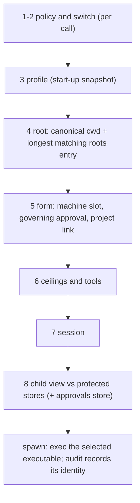
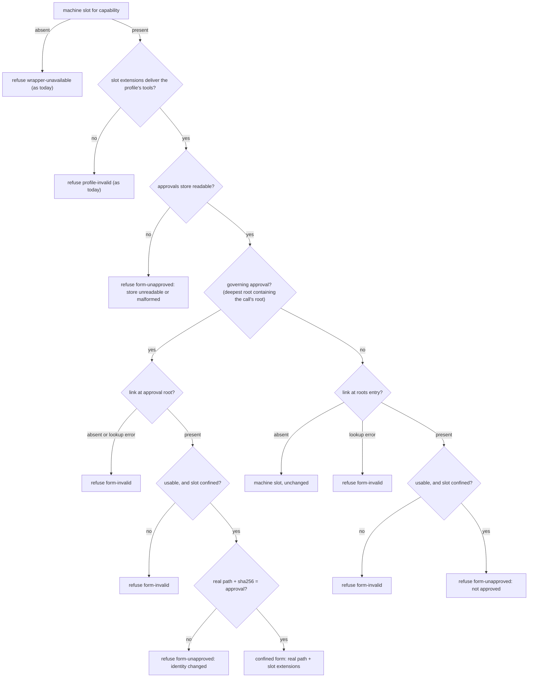
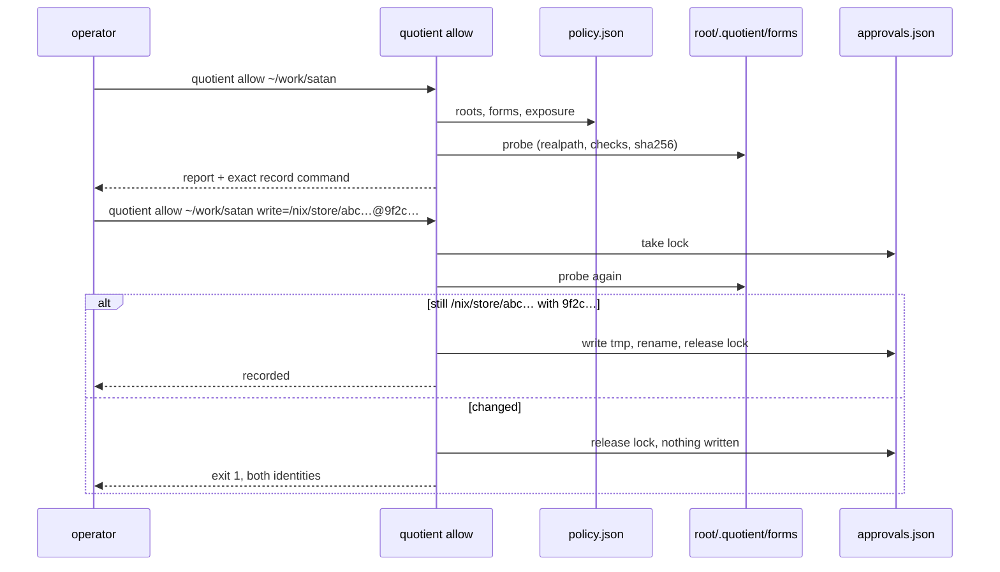
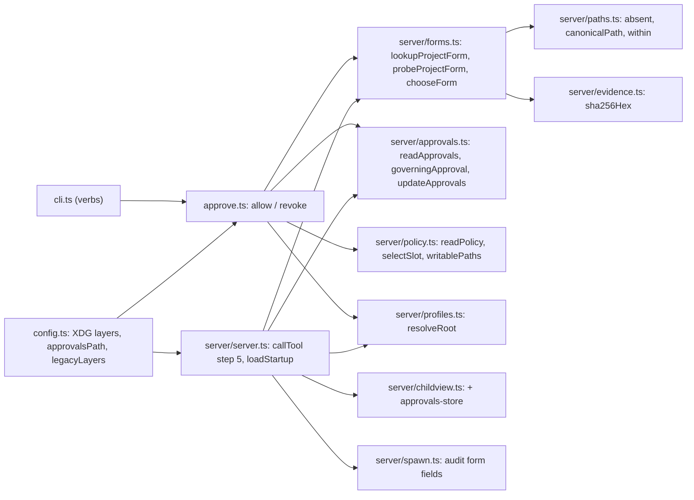

<!-- doctrine:section sec-1 -->
## 1. Design Problem

A quotient server started inside a project refuses every `write` call rooted at that project. The cause is the launch-directory profile and help layers: the server reads `<launch dir>/.quotient/profiles` and `<launch dir>/.quotient/help`, and step 8 of admission (the child-view check) protects every layer whether or not it exists. A write root that contains the launch directory contains those layers, so it is refused `view-overlaps-protected` (ISS-001). Launching an MCP client in a project is the normal case, so the normal case fails.

This slice removes the launch-directory layers and gives projects a narrower, safer thing to supply instead: **forms**. A form is the executable that confines one pi run (`docs/contract/form-1.md`). Confinement depends on the project's toolchain, so the project is the natural place to build it; the authority to run anything at all stays with the machine.

```text
                       machine (operator)                      project (repo)
                 ~/.config/quotient/                     <root>/.quotient/
grant            policy.json: roots, profiles pins,      —
                 exposure, enabled, mode
limits           policy.json: maxima, transcript budget  —
default forms    policy.json: forms.read / forms.write   —
profiles, help   profiles/, help/   (start-up snapshot)  —   (launch-dir layers removed)
project forms    approvals.json  (which identity runs)   .quotient/forms/read, /write  (what is built)
```

### Current and target behaviour

| | today | after SL-002 |
|---|---|---|
| profile and help layers | launch dir over XDG | XDG only; a legacy launch-dir layer fails start-up with migration guidance |
| write call rooted at the launch dir | refused `view-overlaps-protected` | admitted (subject to the other steps) |
| form for a call | `policy.forms[capability]` | the machine slot, or — inside a root where the operator approved one for that capability — the project's built executable in that slot |
| `<root>/.quotient/` | protected (when it is the launch dir) | ordinary project files; a delegate may write it, which can deny service but never select an unapproved form |
| approval of a project form | — | `<xdgConfig>/quotient/approvals.json`, written only by `quotient allow` / `quotient revoke` |

### Boundary

In scope: the location resolver, start-up loading, step 4's root match, step 5's form selection, step 8's protected stores, the spawn audit record, two CLI verbs, and the contracts, help and examples that describe these. Out of scope: policy inheritance (IDE-001), building forms (IMP-003 owns a Nix helper), masking `.quotient/` inside the jail, project-supplied profiles, help, roots or limits, protecting build inputs such as `flake.nix`, and broader pi extension permissions (IDE-002).

The trust boundary is file write access. A confined delegate can write its root and `exposure` paths, so it can rewrite `<root>/.quotient/` and anything the project builds from. It cannot write the policy file or the approvals store, so it cannot change which form identity the server will run. The unconfined orchestrator that called quotient can run `quotient allow`; quotient cannot tell it from the operator and does not try. Approving is documented as the operator's act.

### Governing decisions and evidence

- **DEC-007** splits the policy by job: machine holds grant, limits and default forms; a project supplies only forms, in `<base>/.quotient/forms/`. The base is the root of the approval that governs the call (the deepest one containing it), or else the longest `roots` entry containing the call's `cwd`.
- **DEC-008** makes the operator's approval the selection: a call an approval governs must run exactly the approved identity, or refuse; there is no fallback to the machine default once approved.
- **DEC-009** fixes the approvals store, the `allow` / `revoke` verbs (recording binds the reviewed real path and digest together), and their locking and publishing rules.
- **DEC-010** fixes the layout (`forms/read`, `forms/write`), the substitution rule (a project form replaces only the executable of a confined machine slot and inherits its `extensions`), and the real-path rule that closes the swap race against this policy's delegates; host-wide immutability of an approved form is the operator's obligation.
- **DEC-011** keeps `quotient-policy/2`, edited in place under an explicit compatibility rule, and fails start-up on legacy launch-dir layers.

Two run-level dispositions carry no knowledge record and are specified here: the spawn audit record's form fields (inq-6, sec-2 "Evidence") and the root match returning the matched `roots` entry as `rootsEntry` (inq-7, sec-2 "Step 4").

The repository has no ADRs, policies, standards or specs; the contracts in `docs/contract/` are authoritative over narrative (`docs/design.md:3-4`). Evidence: `research/research.md` rounds 1–2; this design leans only on its ✓ rows and on sites re-read while drafting (`src/config.ts`, `src/server/{policy,profiles,childview,server,spawn,paths,evidence,session}.ts`, `src/cli.ts`, `docs/contract/{quotient-policy-2,form-1}.md`).

<!-- doctrine:section sec-2 -->
## 2. Admission: Root Match, Form Selection and Approval

### Where the change sits in admission

The admission order and its first-failure-wins rule are unchanged. Step 4 now also reports which `roots` entry matched; step 5 reads the approvals store and the project's link as well as the policy; step 8 protects one more store and two fewer.

Within step 5 the existing checks keep their place: the slot lookup, then the profile-extensions check (`checkProfileExtensions` against the slot's `extensions`, refusing `profile-invalid`), then the approvals store and the project link. A project form inherits its slot's `extensions`, so the extensions check depends on the slot alone and never waits on the store; a malformed store therefore never pre-empts today's `profile-invalid`.



### Step 4: the matched roots entry

`resolveRoot` today accepts the first `roots` entry in policy order that contains the canonical `cwd` and returns only the canonical `cwd` (`src/server/profiles.ts:371-375`). It returns the matched entry as well:

```ts
export type RootResolution =
  | { ok: true; root: string; rootsEntry: string }   // both canonical
  | { ok: false; reason: RootRefusal; detail: string };
```

`rootsEntry` is the **longest** canonical `roots` entry that contains `root` — among matches, which are nested by path component, the deepest. One name for one value: the design, the code and both contracts call it the roots entry. Admission is unchanged: the same calls are accepted and refused with the same reasons and details. `rootsEntry` is the lookup base for a call no approval governs (below).

### Step 5: selecting the form

**Governing approval.** For the call's capability, the governing approval is the approval entry with the deepest recorded `root` that contains the call's canonical root (`within` from `src/server/paths.ts`). Approval roots are canonical paths written by the operator into a store no delegate can write, so no delegate can move them. The call's canonical root is where the call physically runs. Together these mean a call that lands anywhere inside an approved root is governed by that approval, however its `cwd` was spelled and however the `roots` entries currently resolve.

**Lookup base.** The governing approval's `root` when there is one; otherwise step 4's `rootsEntry`. The project link is `<base>/.quotient/forms/<capability>`.

Why the base is not simply `rootsEntry`: canonicalising a `roots` entry follows symlinks, and a write delegate can retarget a symlink inside its root. If `rootsEntry` were the only base, a delegate could make a deeper `roots` entry resolve into an approved project (or retarget an approved entry's alias away), so that later calls in the project matched an entry with no approval and ran the machine default — the downgrade DEC-008 forbids (RV-006 F-1).

The link is looked up with `lstat`. Only an absent entry (the existing `absent()` rule in `src/server/paths.ts`, under which a dangling symlink is *not* absent) means "no link". Any other failure — `EACCES`, `ENOTDIR` because `.quotient` is a file, a dangling link — refuses `form-invalid`.



The same rules as a table, for one call and capability:

| governing approval | link at the base | outcome |
|---|---|---|
| none | absent | machine slot — today's behaviour |
| none | present | `form-invalid` if unusable, else `form-unapproved` |
| present | absent | `form-invalid`: the approved form is missing; `quotient revoke` returns the root to the machine default |
| present | present | `form-invalid` if unusable; `form-unapproved` if the identity differs; else run it |

Deleting a link never reverts to the machine default (DEC-008): a delegate that can write the project could otherwise downgrade confinement by deleting it. Only `quotient revoke` does that.

**Usable** means all of:

1. `realpath(link)` succeeds;
2. the real path is a regular file and executable by the server's user (`stat` + `access(X_OK)`);
3. the real path lies outside every `roots` entry, every `exposure` path and the session home of the current policy (`within`, against canonical forms);
4. the machine slot is confined. A project form substitutes only a confined slot's executable; a machine slot declared `{ "unconfined": … }` has no executable to substitute, so a project link or governing approval there refuses `form-invalid`. A project can never express unconfined.

Rule 3 closes the swap race between hashing and exec against every delegate admitted under the current policy: none of them can write the target. It does not reach a delegate still running under an older policy whose grant covered the target, or a delegate of another server with a different policy. Making an approved form immutable to every delegate on the host is the operator's obligation, as the contract already makes keeping the policy file out of every writable path (RV-006 F-2). Nix store paths meet it. Rule 4 is the reading of DEC-010 ("replaces only the executable of a confined form slot") applied to the one slot shape it does not name; it fails closed. Rules 1–3 judge the file and live in the probe; rule 4 judges the slot and lives in `chooseForm`.

**Identity** is the pair (real path, sha256 of the real file's bytes). Admission computes it once. The selected form is

```ts
{ kind: 'confined', path: realPath, extensions: slot.extensions }
```

and the spawn execs `realPath`, never the link, so a repoint after admission does not change what runs. A launch that then fails — the file deleted or garbage-collected before spawn — is an ordinary failed launch with cause `spawn`; there is no fallback.

Refusal details name what an operator needs: the base and whether an approval governs it, the link, the real path, the observed sha256, the approved identity when one exists, and — for `form-unapproved` of a usable form — the exact `quotient allow` command that would approve what is there.

**Residual: relocation.** A `cwd` spelled through a symlink that a delegate can rewrite (for example a `roots` entry that is itself an alias, or `/work/A` renamed away and replaced by a symlink) can send a call to a different directory. The call is then governed by the selection of the place it actually runs, which an approval for `/work/A` does not cover. That moves the call; it does not weaken confinement for any call that runs inside an approved root. The spawn record names the canonical root, and the contract advises naming roots and `cwd`s by real path.

### The selection module

A new `src/server/forms.ts` owns step 5's project-form half. The machine-slot lookup in `src/server/policy.ts` is renamed to match the prose: `selectForm` / `FormSelection` / `FormRefusal` become `selectSlot` / `SlotSelection` / `SlotRefusal` (the refusal reason `wrapper-unavailable` is unchanged). `Form` keeps naming what will be executed.

```ts
export type ProjectFormRefusal = 'form-invalid' | 'form-unapproved';

/** What is at <base>/.quotient/forms/<cap>, judged without the approvals store. */
export type ProjectForm =
  | { kind: 'absent' }
  | { kind: 'invalid'; link: string; detail: string }
  | { kind: 'usable'; link: string; path: string; sha256: string };

export function probeProjectForm(base: string, capability: Filesystem, writable: readonly string[]): ProjectForm;

export type SelectedForm =
  | { ok: true; form: Form; source: FormSource }        // FormSource: policy.ts, beside Form
  | { ok: false; reason: SlotRefusal | ProjectFormRefusal; detail: string };

/** What step 5 knows about a project form before deciding: the governing approval, the base, the probe. */
export type ProjectFormLookup =
  | { ok: true; governing: Approval | undefined; base: string; probe: ProjectForm }
  | { ok: false; detail: string };                       // approvals store unreadable or malformed

/** The one composition admission and `quotient allow` share: read the store, take the
 *  governing approval, pick the base, probe there. Touches the filesystem only through
 *  readApprovals and probeProjectForm. */
export function lookupProjectForm(input: {
  approvalsPath: string;
  capability: Filesystem;
  root: string;                    // canonical call root
  rootsEntry: string;
  writable: readonly string[];     // writablePaths(policy, sessionHome)
  base?: string;                   // `allow` passes its roots entry; admission omits it
}): ProjectFormLookup;             // base defaults to governing?.root ?? rootsEntry

/** The deepest approval for CAPABILITY whose root contains ROOT, if any. */
export function governingApproval(approvals: readonly Approval[], root: string, capability: Filesystem): Approval | undefined;

/** Step 5's decision. Pure: the store and the probe (at the base) are read by the caller. */
export function chooseForm(
  slot: SlotSelection,             // selectSlot(policy, capability)
  governing: Approval | undefined,
  probe: ProjectForm,
): SelectedForm;
```

`governingApproval` lives in `approvals.ts` beside the store's other readers. `lookupProjectForm` is the only composition of store, governing approval, base and probe: admission calls it, refuses `form-unapproved` naming the store when it returns `ok: false`, and otherwise passes `governing` and `probe` to `chooseForm`; `quotient allow` calls it without `base` — exactly what admission sees, for the governing approval's status and revoke advice — and, when the governing approval's root differs from its roots entry, calls it again with `base` set to the roots entry for the candidate it would record (RV-008 F-1). When the two coincide, one call serves both. Report and admission can therefore not disagree about what governs a root or what is at its link, and there is still one composition. `probeProjectForm` is the one place the filesystem is touched for a project form. A capability with no machine slot refuses `wrapper-unavailable` before the store or the link is read, as today.

```ts
// policy.ts, beside Form, so spawn.ts needs no import from forms.ts
export type FormSource =
  | { kind: 'policy' }
  | { kind: 'project'; root: string; sha256: string };

/** Every path a delegate admitted under POLICY can write (form-1 G5): roots, exposure, session home. */
export function writablePaths(policy: Policy, sessionHome: string): string[];
```

`writablePaths` is the one derivation of usability rule 3's input; admission and `allow` both call it.

### The approvals store

`src/server/approvals.ts` owns the store's format, reading, lookup and the one writer used by the CLI. Its format is specified by a new contract, `docs/contract/quotient-approvals-1.md` (sec-3).

Location: `<xdgConfig>/quotient/approvals.json`, a new `Locations.approvalsPath: Resolved` beside `policyPath`. No environment variable (DEC-009). An unusable location (no absolute `XDG_CONFIG_HOME` or `HOME`) cannot reach step 5: with profiles XDG-only, such a host has no profile layer, so step 3 refuses first. The code still fails closed there (treated as an unreadable store), and no contract promises a reason for it.

```json
{
  "schema": "quotient-approvals/1",
  "approvals": [
    {
      "root": "/home/operator/work/satan",
      "capability": "write",
      "path": "/nix/store/abc…-quotient-write",
      "sha256": "9f2c…",
      "approved_at": "2026-10-24T05:12:44.000Z"
    }
  ]
}
```

- At most one entry per (`root`, `capability`). `root` is the canonical `roots` entry the approved path matched when `quotient allow` recorded it.
- Closed-world parsing: an unknown key, a duplicate pair, a non-absolute path, a capability other than `read`/`write`, or a sha256 that is not 64 lowercase hex characters makes the store **malformed**.
- Read on every call that passes step 5's slot lookup and extensions check. An absent file is an empty store. An unreadable or malformed file refuses `form-unapproved` naming the path and the parse failure: whether an approval governs a call is itself the selection, so no call can be decided without it. `allow` and `revoke` never overwrite a malformed store; the operator repairs or removes it.
- An entry keeps governing by containment even if its `root` is no longer a `roots` entry: removing a root from the policy does not silently revert its calls to the machine default. Only `revoke` does.

```ts
export type Approval = { root: string; capability: Filesystem; path: string; sha256: string; approved_at: string };
export type ApprovalsRead = { ok: true; approvals: Approval[] } | { ok: false; detail: string };

export function readApprovals(path: string): ApprovalsRead;           // absent → { ok: true, approvals: [] }
export function updateApprovals(path: string, change: (current: Approval[]) => Approval[] | string): { ok: true } | { ok: false; detail: string };
```

`updateApprovals` is the only writer. `change` returns the new list, or a string that aborts the write and becomes the failure detail:

1. take `<path>.lock` with an `O_EXCL` create (`openSync(…, 'wx', 0o600)`) carrying the pid; `EEXIST` fails naming the holder and saying to remove the lock if no `allow`/`revoke` is running — no automatic reclaim, since the writer is an operator command, not a server;
2. read the store under the lock; malformed or unreadable aborts without writing;
3. apply `change`;
4. write `<path>.<pid>.tmp` in the same directory (mode `0600`), `fsync`, `rename` over `<path>`;
5. unlink the lock in `finally`.

The lock prevents a stale writer from resurrecting an identity another writer replaced; the rename means admission never reads a half-written store.

### Step 8: protected stores

```text
store                          tolerance        change
run evidence directory         unreachable      —
attempts ledger                unreachable      —
session home (except session)  unreachable      —
policy file                    never-writable   —
approvals store                never-writable   new (kind `approvals-store`)
profile layer (XDG)            never-writable   launch-dir entry removed
help layer (XDG)               never-writable   launch-dir entry removed
```

`ChildViewInput` gains `approvalsPath`; `profileLayers` and `helpLayers` now hold only the XDG layer, since `Locations` no longer produces a launch-dir one. `<root>/.quotient/` is not a store. With the launch-dir layers gone, ISS-001's refusal has nothing to match.

The approvals store is protected whether or not it exists, like the policy file, so a delegate cannot create it.

### Evidence: the spawn audit record

The `spawn` record (`src/server/spawn.ts:278-292`) already carries `root` (canonical), `form` (the command executed) and `form_kind`. It gains:

| field | when | value |
|---|---|---|
| `form` | always | the executed path — for a project form, the resolved real path, not the link |
| `form_source` | always | `"policy"` or `"project"` |
| `form_root` | project forms | the approval root whose `.quotient` supplied the form |
| `form_sha256` | project forms | the sha256 admission verified |

Machine-policy forms are not hashed: they are operator-published like the policy itself, and hashing them would add a per-call read and a new failure mode to every default install. `AuditRecord` has no contract or drift guard (research F5), so a spawn test pins these fields.

`SpawnPlan` (`src/server/spawn.ts`) takes both halves of the one `SelectedForm` step 5 produced: `form: Form` (for a project form, the confined real path with the slot's extensions) and the new `formSource: FormSource`, which the spawn copies into the record. `AuditRecord` is loosely typed, so the new fields are pinned only by a spawn test.

### Start-up: legacy layers

`resolveLocations` stops producing launch-dir layers. A pure helper names what used to be read:

```ts
/** The launch-dir layers earlier versions read; their presence fails start-up (DEC-011). */
export function legacyLayers(launchDir: string): string[];  // [<launch>/.quotient/profiles, <launch>/.quotient/help]
```

`loadStartup` checks them first. If either exists (anything but an absent entry, by the same `absent()` rule), start-up fails through the existing path (C7): one stderr line, and every call refuses `profile-invalid` with this detail:

```text
start-up did not complete: /home/op/work/satan/.quotient/profiles: quotient no longer reads profiles from the launch directory; move these documents to /home/op/.config/quotient/profiles/ and restart
```

`quotient help` runs the same check and only warns, so the help that explains the migration still prints.

### Invariants

- A call runs either the machine slot or an operator-approved identity. A call whose canonical root lies inside an approved root runs that approval's identity or refuses.
- No project input can select unconfined, broaden `extensions`, or change roots, limits, profiles or help.
- The selected executable is fixed at step 5 and never changes for the life of the call.
- Every change to which identity governs a root is an `allow` or `revoke` by someone who can write `<xdgConfig>/quotient/`.
- A server with no `.quotient/forms` anywhere and no approvals store behaves as today, except that launch-dir layers are no longer read.

<!-- doctrine:section sec-3 -->
## 3. Operator Interface, Contracts and Migration

### `quotient allow` and `quotient revoke`

Two verbs join `src/cli.ts`'s switch. Their logic lives in a new `src/approve.ts` (exports `allow` and `revoke`, each `(argv, env, cwd, out, err) => number`), so `cli.ts` stays the one module with side effects at import.

```text
quotient allow [<path>]                          report; never writes
quotient allow <path> <cap>=<realpath>@<sha256>...  record, only if each named form still resolves to that path with that digest
quotient revoke <approval-root> [<cap>...]       remove stored entries (all capabilities when none named)
```

`allow` resolves `<path>` (default: the current directory; relative paths against it) the way admission does: read the machine policy with `readPolicy` (`src/server/policy.ts:123`) at `Locations.policyPath`, take the writable set with `writablePaths(policy, Locations.sessionHome)`, canonicalise, and take the roots entry with the same function step 4 uses (`rootsEntry`). `allow` approves the link at `<rootsEntry>/.quotient/forms/<cap>` and keys the approval by that roots entry. It observes through `lookupProjectForm` as sec-2 describes: without `base` for the governing approval's own link (what admission would run), and with `base` set to the roots entry for the candidate when that is a different root. A path inside no entry, or an unreadable or invalid policy, exits 1 naming why; usage errors exit 2.

**Report.** For each capability, one block:

```text
root      /home/op/work/satan   (roots entry)
write     link      /home/op/work/satan/.quotient/forms/write
          resolves  /nix/store/abc…-quotient-write
          sha256    9f2c…
          governed  no approval
          slot      confined, extensions [builtin:mcp]
read      link      absent; machine form /home/op/.local/state/quotient/forms/read/bin/quotient-read
          governed  no approval

to approve what is shown:
  quotient allow /home/op/work/satan write=/nix/store/abc…-quotient-write@9f2c…
```

`governed` names the approval that governs calls at `<path>` today (sec-2), which may sit at a shallower root than the roots entry; recording then adds a deeper approval that governs calls inside the roots entry. Rendering is a pure function of the one or two lookups and the slot, so report tests assert text without a filesystem or argv. An unusable link prints its `form-invalid` detail instead of an identity and contributes nothing to the suggested command. A governing approval whose link is missing or changed says so and suggests `quotient revoke` as well. Exit 0 whenever the report printed.

**Record.** Each `<cap>=<realpath>@<sha256>` (split at the last `@`; a sha256 contains none) is checked against a fresh `probeProjectForm` at the roots entry and against the machine slot, inside the store lock (`updateApprovals`'s `change`). All must pass or nothing is written: the form must be usable, the slot confined, and the observed real path **and** sha256 both equal to those given. A mismatch exits 1 naming both identities: the form changed between the operator's review and the record — new bytes, or the same bytes at another path (RV-006 F-3) — and what is there now was not reviewed. On success it writes `{ root, capability, path, sha256, approved_at }`, replacing any entry for that pair, and prints the recorded identities.

**Revoke.** Addresses a **stored** approval, not a path to resolve: `<approval-root>` must equal an entry's recorded `root` exactly, after making it absolute and lexically normalising it. `revoke` reads neither the policy nor the filesystem, because an approval keeps governing after its root leaves `roots` or its directory moves or disappears (sec-2), and a resolution through the current policy would reach a different key — at worst a parent's approval (RV-006 F-6). It removes that root's entries for the named capabilities (or all of them) and never touches another root's, so revoking a child never revokes a governing parent. Calls there then fall to whatever governs them: a shallower approval if one contains the root, else the machine slot if no link remains, or `form-unapproved` if one does. A root or capability with no stored entry exits 1 and lists the stored roots, so a mistyped root is never a silent success. The `allow` report prints the governing approval's root, ready to paste into `revoke`.

There is no interactive prompt (DEC-009): the digest argument is the confirmation, and an agent that can run the verb could answer a prompt too. The help text and the contract state that approving is the operator's act, and that an unconfined orchestrator able to run `quotient allow` is trusted as the operator.



### Contract changes

`quotient-policy/2` is edited in place. No field is added, removed or retyped, so `src/server/policy.ts`'s validator and `REQUIRED_FIELDS`/`OPTIONAL_FIELDS` do not change.

`docs/contract/quotient-policy-2.md`:

- **Header** (line 4): fix the copy slip — a breaking change mints the *next* version. Add the compatibility rule (DEC-011): a change is breaking when it changes what an existing policy document grants or selects without an operator act.
- **Where things are:** profiles and help come from `<xdgConfig>/quotient/` only, read once at start-up; a `<launch dir>/.quotient/profiles` or `/help` fails start-up with migration guidance. Add the approvals store row (fixed path, no variable; format in `quotient-approvals-1.md`).
- **Fields:** `forms.read` / `forms.write` are the **default** form per capability; a project may substitute the executable (new section below).
- **How a call is admitted:** step 4 names the longest matching roots entry; step 5 reads the approvals store and the project link and adds `form-invalid` and `form-unapproved`.
- **Protected stores:** drop the launch-dir layers and the "cannot be rooted at the launch directory" consequence; add the approvals store, protected whether or not it exists.
- **New section, Project forms:** the `.quotient/forms/{read,write}` layout; the governing approval (deepest approval root containing the call's canonical root) and otherwise the longest roots entry as the lookup base, so nested repositories and worktrees need their own entries; the governing-approval × link table; usability rules; inheritance of slot `extensions`; no unconfined; deletion is not revocation; relocation through delegate-writable symlinks, and the advice to name roots and `cwd`s by real path; what the hash covers (the executable's bytes only — what it reads or execs at run time is the operator's responsibility); operator obligations: an approved form must be immutable to every delegate on the host, not only to this policy's (Nix store paths are), and must embed confinement-critical inputs or keep them where no delegate can write. Points to `quotient-approvals-1.md` for the store.
- **Publishing a policy:** restart after changing XDG profiles or help (launch-dir wording removed); a project form change needs `quotient allow`, not a restart.

`docs/contract/quotient-approvals-1.md` (new): the store's location and format (`quotient-approvals/1`, closed-world, one entry per root and capability), how an approval governs by containment, the `allow` report / record / `revoke` verbs and their identity check, locking and atomic publish, malformed-store behaviour (every call refuses; writers never overwrite), and that approving is the operator's act — an unconfined orchestrator able to run `quotient allow` is trusted as the operator. The policy contract stays policy-only, so its drift check (every `json` block is an admitted policy) still holds.

`docs/contract/form-1.md` (clarification, stays `form-1`): add under Guarantees that a form which cannot establish its confinement exits non-zero before running pi, and that inputs critical to confinement (a seatbelt profile, a bind list) must be inside the executable's bytes or at a path no delegate can write. Add the approvals store to G6's never-writable list. Existing conformant forms already satisfy both via G5; the text makes the dependency explicit.

`docs/contract/pi-agent-result-2.md`: two rows in the Refusals table, both raised at step 5 — `form-invalid` (the project form at the lookup base is missing while an approval governs, unreadable, not an executable regular file, inside a writable path, or substitutes an unconfined slot) and `form-unapproved` (a usable project form is not approved, or differs from the governing approval's identity, or the approvals store cannot be read). Add the rule that a consumer must handle a refusal reason it does not know. The validator already accepts any reason string (`src/server/result.ts:388`), so no code changes there.

### Help, examples and snippets

| file | change |
|---|---|
| `src/help/help.ts` | header prose (layers); `renderContext` stops saying the launch dir is where `./.quotient` is found; the client snippet's `cwd` note says the launch directory only defaults `cwd`; profile layer list shows XDG only |
| `help/profiles.md` | one location, XDG |
| `help/setup.md` | profiles and help in XDG; a short "project forms" subsection: build into `.quotient/forms/<cap>`, run `quotient allow`, re-approve after rebuilds |
| `help/agent.md` | remove the launch-dir layer sentence; state that `form-unapproved` needs the operator, not a retry |
| `README.md` | lines 63 and 190: XDG profiles; one paragraph on project forms and approval |
| `examples/profiles/*.md` | location sentence: XDG only |
| `docs/design.md` | `:64-80` profile/help layering rewritten; a short project-forms paragraph pointing to the contract |

`docs/contract/quotient-policy-1.md` is historical and is not edited (DEC-004).

### Migration and release

- The only known affected installation is satan, whose `.quotient/` holds `profiles/{read,research,write}.md` (research S5). It must move those to `~/.config/quotient/profiles/` before upgrading; the start-up failure says exactly that if it does not.
- A default install with no launch-dir layers, no `.quotient/forms` and no approvals store sees no difference.
- Package version `0.2.0` → `0.3.0` (minor, DEC-011), `package.json` and `package-lock.json` together. The release note names the start-up failure, the two verbs, the two refusal reasons, and satan's move.

<!-- doctrine:section sec-4 -->
## 4. Code Impact, Verification and Risks

### Module boundaries



`forms.ts` imports `readApprovals`, `governingApproval` and the `Approval` type from `approvals.ts`; `approvals.ts` imports nothing from `forms.ts`. `chooseForm` stays pure and takes the lookup's values. `FormSource` lives in `policy.ts` beside `Form`, so `spawn.ts` keeps importing only from `policy.ts`. The filesystem is touched in `probeProjectForm`, `readApprovals` and `updateApprovals` only; `lookupProjectForm` composes the first two.

### Code-impact commitments

| path | change |
|---|---|
| `src/config.ts` | `Locations` loses the launch-dir layer entries and gains `approvalsPath: Resolved`; new `legacyLayers(launchDir)`; header comment's authority split updated |
| `src/server/profiles.ts` | `resolveRoot` returns `{ root, rootsEntry }`, rootsEntry = longest canonical match |
| `src/server/forms.ts` (new) | `ProjectFormRefusal`, `ProjectForm`, `ProjectFormLookup`, `SelectedForm`, `lookupProjectForm`, `probeProjectForm`, `chooseForm` |
| `src/server/approvals.ts` (new) | store format and validation, `readApprovals`, `governingApproval`, `updateApprovals` (lock + temp + rename) |
| `src/server/policy.ts` | unchanged validator; `selectForm`/`FormSelection`/`FormRefusal` renamed `selectSlot`/`SlotSelection`/`SlotRefusal`; new `FormSource` beside `Form`; new `writablePaths(policy, sessionHome)` |
| `src/server/server.ts` | step 5: `selectSlot`, extensions check, `lookupProjectForm`, `chooseForm`; `SpawnPlan` gets `formSource`; `checkChildView` gets `approvalsPath`; `loadStartup` checks `legacyLayers` first |
| `src/server/childview.ts` | store kind `approvals-store` (never-writable); `ChildViewInput.approvalsPath`; comment on layers updated |
| `src/server/spawn.ts` | `SpawnPlan.formSource`; `spawn` record gains `form_source`, `form_root`, `form_sha256` |
| `src/approve.ts` (new) | `allow` and `revoke` verbs; pure report rendering |
| `src/cli.ts` | `allow`, `revoke` cases; usage text; `help` runs the legacy-layer warning |
| `src/help/help.ts` | prose and snippet changes (sec-3) |
| `src/server/test-rig.ts` | drop the launch-dir layer from `newRig`; helpers to plant a project form (an executable script outside the roots), write an approvals store, and point `XDG_CONFIG_HOME` at the rig |
| tests | `config`, `profiles`, `childview`, `server`, `spawn`, `cli`, `help`, `drift`; new `forms.test.ts`, `approvals.test.ts`, `approve.test.ts` |
| `docs/contract/quotient-policy-2.md`, `form-1.md`, `pi-agent-result-2.md`, new `quotient-approvals-1.md` | sec-3 |
| `scripts/pack-check`, `scripts/hostile-audit` | fixtures stop planting `<launch>/.quotient/profiles` (`pack-check:155,227-241`; `hostile-audit:157-158`) and write their profile to `<fixture XDG_CONFIG_HOME>/quotient/profiles/` instead; the launch directory stays free of legacy layers |
| `docs/design.md`, `help/{profiles,setup,agent}.md`, `README.md`, `examples/profiles/*.md` | sec-3 |
| `package.json`, `package-lock.json` | `0.3.0` |

`examples/policy.json` does not change (no policy field changes). `src/drift.test.ts`: the `*Refusal*` union guard (research F8) picks up `ProjectFormRefusal` and fails until the result contract lists both reasons, with no new rule. The policy contract's "every `json` block is an admitted policy" check (`src/drift.test.ts:245-255`) keeps holding because the approvals example lives in its own contract; a new check parses every `json` block of `quotient-approvals-1.md` with the approvals reader, with a negative control (a malformed block is reported). No new environment variable or policy key is introduced.

### Verification alignment

Red first for each; the ISS-001 case is the first red.

| test | asserts |
|---|---|
| server: write call rooted at the launch dir is admitted | ISS-001: no `view-overlaps-protected` with a launch-dir root (the slice's acceptance case) |
| server: no `.quotient`, no store | machine form runs; spawn record `form_source: "policy"`, no `form_sha256` |
| server: approved project form runs (governed call) | the real path is exec'd (not the link); record carries `form_source`, `form_root`, `form_sha256`; slot `extensions` inherited (an `mcp__*` profile passes) |
| server: link, no approval | `form-unapproved`; detail has link, real path, sha256 and the `quotient allow` command |
| server: approved then rebuilt (bytes change) | `form-unapproved` naming both identities |
| server: approved then repointed to another path | `form-unapproved` |
| server: approved then link deleted | `form-invalid`, not the machine form |
| server: root alias retargeted (RV-006 F-1) | roots `[/work, /work/current]` in both orders, approval at the canonical `/work/A`; a delegate-style retarget of a symlink so a deeper `roots` entry resolves inside `/work/A` (or the approved alias resolves elsewhere): a call whose canonical root is inside `/work/A` still needs A's approved form; it never runs the machine default |
| server: nested approvals | the deepest approval containing the call governs; a shallower one governs calls outside the deeper root |
| server: approval root no longer in `roots` | still governs calls inside it (no silent revert) |
| server: link resolving inside a root / exposure / session home | `form-invalid` |
| server: link not executable; dangling; `.quotient` is a file | `form-invalid` |
| server: machine slot unconfined with a project link | `form-invalid` |
| server: machine slot absent with a project link | `wrapper-unavailable` (order unchanged) |
| server: profile needs an extension the slot lacks, and the store is malformed | `profile-invalid` (the extensions check precedes the store read) |
| server: malformed or unreadable approvals store | `form-unapproved` naming the store, for a call with no link too |
| server: repoint after admission | the running call is unaffected (the spawn execs the resolved path captured at step 5) |
| server: legacy `<launch>/.quotient/profiles` or `/help` present | start-up fails; every call `profile-invalid` with the migration detail |
| profiles: nested roots | `rootsEntry` is the deepest; the first-in-order entry no longer wins the lookup base; accept/refuse unchanged |
| childview: approvals store | a writable member that is, contains or lies inside it refuses; launch-dir layers no longer stores |
| approvals: format | absent = empty; each malformation rejected; duplicate pair rejected |
| approvals: writer | lock held → second writer fails naming the holder; malformed store never overwritten; publish is rename (no partial file observable) |
| approve: report | per-capability identity, approval state, exact command; unusable form shows its detail |
| approve: record | path and digest match → records at the roots entry; changed bytes → nothing written, exit 1; same bytes at a different real path (RV-006 F-3) → nothing written, exit 1; one bad pair in a batch writes nothing; unconfined or absent slot refused |
| approve: report | shows the governing approval when it sits at a shallower root than the roots entry; with the candidate fixed, a changed or deleted governing link changes the governing status and adds revoke advice, and with the governing link fixed, a changed candidate changes only the suggested command (RV-008 F-1) |
| approve: revoke | removes named / all capabilities of an exact stored root; after the root is removed from `roots`, and after its directory is deleted, the entry is still revocable; revoking a child root leaves a parent approval intact; an unknown root or capability exits 1 listing stored roots |
| cli: verbs and usage | exit codes 0 / 1 / 2 |
| help: legacy layer | `quotient help` warns and still prints |
| drift | refusal reasons documented; contracts' JSON blocks parse |

| pack-check | the packaged smoke still reaches and executes its stub form with the profile in its fixture XDG layer |
| hostile-audit setup | the fixture's server gets past start-up (no legacy layer) to its confinement check; verified with a stub form, without a paid model call |

Prose drift (research X6) is not caught by tests: the plan carries an explicit checklist of the sec-3 documentation rows. `just gate` green and lint at zero warnings close the slice.

### Risks and explicit limits

- **Hash scope.** The sha256 pins the executable's bytes. A Nix-built script that `exec`s other store paths by hash pins its chain transitively; anything read from host state at run time (keys, `/home/…` paths) is not pinned (research S3). The contract says so.
- **Re-approval friction.** Every rebuild that changes bytes stops calls for that pair until `quotient allow`. Mitigation is operational: narrow, stable form toolchains.
- **Orchestrator approval.** An unconfined orchestrator can run `quotient allow`. Quotient cannot prevent it; the documentation assigns the act to the operator.
- **Denial of service by delegates.** A write delegate can plant, repoint or delete `.quotient/forms/*` and stop later calls for that pair. It cannot make an unapproved identity run.
- **Root-keyed identity.** Approvals are keyed by the canonical root at approval time and govern by containment. Moving a project to another real path leaves its approval behind (calls at the old path refuse `form-invalid`; calls at the new path need a fresh approval). Removing a root from the policy does not revoke its approvals.
- **Relocation.** A `cwd` or `roots` entry spelled through a delegate-writable symlink can send a call to another directory, where that directory's selection applies (sec-2 "Residual: relocation"). Calls inside an approved root are never downgraded. The contract advises real paths.
- **Host-wide immutability.** The outside-writable-paths rule is checked against the current policy only. A delegate still running under an older policy that exposed the target, or one under another server's policy, could rewrite a non-store target between hashing and exec. Approved forms must be immutable to every delegate on the host — an operator obligation, as for the policy file.
- **G5 is unverified.** The real-path rule is sound only if forms add nothing writable (form-1 G5), which quotient does not check.

