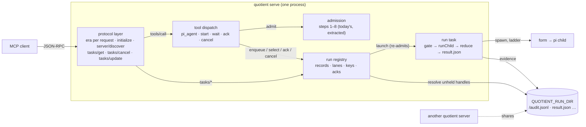
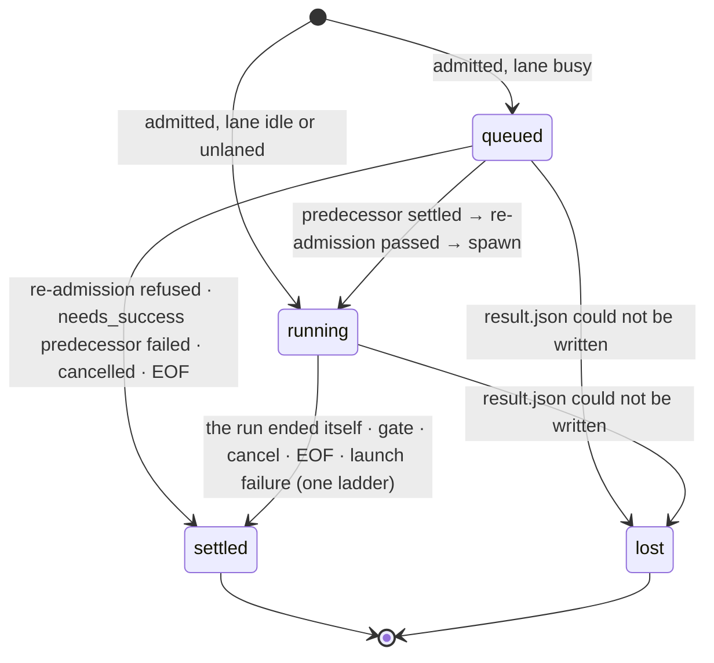
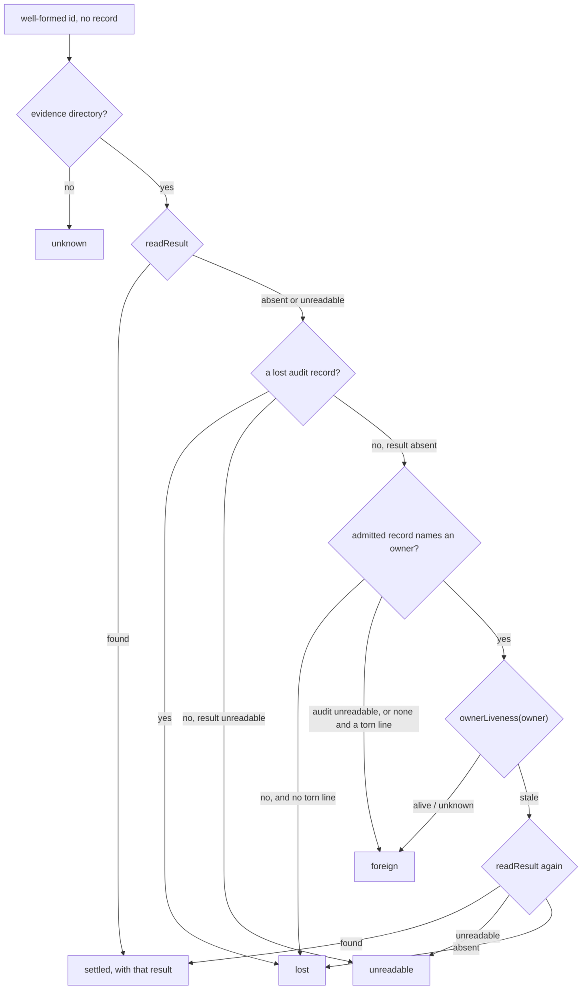
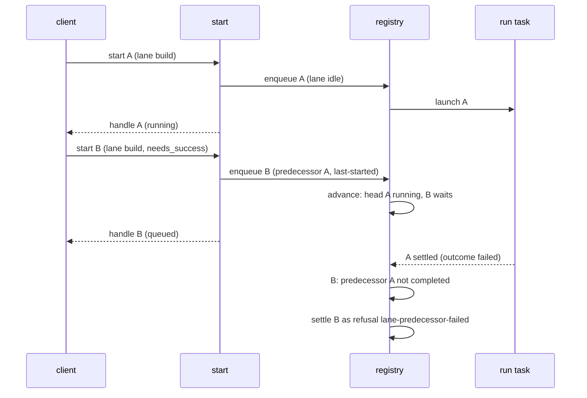
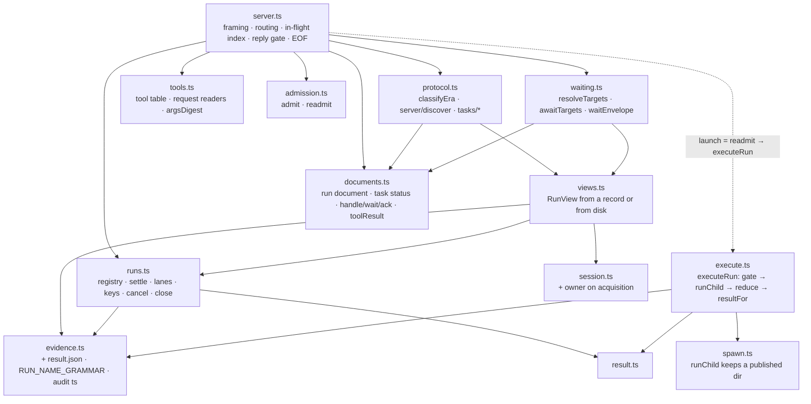
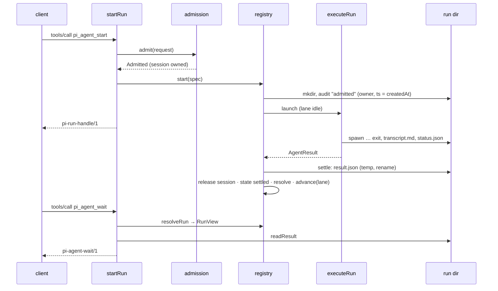

<!-- doctrine:section sec-1 -->
## 1. Design Problem

quotient answers every `pi_agent` call only when the run behind it has ended. MCP clients decide whether two tool calls may overlap from the tool's annotations, and a tool without `readOnlyHint: true` is run one call at a time. `pi_agent` can start write-capable runs, so it cannot honestly declare that hint, and today two delegated runs sent in one client message execute strictly one after the other (EVD-001: Claude Code, quotient 0.5.0, two `read` runs serial without the hint and overlapping within 4 ms with it). A blocking call is also bounded by the client's patience: Codex abandons a tool call after 60 s by default (EVD-003), and Claude Code's stdio idle timeout is 30 minutes (EVD-002).

This slice separates *starting* a run from *waiting* for it, in two ways that share one run model:

- **Bespoke tools**, for every client. A start answers at once with a handle; a wait blocks on one or many handles, changes nothing, and is the only tool that declares `readOnlyHint`. Concurrency then no longer depends on how a client schedules calls: one wait over several handles covers several runs.
- **MCP tasks**, for clients that speak the 2026-07-28 protocol revision and declare the tasks extension (`io.modelcontextprotocol/tasks`). `pi_agent` answers such a client with a task at once, and the client polls `tasks/get`. Serving that revision means quotient now speaks two protocol *eras*: the stateless 2026-07-28 revision ("modern", every request carries its version in `_meta`) beside today's `initialize` handshake at 2025-06-18 ("legacy"), which Codex and older clients keep using.

The same run machinery gives *lanes*, an opt-in way to have runs execute strictly one after another in start order.

### Current and target behaviour

| | today | after this slice |
|---|---|---|
| protocol | legacy only: `initialize` at 2025-06-18 | legacy unchanged, plus modern 2026-07-28 served statelessly, chosen per request by its `_meta` (sec-2) |
| tools | `pi_agent` | `pi_agent` (kept), `pi_agent_start`, `pi_agent_wait`, `pi_agent_ack`, `pi_agent_cancel` |
| `pi_agent`'s answer | `pi-agent-result/2` when the run ends | the same, unless the request declares the tasks extension: then a task at once |
| a run's lifetime | the call that started it | the server process; the call that started it may already have answered |
| concurrency | the client's choice; serial in practice | every unlaned run executes as soon as it is started; a wait over many handles is one call |
| ordering | none | a run started in a named lane executes after the lane's previous run settles |
| result storage | written to the caller only | also written atomically to the run's evidence directory as `result.json`, so a later wait or `tasks/get` (even after a restart, or from another server) can read it |
| cancellation | by the JSON-RPC request id; the cancelled call still answers | by request id with no reply (both eras), by handle (`pi_agent_cancel`), or by task (`tasks/cancel`) |
| client EOF | aborts every in-flight call | aborts every running run and drops every queued run |
| `pi-agent-result/2` | the answer | unchanged; one new refusal reason, `lane-predecessor-failed` |

What does not change: confinement, forms, approvals, profiles, the per-run gate and its maxima, session ownership rules, and accounting. A run executes exactly as a `pi_agent` run executes today; only who waits for it, and when, moves.

### Boundary

The diagram shows where the new parts sit. The protocol layer classifies each request by era and serves the methods only one era has; the run registry is the one new owner of state; tools and task methods are thin readers and writers over it; the run task is today's `callTool` tail, moved so it runs whether or not anyone is waiting.



Non-obvious edges: the registry, not the start call, launches a run (immediately when unlaned or the lane is idle, later otherwise), and launching re-runs admission against the policy current at that moment. Results are read from disk, not memory; the registry holds only compact records. Every quotient server a user runs shares one run directory, so a handle may name a run another live server owns; the registry resolves such a handle from disk and the owner's liveness (sec-3) rather than guessing.

### Governing decisions and evidence

No ADRs, policies, standards or specs exist in this repository. What binds this slice is the accepted decisions, the contracts in `docs/contract/`, and `docs/design.md` (rationale; the contract wins where they differ).

| source | how it binds |
|---|---|
| DEC-048 | the five tools and their arguments; start's idempotency `key`; no list tool |
| DEC-049 | run states, the handle, compact records, `result.json`, acknowledgement only by `pi_agent_ack`; blocking runs are owned |
| DEC-050 | lanes, `needs_success`, full re-admission at launch |
| DEC-053 | cancellation marks before awaiting; EOF; `notifications/cancelled` per tool |
| DEC-054 | only `pi_agent_wait` declares `readOnlyHint` |
| DEC-055, DEC-063 | both protocol eras in one process; each request's era from its own `_meta` |
| DEC-056, DEC-057, DEC-059, DEC-061 | `pi_agent` as a task; run state → task status; task lifetime fields; the task methods served and not served |
| DEC-058, DEC-068 | run documents are Tasks with quotient extras; `isError` per surface; unknown and unreadable handles listed apart |
| DEC-060, DEC-070 | owned runs (blocking and task-created) are never implicit wait targets |
| DEC-062, DEC-069 | wait: selectors, `until`, 45 s default timeout, byte budget with the first result always whole |
| DEC-064, DEC-065 | no reply to a client-cancelled request; the cancel mark is intent, status follows the committed outcome |
| DEC-066, DEC-067 | the `admitted` record is the publication line; runs record their owning server |
| DEC-045 | docs: `docs/design.md` rationale, README pass, help per tool, contracts |
| EVD-001 | the scheduling probe the slice exists to answer |
| EVD-002, EVD-003 | Claude Code's and Codex's timeouts and tasks support, which set wait's default timeout and the help text |
| EVD-004 | the 2026-07-28 protocol and the tasks wire format, which sec-2 follows field for field; the tasks extension has no per-tool declaration, and the server decides per request whether to answer a task |
| `docs/design.md` "One process per call" | revised by this slice (sec-8): runs no longer end before their call answers. Its reasons survive as the new invariant **nothing outlives the server; every run reaches the one termination ladder** |
| `docs/design.md` one termination ladder; client gone | binding and kept: cancel by handle or task and the queue drain hand the existing ladder a cause rather than adding a path |
| `docs/design.md` sessions: one owner, refuse rather than queue | binding and kept: lanes queue *runs*, never sessions; a queued run already owns its session |
| `pi-agent-result/2` invariants (only `completed` is final; no non-terminal document) | binding and kept: non-final states live in the wrapper documents and tasks, never in a result |
| shipped text cites no doctrine ids (`src/drift.test.ts`) | binding on every doc and help change |

Deferred, not designed here: listing acknowledged runs (IDE-004); a policy bound on runs in flight (IDE-005); recovering a task whose creation reply never arrived. quotient publishes the run and writes the `CreateTaskResult` in one synchronous step (sec-2), so no cancellation can fall between them; over stdio the reply then goes missing only if the client goes away, and EOF aborts the run. A client that retries anyway starts a second run: whatever the first one did before EOF stands (revisit with any non-stdio transport).

<!-- doctrine:section sec-2 -->
## 2. Protocol, Tools and Documents

This section is the whole wire surface: how a request is assigned an era, which methods each era has, the five tools, the task methods, and the documents they answer. Everything after it is how the server keeps those promises.

### Eras: one rule per request

There is no process-wide era. Each request is classified by its own `params._meta`, before anything else reads it:

| `params._meta` | era | outcome |
|---|---|---|
| no `io.modelcontextprotocol/protocolVersion` key | legacy | served exactly as today: no `resultType`, no gating on `initialize` |
| version `"2026-07-28"` and `io.modelcontextprotocol/clientCapabilities` an object | modern | served statelessly (below) |
| version present but not `"2026-07-28"` (unknown, or a legacy revision) | — | error `-32022`, `data: { supported: ["2026-07-28"], requested }` |
| version not a string; `clientCapabilities` missing or not an object | — | error `-32602` (the spec's rule for a malformed required field) |

The checks run in this order: a version that is not a string is `-32602`; a string version other than `2026-07-28` is `-32022` (its `requested` is that string), even when `clientCapabilities` is also missing; then a missing or non-object `clientCapabilities` is `-32602`. A modern request after an `initialize` is still modern: the spec lets one process serve both eras at once, and `initialize` changes nothing a later request depends on. Classification is a pure function, `classifyEra(params) → { era: 'legacy' } | { era: 'modern', capabilities } | { error }`, so it is tested without a server.

### Methods by era

| method | legacy | modern |
|---|---|---|
| `initialize`, `notifications/initialized`, `ping` | as today (`initialize` answers `2025-06-18`) | removed by 2026-07-28: `-32601` when a request for one classifies modern |
| `server/discover` | — (no version: `-32602`) | answered (below) |
| `tools/list` | as today, plus each tool's `annotations` | the same tools, plus `resultType`, `ttlMs`, `cacheScope` |
| `tools/call` | as today | as today, plus `resultType`; `pi_agent` may answer a task |
| `tasks/get`, `tasks/cancel`, `tasks/update` | `-32601` (method not found): tasks exist only in the modern era | answered (below) |
| `notifications/cancelled` | cancels the named request; no reply to it (sec-6) | the same |

Every modern result carries `resultType` (`"complete"`, or `"task"` for a created task). `_meta` server info appears only on `server/discover`, where the spec requires it. Legacy results carry none of the modern members (`resultType`, `_meta`, `ttlMs`, `cacheScope`). What does change for a legacy client is deliberate, and sec-9's regression net lists it: five tools with annotations, `pi_agent`'s new arguments and description, no reply to a cancelled request, and a failed `spawn` record that keeps its run directory.

`server/discover` answers:

```json
{
  "resultType": "complete",
  "supportedVersions": ["2026-07-28"],
  "capabilities": { "tools": {}, "extensions": { "io.modelcontextprotocol/tasks": {} } },
  "instructions": "… the agent help section, as initialize's instructions today …",
  "_meta": { "io.modelcontextprotocol/serverInfo": { "name": "quotient", "version": "<package version>" } },
  "ttlMs": 0,
  "cacheScope": "private"
}
```

`supportedVersions` and `-32022`'s `supported` list only the modern revision. A client that sends a version in `_meta` is modern, and the spec forbids it to fall back to `initialize` on a recognised modern error; a legacy revision named there would only invite a retry this table refuses. Legacy clients never send a version, never see `-32022`, and reach `2025-06-18` through `initialize` as today. `tools/list` carries the same `ttlMs: 0` and `cacheScope: "private"`. The descriptions are rendered on every request from the policy as it reads now (`selfDescription` → `renderContext` → `policyView`), and they name local profile sources, capabilities and the launch directory: they are neither fixed nor fit to share. `ttlMs: 0` tells the client to re-fetch when it next needs the list, which costs one cheap local read.

### The tool table

| tool | arguments (beyond today's `pi_agent` set) | answers | annotations |
|---|---|---|---|
| `pi_agent` | `lane?`, `needs_success?` | `pi-agent-result/2`; a task when the request declares the tasks extension | `readOnlyHint: false`, `openWorldHint: true` |
| `pi_agent_start` | `lane?`, `needs_success?`, `key?` | `pi-run-handle/1`, or a `pi-agent-result/2` refusal | `readOnlyHint: false`, `openWorldHint: true` |
| `pi_agent_wait` | — own set: `runs?`, `lanes?`, `until?`, `timeout_s?`, `status_only?`, `budget_bytes?` | `pi-agent-wait/1` | `readOnlyHint: true` |
| `pi_agent_ack` | — own set: `runs` (required) | `pi-agent-ack/1` | `readOnlyHint: false`, `idempotentHint: true` |
| `pi_agent_cancel` | — own set: `runs` (required) | `pi-agent-wait/1` over its targets | `readOnlyHint: false`, `idempotentHint: true` |

"Today's `pi_agent` set" is `prompt`, `profile`, `cwd`, `session`, `tools`, `ceilings`, `transcript_budget_bytes`. `destructiveHint` is left at its default (true) on every non-read-only tool. Each `tools/list` entry gains an `annotations` object holding exactly the hints above, and its `description` is that tool's own help section (sec-8). The tools are the same in both eras.

New argument grammar:

- `lane`: a name in the session-id grammar the server already has (`SESSION_GRAMMAR`: 1–64 of `A-Za-z0-9._-`, alphanumeric at both ends), checked in the request reader and refused `request-invalid` otherwise. A lane name and a session id share a grammar, not a namespace.
- `needs_success`: boolean; `true` is valid only with `lane` (`request-invalid` otherwise, since an unlaned run has no predecessor). `false` is accepted anywhere.
- `key`: a string of 1–128 printable ASCII characters. A key lives for one server process (sec-3): a reconnected client talks to a new server, which knows none.
- `runs`: an array of task ids (a run's handle *is* its task id, sec-3); `lanes`: an array of lane names. Each id must match the run-name grammar (sec-3) or the request is `request-invalid`; this is also what keeps an id from naming a path outside the run dir.
- `until`: `"all"` (default) or `"any"`.
- `timeout_s`: a non-negative finite number; `0` means "answer now".
- `status_only`: boolean, default false.
- `budget_bytes`: a positive integer.

### Runs as tasks

`pi_agent` answers a task when, and only when, the request is modern and its `clientCapabilities.extensions` holds `io.modelcontextprotocol/tasks`. That declaration is the extension's only handshake: no tool declares task support in `tools/list`, and the server decides per request whether to answer a task (EVD-004). Otherwise it blocks and answers `pi-agent-result/2`, as today; the server never returns a task to a client that did not ask. The other four tools never answer tasks: they are the non-task path, for subagents and clients without the extension, and each already answers promptly or within its own timeout.

The run is started exactly as `pi_agent_start` starts one (sec-3), and its `admitted` record is written before the answer, so the task exists on disk before the client hears of it. Admission, publication and writing the `CreateTaskResult` happen in one synchronous step: the reply is written before the server reads its next input line (sec-7, `server.ts`), so no `notifications/cancelled` can fall between the run existing and its creation reply. A refusal at admission is not a task: it answers the `pi-agent-result/2` refusal as a complete result, as today.

```json
{
  "resultType": "task",
  "taskId": "run-20261026T120301123Z-7-3f9a0c1d2e4b",
  "status": "working",
  "statusMessage": "running",
  "createdAt": "2026-10-26T12:03:01.123Z",
  "lastUpdatedAt": "2026-10-26T12:03:01.123Z",
  "ttlMs": null,
  "pollIntervalMs": 2000
}
```

`ttlMs` is `null` because the result lives as long as the evidence directory, which is the operator's to prune, not the server's. `createdAt` is the `admitted` audit record's `ts`; `lastUpdatedAt` is the latest audit record's `ts`, or when `result.json` was written. Both survive a restart because both are on disk.

**Status.** A task's status is derived from the run's committed outcome, never from a cancel mark (sec-6), so a terminal status never changes and a restarted server derives the same one:

| quotient state | `status` | `statusMessage` | `tasks/get` adds |
|---|---|---|---|
| `queued` | `working` | `queued in lane <lane> behind <predecessor>`, or `cancelling` once marked | — |
| `running` | `working` | `running`, or `cancelling` once marked | — |
| `foreign` (another live server owns it, sec-3) | `working` | `owned by another quotient server (pid <pid>)` | — |
| `settled`, result state `cancelled` | `cancelled` | the result's causes, joined with `, ` | — (the run's `pi-agent-result/2` document stays readable by `pi_agent_wait` naming the task id) |
| `settled`, any other result state | `completed` | the result state | `result`: the CallToolResult a modern blocking `pi_agent` would have answered — `{ resultType: "complete", content: [{ type: "text", text: <pi-agent-result/2 JSON> }], isError }`, built by the same serialiser |
| `lost` (no result was recorded: the owner is confirmed dead, or `result.json` could not be written) | `failed` | `lost: inspect <dir>` | `error`: `{ code: -32603, message: "run lost: no result was recorded; inspect the evidence directory", data: { dir } }` |

A delegated run that failed is therefore a `completed` task whose result has `isError: true`: the task finished and produced the answer the blocking call would have given. `failed` is kept for the one case where no answer exists.

**Methods.**

- `tasks/get {taskId}` answers the Task plus the column above, `resultType: "complete"`. Never budgeted: the spec requires the whole result.
- `tasks/cancel {taskId}` marks the run, starts the termination ladder, and answers `{ resultType: "complete" }` at once without waiting for the run to end. On a terminal task, or one a foreign server owns, it is the same empty answer and changes nothing; cancellation is cooperative by the spec.
- `tasks/update {taskId, inputResponses}` answers `{ resultType: "complete" }` and does nothing: no run ever enters `input_required`.
- An unknown or malformed `taskId` in any of the three is `-32602`.
- A run this server does not hold whose `result.json` exists but cannot be read (sec-3, *unreadable*) has no status to report: `tasks/get` answers it `-32603` ("the result could not be read; retry"), as it does a settled run whose document cannot be read now, and `tasks/cancel` gives it the empty acknowledgement and changes nothing.
- Not served: `notifications/tasks`, `subscriptions/listen`, and multi round-trip requests. Polling at `pollIntervalMs` is the only way to follow a task.

### `isError`

Per surface:

- **Blocking `pi_agent`**, and the result inside a completed task: today's rule, `isError` is true for any result state other than `completed`. Callers need no migration.
- **Start, wait, ack and cancel**: `isError` is true only when the call itself was refused — a `request-invalid`, or start's admission refusal. A handle, a wait envelope or an ack answer is never an error because of the runs inside it.

Every refusal any tool answers is a `pi-agent-result/2` refusal, as today; a client tells it from a handle, wait or ack document by its `schema`.

### Run documents

Every document that describes a run is a Task with its field names verbatim — `taskId`, `status`, `statusMessage`, `createdAt`, `lastUpdatedAt`, `ttlMs`, `pollIntervalMs` — plus quotient's extras in snake_case: `lane`, `key`, `session`, `artifacts: { dir }`, and `state`, the finer quotient state that `status` collapses. A client that knows tasks reads the Task fields; the extras are quotient's.

`state` values: `queued`, `running`, `foreign`, `settled`, `lost` (sec-3 defines each).

### `pi-run-handle/1` — what start answers

```json
{
  "schema": "pi-run-handle/1",
  "taskId": "run-20261026T120301123Z-7-3f9a0c1d2e4b",
  "status": "working",
  "statusMessage": "queued in lane build behind run-20261026T120259870Z-6-0b1c2d3e4f5a",
  "createdAt": "2026-10-26T12:03:01.123Z",
  "lastUpdatedAt": "2026-10-26T12:03:01.123Z",
  "ttlMs": null,
  "pollIntervalMs": 2000,
  "state": "queued",
  "lane": "build",
  "key": "step-2",
  "session": "9c0f…32 hex…",
  "artifacts": { "dir": "/var/lib/quotient/runs/run-20261026T120301123Z-7-3f9a0c1d2e4b" }
}
```

`lane` and `key` are null when not given. `state` is usually `queued` or `running`, but a handle can be terminal: a new laned run refused `lane-predecessor-failed` at placement (sec-4) answers settled, and a key replay (sec-3) answers the original run in whatever state it is in now. The session — the one the request names, or one minted at start — is owned from start (sec-3) and recorded in the `admitted` record, so a caller can continue it once the run settles. `session` is null only for a run directory from before this release, which recorded none. A run refused at launch keeps its session in its run document, while its result's `session` is null because no turn ran in this run: a session the request resumed keeps its earlier conversation, and a session minted at start has none.

### `pi-agent-wait/1` — what wait and cancel answer

```json
{
  "schema": "pi-agent-wait/1",
  "until": "all",
  "timed_out": false,
  "truncated": false,
  "runs": [
    { "taskId": "run-…-3f9a0c1d2e4b", "status": "completed", "statusMessage": "completed", "state": "settled",
      "createdAt": "…", "lastUpdatedAt": "…", "ttlMs": null, "pollIntervalMs": 2000,
      "lane": "build", "key": null, "session": "…", "artifacts": { "dir": "…" },
      "status_only": false,
      "result": { "schema": "pi-agent-result/2", "state": "completed", "final": true, "…": "…" } },
    { "taskId": "run-…-77aa01bc9d10", "status": "working", "statusMessage": "queued in lane build behind run-…-3f9a0c1d2e4b", "state": "queued",
      "…": "…", "status_only": true, "result": null }
  ],
  "unknown": ["run-20261024T080000000Z-1-aaaaaaaaaaaa"],
  "unreadable": []
}
```

`result` is the `pi-agent-result/2` object itself, not a CallToolResult or a string holding one: a wait caller reads the run's answer directly. `status_only` on an entry is true when results were not asked for, the entry is not settled, or the entry did not fit the byte budget; `truncated` is true when at least one settled entry was reduced to status for the budget (sec-5). `timed_out` is true when the wait's `until` condition did not hold over the states the answer reports (sec-5). A result inside an entry is a complete, valid `pi-agent-result/2` — a refusal included (a queued run refused at launch, sec-4).

`unknown` lists the ids that are well formed but name no run: no record in this server and no evidence directory. They are not Tasks, for the same reason `tasks/get` answers them `-32602`; they are still reported, and `until` counts them as done.

`unreadable` lists the ids of runs this server does not hold whose `result.json` exists but cannot be read now, or does not validate, with no published `lost` record (sec-3). Their status cannot be derived without the result, so they are not Tasks either: reporting one `working` could follow an answer that read it `completed`. `until` counts them as not done, and the wait re-reads them until they resolve (sec-5).

### `pi-agent-ack/1` — what ack answers

```json
{
  "schema": "pi-agent-ack/1",
  "runs": [
    { "taskId": "run-…-3f9a0c1d2e4b", "acknowledged": true },
    { "taskId": "run-…-77aa01bc9d10", "acknowledged": false, "reason": "not-settled" }
  ]
}
```

A record in a terminal state — settled or lost — can be acknowledged. Per-run reasons: `not-settled` (queued, running or foreign) and `unknown` (no record in this server, including a run this server resolves from disk, unreadable ones included). Acknowledging an already-acknowledged run answers `acknowledged: true` again. The request is validated whole (every id well formed) before any acknowledgement applies.

<!-- doctrine:section sec-3 -->
## 3. Run Lifecycle

A *run* is one admitted delegation: one session, one evidence directory, at most one pi child. Today a run exists only inside the `tools/call` that started it. Here it becomes a record the server holds for its whole life, and the call that started it is just its first observer. A run is created the same way whichever door it came through — `pi_agent_start`, blocking `pi_agent`, or `pi_agent` as a task — and only its *origin* differs.

### States

The registry holds four states for the runs it owns; `lost` is reached only when `result.json` cannot be written (below):



A refusal at admission creates no run: the caller gets a `pi-agent-result/2` refusal exactly as `pi_agent` answers one today, recorded in `attempts.jsonl`. Every transition into `settled` writes `result.json` (below), so *settled* means "a result document exists".

A handle the registry does not hold is resolved from disk into one of five further answers (below): `settled`, `foreign` (another live server owns it), `lost` (its owner is confirmed dead and left no result), `unreadable` (a `result.json` exists but cannot be read now) or `unknown` (no evidence at all). Only `settled` and `lost` are terminal; sec-2 maps the first three onto task status and lists the last two apart, since neither has a status to report.

Two flags ride beside the state and never change it: `cancelled` (an intent mark taken before any await, sec-6) and `acknowledged` (set only by `pi_agent_ack`, only once terminal: settled or lost).

### The handle

A run's handle is its evidence directory's name, which `evidence.ts` already mints unique per run: `run-<UTC stamp>-<call-id slug>-<12 hex>`. The same string is the run's task id, in tasks and in every run document. It is opaque to clients, but the server validates every incoming id against that grammar (`RUN_NAME_GRAMMAR = /^run-[0-9TZ]+-[A-Za-z0-9_-]{1,32}-[0-9a-f]{12}$/`, exported from `evidence.ts` beside `runName`) before using it, so an id can never name a path outside `QUOTIENT_RUN_DIR`.

### The record

The registry holds one compact record per run for the server's life. It never holds a result document: a final answer is unbounded, and the assumption that holding them would be affordable (ASM-002) was invalidated.

```ts
type RunState = 'queued' | 'running' | 'settled' | 'lost';
type Origin = 'start' | 'blocking' | 'task';

type RunRecord = {
  readonly run: string;               // the handle, and the task id
  readonly layout: RunLayout;         // evidence paths
  readonly origin: Origin;            // which door it came through
  readonly lane: string | null;
  readonly predecessor: string | null; // the lane's last-started run at enqueue
  readonly needsSuccess: boolean;
  readonly key: string | null;
  readonly argsDigest: string;        // sha256 of the normalised request (defaults applied), key excluded
  readonly session: string;
  readonly createdAt: string;         // the admitted record's ts
  updatedAt: string;                  // the latest audit record's ts, or the result.json write
  state: RunState;
  outcome: { state: ResultState; causes: Termination[] } | null; // the settled result's state and causes, for needs_success and task status
  cancelled: boolean;
  acknowledged: boolean;
  readonly controller: AbortController; // the run's one abort trigger
  readonly settled: Promise<void>;    // resolves when the run settles or is lost
};
```

`outcome` keeps the facts lanes and task status need from the result without holding the result. A run is *owned* when its origin is `blocking` (its call is its observer) or `task` (its client polls `tasks/get`); owned runs are never implicit wait targets (sec-5).

### Start

The same steps serve all three origins; only the answer differs (sec-2).

1. Read the request (shape; `request-invalid` refusals as today).
2. **Key** (start only). When `key` is given and the registry already maps it: identical `argsDigest` → answer the original run's handle (its current state, terminal included) and do nothing else; a different digest → refuse `request-invalid` (detail: the key was used with different arguments), so `pi-agent-result/2` gains no reason for it. Keys live for the server's life. A refused start records no key, so a retry re-admits.
3. **Admission**, today's steps 1–8 unchanged and in today's order, including the session lock (step 7), the child-view check (step 8) and the `attempts.jsonl` probe.
4. **Publish.** Allocate the evidence directory and write the run's first audit record, `admitted`: origin, lane, predecessor, `needs_success`, key, session, and the **owner** — this server's pid and kernel start time (field 22 of `/proc/<pid>/stat`, the identity `session.ts` already uses), plus its boot id, pid-namespace id and hostname, read once at start-up, which say where that pid means something. The pid-namespace id is recorded only when the pid table this server reads numbers pids in its own namespace (the `NSpid` line of its own `status` entry has one field, so the table's namespace is this process's); otherwise it is null. If it cannot be written, the directory is discarded, the session acquired at step 3 is released, and the call refuses `audit-failed`, appended to `attempts.jsonl` — today's rule that a run whose audit cannot be written never starts. The record is written synchronously, the same way for queued and immediate runs.
5. Insert the record and place it. An unlaned run launches now. A laned run is appended to its lane, and the lane's one advance step (sec-4, sec-7) decides, exactly as for a run reaching the head later, whether it launches now, waits, or is refused for `needs_success`.
6. Answer: `pi-run-handle/1` (start) or a `CreateTaskResult` (task), written before the next input line is read; or, for a blocking call, await the document the commit hands it and answer that.

Steps 1–5 are synchronous, so no other line is handled between admission and the record existing (sec-6 relies on this). Until step 5 inserts the record, the session belongs to the call: every refusal or exception before then releases it, as today's `finally` does. From step 5 it belongs to the registry, which releases it only at commit.

**The publication line.** Once the `admitted` record exists, the run has been promised to someone — a handle, a task id, a blocking caller — and its directory is never deleted. Every later failure becomes a settled result, never a disappearance.

### Launch and the run task

Launching starts the *run task*: today's `callTool` tail from the gate onwards, moved into its own async function so it runs to the end whether or not any call is waiting.

1. For a queued run only, **re-admission** (sec-4) against the policy and approvals current now. A refusal settles the run as that `pi-agent-result/2` refusal.
2. Create the gate (wall clock starts here, at launch, not at start).
3. `runChild`: the `spawn` record, spawn, capture, the one ladder, reap, drain, `exit` record. One change: a `spawn` record that cannot be written no longer discards the directory (the run was published at step 4 of start). It settles the run as an `audit-failed` refusal, written to `result.json` like any other settlement.
4. Reduce, write `transcript.md` and `status.json`, latch, `resultFor` — unchanged.
5. **Commit**: write `result.json` (the `pi-agent-result/2` document, pretty-printed) to a temporary file in the run directory and rename it into place, set `outcome` and `updatedAt`, release the session lock, mark the record `settled`, resolve `settled`, then let the lane advance.

The rename means a reader — this server, another one, or one started later — sees no `result.json` or a whole one, never a torn file. A `result.json` that cannot be written makes the run `lost` at that moment, in this server as after a restart: no result was ever recorded, so this server and every server after it report `lost` (Task `failed`), and the status cannot differ before and after the server ends. The loss is published: before releasing the session, the commit appends a `lost` audit record, and every server resolving the run on disk reads that record as `lost` whatever the owner's liveness, so no live server reports it `working` while this one reports `failed`. If even that append fails, the loss is unpublished: another live server reads `foreign` (`working`) until this server is confirmed dead and then `lost`. That is the one stated case where two live servers disagree (sec-9). The session is still released and `settled` still resolves, so waiters wake. The one exception is a blocking `pi_agent` call, which answers once and is not a task: the commit hands it the small failed-arm document `failedResult('audit', ['audit', ...causes], …)` directly (`audit` first, so the termination is `causes[0]` as `pi-agent-result/2` requires). On success the commit hands it the document it wrote, so a blocking call never re-reads `result.json`. The order in step 5 — file, then session release, then the state flip — means a waiter woken by `settled` always finds the file, and a session is never free while its run might still write.

### Collecting and acknowledging

Results are collected at least once: a wait returns a settled run's result every time it is targeted, so a lost wait reply loses nothing. `pi_agent_ack` marks terminal runs (settled or lost) acknowledged, which only removes them from the implicit selections a wait makes (sec-5); an acknowledged run stays addressable by id. Callers dedupe by id.

Owned runs never appear in an implicit selection but remain addressable by id: a blocking run's id is in its result's `artifacts.dir`, a task's is its `taskId`.

### Resolving a handle the registry does not hold

A well-formed id with no record — from before a restart, or from another server sharing `QUOTIENT_RUN_DIR` — is resolved on disk:



- `foreign` is not terminal: the owner may still settle the run. A wait re-reads foreign targets from disk every `pollIntervalMs` (sec-5), and a `result.json` that lands turns the target `settled`.
- The owner may publish its result and exit between the first read and the liveness check. So a `stale` owner is followed by a second read of `result.json`, and only its absence means `lost`: a dead owner can write nothing more, so the second read is final.
- A result read has three outcomes: *found* (the file parses and validates as `pi-agent-result/2`), *absent* (no such file) and *unreadable* (any other read error, or a file that does not validate). Only *absent* is evidence that no result was written; an unreadable file reads `unreadable`, never `lost`, because the result may be there — and never `foreign`, because a run that has read `completed` must not then read `working`. `unreadable` is not a state and has no status: it is a failed observation, reported apart and re-read until the file reads (sec-2, sec-5). A published `lost` record outranks an unreadable file: it means the commit's rename never happened, so whatever sits at that path is not a result.
- `ownerLiveness` judges pid and start time only where they mean something. Same hostname, boot id and pid namespace as this server: `observeLiveness(pid, starttime)` (alive, stale or unknown). Matching namespace ids mean the same pid numbering only because each side records its id only when its pid table numbers pids in its own namespace (step 4); a server whose pid table does not has a null id and judges every owner `unknown`. Same hostname and a different boot id: `stale`, since the owner's boot has ended. Anything else — another host, another pid namespace, or an identity component missing on either side — is `unknown`, and so `foreign`.
- `lost` requires positive evidence that no one can still write a result — a published `lost` record, the owner's pid gone or reused within its own namespace (`stale`), the owner's boot ended, or no owner ever recorded (a directory from a release before this one, whose runs never write `result.json`). An unreadable pid table reads `unknown` and so `foreign`. So does an audit that cannot be read, and one with no `admitted` record but a torn line (a partly written record that may have been it): not finding an owner is not evidence that none was recorded. A torn line does not hide the records after it: each append starts on a fresh line (sec-7, `appendAudit`). Never guess a run dead.
- A disk-resolved run is never acknowledged and cannot be acked (`not-settled` while foreign, `unknown` otherwise, unreadable included): acknowledgement is per server process.
- No server cancels another's run: `tasks/cancel` on a foreign run is an empty acknowledgement, and `pi_agent_cancel` reports it `foreign`.

### Invariants

- Every published run reaches the commit exactly once, whatever throws on the way (sec-7, the launch guard).
- Every run that leaves `queued` or `running` writes `result.json`, atomically, before it is observable as `settled`.
- A published run's directory is never deleted by the server.
- A terminal status (`settled`, `lost`) never changes: it is derived only from `result.json`, a published `lost` record and the owner's confirmed death, all of which are permanent.
- Every running run reaches the one ladder; no stop path bypasses `runChild`'s termination.
- A session is owned from admission at start until the run's commit, so a queued run's session cannot be taken by another call.
- The registry holds no result payloads: the commit hands a blocking caller its document and keeps none. Memory per run is the record above.
- Nothing outlives the server: EOF settles every record (sec-6).

<!-- doctrine:section sec-4 -->
## 4. Lanes

A lane makes runs execute strictly one after another, in the order they were started. Naming a lane is the only way to opt in; unlaned runs launch as soon as they are admitted. Lanes exist per server process and need no declaration: the first start that names a lane creates it.

### Rules

- **FIFO, one executing.** Each lane is an ordered list of handles. A run launches when it reaches the head of its lane, which happens when its predecessor settles.
- **Predecessor fixed at enqueue.** A run records the lane's *last-started* run — the most recent run started into the lane, whether or not it has settled (`predecessor`, null only for the first run the lane ever had). Later cancellations do not re-link it.
- **Cancelled runs are skipped.** When the head settles, the lane advances past every run marked `cancelled` (their settlement is the cancel path's, sec-6) to the first unmarked run, and launches that.
- **`needs_success`.** Before launching a run with `needs_success: true`, the lane checks its predecessor's `outcome`. Anything but `completed` settles the run without launching, as a `pi-agent-result/2` refusal with reason `lane-predecessor-failed` (detail names the predecessor handle and its state), recorded the same way as a re-admission refusal below. Because that refusal is itself not `completed`, a following `needs_success` run refuses in turn: failure cascades down the lane until a run without `needs_success`. A predecessor that was cancelled while queued settled `cancelled`, so it counts as failed. The check runs wherever a laned run is placed — started into an idle lane as much as reaching the head of a busy one — so the outcome never depends on whether the predecessor settled before or after the start: A failed then B started, or B started then A failed, both refuse B.

Example: three runs started in lane `build` — A (no flag), B and C (`needs_success`). A fails: B refuses `lane-predecessor-failed` naming A; C refuses naming B. Had C been started without the flag, C would launch after B's refusal.

### Re-admission at launch

A queued run was admitted against the policy, profiles and approvals as they stood at start; it may launch minutes later. Authority is judged when it is exercised and may only narrow while a run waits, so launching re-runs the full admission against what is current:

| step | at launch |
|---|---|
| 1–2 policy readable, `enabled` | re-read; refusal settles the run |
| 3 profile | the same profile name, re-resolved against the start-up snapshot and the *current* policy's pins; the snapshot is fixed for the process, so only a changed pin can refuse (`profile-capability-mismatch`) |
| 4 root | the admitted root, re-resolved: it must still canonicalise to itself (a path component replaced by a symlink refuses `root-missing`) and lie inside the current `roots` |
| 5 slot, form, approvals | re-selected from the current policy and approvals store for the admitted capability; a revoked approval refuses |
| 6 ceilings | the per-unit minimum of the admitted ceilings and the current maxima, over the units present — never a refusal, only a narrowing |
| transcript budget | the admitted budget clamped by the current policy's transcript maximum (`transcriptBudget`, unchanged): narrowed, never widened |
| 7 session | not re-acquired: the run has owned it since start |
| 8 child view; ledger probe | re-checked |

Any refusal settles the run as that `pi-agent-result/2` refusal, recorded in the run's audit (a `refused` record carrying the reason) and in `attempts.jsonl`, the ledger of attempts that spawned nothing; the run's session lock is released. The run keeps its admitted root, session and capability throughout — re-admission can refuse a run but never moves it.

The ceilings rule reuses `clampCeilings` unchanged: the launch passes `min(admitted, current maxima)` per unit as the request, which by construction is never above a maximum, and passes no request for a unit the admitted ceilings lack, so `clampCeilings` applies the current maximum to it. The admitted `tools` list is not re-checked: the profile it was narrowed against is the same snapshot.

### Sequence



### Why lanes do not conflict with session rules

Sessions refuse a second owner rather than queueing it. Lanes queue *runs*, each of which already owns its own session from start. A consequence: a lane cannot chain several runs on **one** session, because the second start finds the session owned by the first and refuses `session-busy`. To continue a conversation, start the next run after the previous one settles. Sec-9 lists this as an explicit limit.

<!-- doctrine:section sec-5 -->
## 5. Waiting

`pi_agent_wait` blocks until a set of runs reaches a condition or a timeout passes, then reports every target. It changes no state anyone can observe — not acknowledgement, not lanes, not keys — which is what lets it declare `readOnlyHint: true` honestly. It is the non-task way to wait; a task client polls `tasks/get` instead.

### Selecting targets

| `runs` | `lanes` | targets |
|---|---|---|
| omitted | omitted | every unacknowledged run this server started through `pi_agent_start` |
| given | omitted | exactly the named runs |
| omitted | given | each named lane's unacknowledged `pi_agent_start` runs, as of the wait's arrival |
| given | given | both, deduplicated |

One rule covers both implicit selections: they pick only runs whose origin is `start` and that are not yet acknowledged. Owned runs — started by a blocking `pi_agent` or as a task — are never implicit targets, since their caller collects them another way and never acks them; they are still ordered by their lane (sec-4). Named runs are always reported, whatever their origin or acknowledgement; ids the registry does not hold are resolved on disk (sec-3), and ids that resolve to nothing go to the envelope's `unknown` list. An empty array selects nothing from that selector. A lane's membership is a snapshot taken when the wait arrives, read from each run's recorded lane — not from the lane's queue, which drops settled runs — so a settled, unacknowledged run is still selected by its lane; a run started into the lane during the wait is not a target.

Implicit selection and acknowledgement belong to the server, not to a caller: there is no caller identity over stdio, so two callers sharing one server see, and can acknowledge, each other's runs. A caller running alongside others waits on its own ids. Order: named runs in the order given, then lanes' runs lane by lane in start order, duplicates dropped at their first position.

With no selectors, `timeout_s: 0` and `status_only: true`, a wait is the listing tool: it answers at once with the state of every started run no one has acknowledged.

### The condition and the timeout

A target is *done* when it is `settled`, `lost` or `unknown`; `queued`, `running`, `foreign` and `unreadable` are not. `until: "all"` (default) returns when every target is done; `until: "any"` when at least one is. A wait with no targets returns at once.

`timeout_s` defaults to `WAIT_TIMEOUT_DEFAULT_S = 45`, and any value is capped at the policy's `maxima.wall_clock_s` as read when the wait arrives (no maximum → `WAIT_TIMEOUT_MAX_S = 900`). 45 s sits inside Codex's default 60 s tool timeout with margin, and far inside Claude Code's 30-minute idle window (EVD-002, EVD-003). When the timeout passes first, the wait answers with every target in its current state and `timed_out: true`; the caller waits again.

Live records contribute their `settled` promise; there is no polling for them. Foreign and unreadable targets have no promise in this process, so the wait re-reads each from disk every `pollIntervalMs` (2 s) until it resolves `settled` or `lost`; this is the only polling, and it exists only while such a target is waited on.

```ts
async function awaitTargets(targets: Target[], until: 'all' | 'any', timeoutMs: number, signal: AbortSignal): Promise<boolean /* timed out */>
```

When the answer is built, every target is re-resolved (sec-7), and `timed_out` is computed from those states: an answer whose targets all turned done during the last instant reports `timed_out: false`.

`signal` is the wait call's own: `notifications/cancelled` naming the wait ends it early and it answers nothing (sec-6), and EOF ends it with the server.

### The byte budget

A wait over many settled runs could return many full transcripts. The results it includes are bounded:

- `budget_bytes` defaults to `WAIT_BUDGET_DEFAULT = 65536` and is capped at `WAIT_BUDGET_MAX = 1048576`; a larger request is clamped silently (a report bound, as the transcript budget is, not a spend bound).
- The budget counts the serialised bytes of the `result` objects included. The envelope's own fields, the Task fields of each entry and the `unknown` and `unreadable` lists are not counted: each is small and there is one per target.
- Entries are laid out in target order. A settled entry's result is read from `result.json` and included if the running total stays within the budget; otherwise the entry is emitted status-only (`status_only: true`, `result: null`) and `truncated` is set. Later, smaller results may still fit.
- **The first settled entry's result is always included whole**, even when it alone exceeds the budget. So any result can be collected by waiting on its run alone, and every wait that finds a settled run makes progress. One answer can therefore exceed the budget by at most that one result; the contract says so.
- `status_only: true` on the request makes every entry status-only.

A caller that sees `truncated` waits again on the status-only ids; results are collected at least once (sec-3), so nothing is lost.

### The loops help teaches

The caller waits on the ids it holds, uses each result, acknowledges what it used, and drops each id it has finished with:

```
ids = [start(..., key: "a").taskId, start(..., key: "b").taskId, start(..., key: "c").taskId]
loop:
  w = wait(runs: ids, until: "any")          # default timeout_s 45
  used = w.runs where entry.state is settled and entry.result is present
  for entry in used: use entry.result
  ack(runs: used ids)
  for entry in w.runs where entry.state is lost:
    report entry.artifacts.dir                # no result exists; inspect the evidence
  ids = ids minus used, minus lost, minus w.unknown
  until ids is empty
```

The exit rule is what the caller used, not what `ack` answered: a run this server resolved from disk acks `unknown`, and its id must still go. An id is dropped only after its result is used, which is what makes a lost reply harmless: an id still held is asked for again. A status-only entry (`truncated`, or a settled run whose `result.json` cannot be read just now) and an id in `unreadable` keep their ids and come back in a later wait.

The `ack` does not change what a named wait returns. It is there for recovery: a caller that has lost its ids — a start whose reply never arrived, a conversation restarted against the same server — waits with no `runs`, and acknowledged runs stay out of that selection. Its cost is one call that is not read-only (sec-2): clients run it alone, and some prompt for approval.

A client with the tasks extension needs none of this: it calls `pi_agent` and polls `tasks/get` at the task's `pollIntervalMs`.

<!-- doctrine:section sec-6 -->
## 6. Cancellation and Shutdown

Every stop still goes through `runChild`'s one ladder; this slice adds addresses for a stop, not new ways to stop. Two rules hold throughout:

- **Mark first, await second.** The hazard is a lane advancing into its next run while a sweep is in progress, so every cancelling path marks all its targets before it awaits anything.
- **The mark is intent, not outcome.** A mark stops a lane from launching the run and hands a running run to the ladder; it never decides what the run reports. A run that completes before the ladder reaches it reports `completed`. Status — the run document's and the task's — comes only from `result.json` (sec-2, sec-3), so it never changes once terminal and reads the same after a restart.

### `pi_agent_cancel`

1. Validate every id (`request-invalid` otherwise).
2. Synchronously, for each target with a record: set `cancelled`. From this point no lane will launch it.
3. For each marked running run: `controller.abort('cancelled')` — the ladder, cause `cancelled`, exactly as `notifications/cancelled` drives today.
4. For each marked queued run: write a `cancelled` audit record, then settle it without launching through the failed arm — `failedResult('cancelled', ['cancelled'], session, emptyStatus, layout)`, state `cancelled` — by the one commit every settlement uses (sec-3): `result.json`, then session release, then the state flip.
5. Await every marked target's `settled`, then answer `pi-agent-wait/1` over all targets (results included, within the default budget), each reporting what it actually ended as. Targets already settled or lost are reported as they are; foreign targets are reported `foreign` and not awaited (no server cancels another's run, sec-3); unknown ids go to `unknown` and unreadable ones to `unreadable`, neither awaited.

Step 2 completes before any await, so when a running target settles and its lane looks for the next run, every run this call targets is already marked and is skipped.

### `tasks/cancel`

Steps 1–4 above for its one task, then the empty acknowledgement at once — it does not await the run's end. The client learns the outcome from `tasks/get`: `cancelled` if the ladder stopped the run, or whatever the run reached first. A terminal or foreign task gets the same empty acknowledgement and nothing changes; an unknown id is `-32602`. Answering before the run settles keeps the input reader free: a cancel never holds up the lines behind it.

### `notifications/cancelled`

The notification names a request id. From the moment it is read, **that request gets no reply**, in either era: the 2026-07-28 stdio transport forbids any further message for it, and 2025-06-18 asks the same. A reply already written stands. The outcome is not lost: the run's result is still written to `result.json`. It reads `cancelled` when the cancellation was the first termination cause; an earlier cause (a gate timeout, an audit failure) keeps precedence, as it does today.

What else it does depends on the request it names:

| request | effect beyond silence |
|---|---|
| blocking `pi_agent` | cancels its run, as today: mark, then the ladder with cause `cancelled` |
| `pi_agent` answered as a task | none: its `CreateTaskResult` was written before the server read the notification's line (sec-7), so the notification names a completed request and is ignored. `tasks/cancel` cancels a task |
| `pi_agent_start` | none: start answers before the server reads the next line, as a task does, so by the time a notification is read the start has answered. The run stands; a client that did not see the answer finds it again by `key` or by a selector-less wait |
| `pi_agent_wait` | ends that wait; its runs are untouched |
| `pi_agent_ack`, `tasks/*` | none: each answers before the next line is read |
| `pi_agent_cancel` | silence only: it awaits its targets (up to the grace and drain bounds), so the notification can arrive first; its reply is suppressed and the cancellation it started completes |

The in-flight index keeps a per-call `AbortController` (today's) and gains a per-call `silenced` flag, set by the notification. The reply gate checks `silenced` beside `closed`: it is the one place a reply is suppressed, whichever tool the call ran, and whether the call answered or failed. Each tool decides what its call's abort means: blocking `pi_agent` forwards it to its run's controller, wait resolves early, the rest ignore it.

The operator switch (the policy's `enabled` turned off at a gate tick) is not a client cancellation: its runs settle `cancelled` with cause `switch`, and their calls answer as today.

### Client EOF and shutdown signals

EOF on stdin, a failed input, SIGTERM and SIGINT remain one trigger: the client is gone.

1. Set `closed` on the server context — no new line is admitted, and no lane advances from here (the launch path checks `closed` first). It is set the moment the trigger is observed — by the signal's abort listener and the input's `end` and `error` events, which also mark the registry closing (sec-7) — not when the input loop unwinds, so no run settling in between can advance its lane.
2. For every running run: `controller.abort('eof')`.
3. For every queued run: write a `dropped` audit record, then settle it without launching (failed arm, cause `eof`, state `incomplete`) by the one commit (sec-3).
4. Await every record's `settled` and every in-flight call's `done`. No replies are written.

Writing `result.json` for dropped and aborted runs is what lets a later server, or another one sharing the run directory, report them as `settled` rather than `lost`. Task runs are swept like any other: a task client that reconnects to a new server finds its task terminal, with whatever outcome the ladder committed — `incomplete` with cause `eof` unless an earlier cause won.

### Why not settle queued runs one by one, or keep them across EOF

Sequential cancel (abort one, await, then the next) lets a lane launch a target between steps — the race this section exists to close. Surviving EOF would need a run that outlives the server, which the governing invariant forbids: no client is left to observe it, and nothing would stop it. Tasks do not change this: a task is a durable *handle* on a result, not a promise that the work outlives the process.

<!-- doctrine:section sec-7 -->
## 7. Code Structure

Today `src/server/server.ts` does everything for one call in `callTool`: read the request, admit it, run it, answer it. This slice needs those jobs apart — start admits without running, the registry launches without a caller, re-admission repeats admission without a session, wait and `tasks/get` read a run nobody is running — so each moves to its own module. The rule throughout: **move today's code, do not write a second copy of it.** Each piece of behaviour below has one home, and every path that needs it calls that home.

### Modules

The diagram shows which module calls which. Arrows point from caller to callee; nothing points back to `server.ts`, and `runs.ts` reaches the run task only through the `launch` function it is given.



| module | responsibility | long-lived state |
|---|---|---|
| `protocol.ts` (new) | the era rule, `server/discover`, modern result decoration, and the three `tasks/*` methods | none |
| `tools.ts` (new) | the five tool definitions (name, input schema, annotations, help section) and their pure request readers; `PI_AGENT_TOOL`, `AgentRequest` and `readAgentRequest` move here from `server.ts` | none |
| `admission.ts` (new) | admission steps 1–8 and the ledger probe, moved out of `callTool`; `readmit` repeats them for a queued run | none (reads policy, approvals, the session store) |
| `execute.ts` (new) | one run from gate to result document: `callTool`'s tail | none beyond one run |
| `runs.ts` (new) | the registry: records, lanes, keys, acknowledgement, marks; publish, launch, settle, cancel, close | **the only new long-lived state** |
| `views.ts` (new) | what any reader sees of a run, by id: from its live record, or resolved from disk with the owner's liveness | none |
| `waiting.ts` (new) | waiting over targets and laying out the budgeted envelope | none |
| `documents.ts` (new) | the run document and its task status, the three wrapper documents, `toolResult` (moved from `server.ts`), schema tokens and validators | none |
| `server.ts` | framing, routing by era and method, the in-flight call index, the reply gate, EOF | the context it already has, plus the registry |

### `protocol.ts`

```ts
export const MODERN_VERSION = '2026-07-28';
export const LEGACY_VERSION = '2025-06-18';   // today's PROTOCOL_VERSION, renamed and moved
export const TASKS_EXTENSION = 'io.modelcontextprotocol/tasks';

export type Era =
  | { era: 'legacy' }
  | { era: 'modern'; capabilities: Record<string, unknown> }
  | { error: { code: -32022 | -32602; message: string; data?: unknown } };

export function classifyEra(params: unknown): Era;                        // sec-2's table, nothing else
export function declaresTasks(era: Era): boolean;                          // modern and extensions holds TASKS_EXTENSION
export function modernResult(result: object, resultType: 'complete' | 'task'): object;  // + resultType
export function discoverResult(instructions: string): object;              // server/discover's body, the only one with _meta serverInfo
export const LIST_CACHE = { ttlMs: 0, cacheScope: 'private' } as const;    // tools/list and server/discover

export type TaskDeps = { resolve(run: string): Resolution; cancel(run: string): void };
export function tasksGet(params: unknown, deps: TaskDeps): { result: object } | { error: object };
export function tasksCancel(params: unknown, deps: TaskDeps): { result: object } | { error: object };
export function tasksUpdate(params: unknown, deps: TaskDeps): { result: object } | { error: object };
```

`classifyEra` reads only `params._meta`, so it runs before anything else looks at a request and is tested as a table. The three task methods check `taskId` against `RUN_NAME_GRAMMAR`, ask `deps.resolve` for the run (`-32602` when it answers null; for `unreadable`, `tasksGet` answers `-32603` and the other two the empty result), and build the answer from `documents.ts`; `tasksGet` adds the `result` or `error` member of sec-2's status table, the `result` taken from the resolution (`-32603` when a settled run's document could not be read, above) and built by `toolResult` — the serialiser blocking `pi_agent` uses — then decorated by `modernResult`. `tasksCancel` calls `deps.cancel`, which marks the run and starts its ladder synchronously (`registry.cancel` without awaiting its promise, sec-6), then answers the empty result. `protocol.ts` imports neither `runs.ts` nor `server.ts`: the server passes `TaskDeps`, so its tests use a table of fake views and fake documents, with no filesystem.

### `tools.ts`

```ts
export const TOOLS: Record<ToolName, { inputSchema: object; annotations: Annotations; section: Section }>;
export function readAgentRequest(args: unknown, options?: { key: boolean }): Read<AgentRequest>;  // moved; gains lane, needs_success, and key when options.key
export function readWaitRequest(args: unknown): Read<WaitRequest>;
export function readRunIds(args: unknown): Read<{ runs: string[] }>;   // ack and cancel
export function argsDigest(request: AgentRequest, launchDir: string): string;  // sha256 of the normalised request, key excluded
type Read<T> = { ok: true; request: T } | { ok: false; detail: string };
```

Readers are pure and own every grammar in sec-2 (`lane` by `SESSION_GRAMMAR`, ids by `RUN_NAME_GRAMMAR`, `key`, `until`, the numbers). One reader serves `pi_agent` and `pi_agent_start`, its unknown-field check admitting `key` only for start. A failed read is the `request-invalid` refusal it is today. `argsDigest` hashes the request after normalisation — `cwd` resolved against the launch directory, an absent `needs_success` as `false`, `tools` sorted and deduplicated, keys in sorted order — so two spellings of one request share a digest.

### `admission.ts`

```ts
export type Admitted = {
  request: AgentRequest;
  root: string; profile: Profile; form: Form; formSource: FormSource;
  ceilings: Maxima; tools: string[];
  session: SessionAcquisition & { ok: true };   // gains `owner: { pid, starttime }`
  policyDigest: string; policyPath: string; runDir: string;
  transcriptBudget: number | undefined;
  callId: CallId;                              // the starting call's id: names the run, its attempts lines and its spawn
};
export type Refused = { ok: false; reason: string; detail: string };
export type AdmissionContext = { startup: Startup & { ok: true }; locations: Locations; launchDir: string; procDir: string };

export function admit(request: AgentRequest, context: AdmissionContext, callId: CallId): { ok: true; admitted: Admitted } | Refused;   // callId lands on Admitted
export function readmit(admitted: Admitted, context: AdmissionContext): { ok: true; admitted: Admitted } | Refused;
```

Both are built on one private `authorise` (steps 1–6 and the `tools` narrowing, over an explicit profile name, root, requested ceilings and requested tools) and one private `checkLaunchable` (step 8 and the `attempts.jsonl` probe). `admit` is `authorise` → `acquireSession` → `checkLaunchable`, releasing the session on any refusal after it; `readmit` is `authorise` over the admitted root — refusing `root-missing` unless it still canonicalises to itself — and the per-unit `min(admitted.ceilings, current maxima)` over the units present, then `checkLaunchable`; it keeps the admitted session, transcript budget and `tools`. Every refusal is appended to `attempts.jsonl` where it is decided, as today.

`session.ts` changes in two places. The acquisition's `ok` arm carries `owner: { pid, starttime, boot, pidns, host }`: pid and start time are what `acquireSession` already reads for the lock (`processStartTime(procDir, process.pid)`); boot id (`<procDir>/sys/kernel/random/boot_id`), pid-namespace id (`readlink <procDir>/self/ns/pid`) and hostname (`os.hostname()`) are read once at start-up and passed in, each null when unreadable. The namespace id is kept only when the `NSpid` line of `<procDir>/self/status` has exactly one field: its leftmost value is numbered in the pid table's own namespace and its last in this process's, so one field means the two are the same namespace and the id says which numbering `observeLiveness` reads. A missing `NSpid` line keeps it null. A pid table mounted from another namespace makes it null, and that server then judges every owner `unknown`. And a new `ownerLiveness(procDir, here, owner)` applies sec-3's rule: `observeLiveness` only for the same host, boot and namespace; a different boot on the same host is `stale`; anything else is `unknown`. The `admitted` audit record names that owner, so a run's owner and its session lock's owner are one identity, read once.

### `execute.ts`

```ts
export type ExecuteDeps = {
  env: Env; graceMs: number; gateIdleMs: number; diagnostics: Writable;
  profileDigest: string; helpDigest: string;
};
export function executeRun(admitted: Admitted, layout: RunLayout, controller: AbortController, onAudit: (ts: string) => void, deps: ExecuteDeps): Promise<AgentResult>;
```

It holds the lines `server.ts:352-363` and `398-479` hold today — the gate onwards, less step 8 and the probe (to `admission.ts`) and the layout allocation (to publish): the gate (created first, so wall clock starts at launch; aborting through `controller`; closed in `finally`), `runChild`, the reduction, `writeRunFiles`, the latch and `resultFor`. `onAudit` is the run's own callback, passed by the registry, so `server.ts` never writes a record. It never throws: an exception becomes today's `failedResult('error', …)`. Two differences from today: it does not release the session (the registry does, in `settle`), and a `spawn` record that cannot be written returns `refusedResult('audit-failed', …)` — today's refusal, now a settled result rather than a call answer, because the run is already published.

### `runs.ts`

```ts
export type StartSpec = {
  admitted: Admitted; origin: Origin; lane: string | null; needsSuccess: boolean;
  key: string | null; argsDigest: string;
};
export type Registry = {
  start(spec: StartSpec): { ok: true; record: RunRecord; document: Promise<AgentResult> } | Refused;  // publish, place, maybe launch; synchronous
  findKey(key: string): RunRecord | undefined;
  get(run: string): RunRecord | undefined;
  implicit(lanes?: string[]): RunRecord[];   // origin 'start', unacknowledged, start order; whole registry or those lanes
  ack(runs: string[]): AckEntry[];
  cancel(runs: string[]): Promise<void>;     // marks and starts every ladder synchronously; the promise is every target's settled
  closing(): void;                           // EOF observed: synchronous; no lane advances or launches from here
  close(): Promise<void>;                    // EOF: closing, abort running, drop queued, await all
};
export type Launch = (record: RunRecord, admitted: Admitted, queued: boolean, onAudit: (ts: string) => void) =>
  Promise<{ refused: Refused } | { result: AgentResult }>;
export function createRegistry(deps: { launch: Launch; diagnostics: Writable; now?: () => string }): Registry;
```

`launch` is the server's `readmit` (when `queued`) then `executeRun`; a re-admission refusal returns `{ refused }`, so the registry can write its `refused` audit record, and `runs.ts` never imports admission or execution, and its tests drive lanes, marks, keys and every settlement with a fake `launch` and no processes. The registry keeps the `Admitted` of each unsettled run in a private map beside the records — a queued run needs it to launch, and `settle` needs its session to release — and drops it at settlement, so a settled record holds only the fields of sec-3.

Sec-3's `RunRecord` is implemented as written, with `outcome` holding the result's `state` and `causes` (the causes give a cancelled task its `statusMessage`). `origin` is set once by `start`; `updatedAt` is set from every audit record's `ts` (`appendAudit` now returns it, below) and from the `result.json` write.

**Publish** is `start`'s first act: mint the layout with `runLayout(admitted.runDir, admitted.callId)`, `mkdirSync(layout.dir)` (the one place a run directory is made), then `appendAudit(layout, { record: 'admitted', policy_digest, session, origin, lane, predecessor, needs_success, key, owner })`, where `owner` is `admitted.session.owner` and `predecessor` is the lane's last-started run. Its `ts` is `createdAt` and the first `updatedAt`. If the directory cannot be made or the append fails, `start` calls `removeRun(layout)` — the one remaining caller, before the publication line — appends `audit-failed` to `attempts.jsonl`, releases the session and returns `Refused` with `audit-failed`.

Every audit record the registry writes — `admitted`, `refused`, `cancelled`, `dropped`, `lost` — goes through one private `audit(record, fields)` that adds `policy_digest` and `session`, as `runChild`'s own records carry them (`spawn.ts:261`), so every record names the policy it was admitted under (`docs/contract/quotient-policy-2.md:329`).

**Placement.** After the record is inserted, an unlaned run is launched; a laned run is appended to its lane, becomes the lane's last-started run, and `advance(lane)` runs. So the immediate path and the queued path meet in one loop, and the `needs_success` check cannot be skipped by starting into an idle lane.

**The launch guard.** Every launch goes through one private `run(record)`: it flips the record to `running`, then calls `Promise.resolve().then(() => launch(record, admitted, queued, onAudit))`, so a synchronous throw becomes a rejection like any other. `{ result }` is settled as it is; `{ refused }` gets a `refused` audit record and is settled; a rejection is reported on `diagnostics` and settled as `failedResult('error', ['error'], …)`. No path out of a launch avoids `settle` — given that the run's own event callbacks cannot throw past it (`spawn.ts`, below). Promises the registry or the server starts and does not await — `tasks/cancel`'s `cancel` — carry a `catch` that reports on `diagnostics`.

**`settle(record, document)`** is the one save sequence. Every way a run ends calls it, and nothing else writes `result.json` or flips a state:

| settlement | document handed to `settle` |
|---|---|
| the run task ends (including a `spawn` audit failure, which also appends `audit-failed` to `attempts.jsonl`: nothing was spawned) | `executeRun`'s result |
| re-admission refuses at launch | the refusal, after a `refused` audit record (its `attempts.jsonl` line was appended by `readmit`) |
| `needs_success` and the predecessor's `outcome.state` is not `completed` | `refusedResult('lane-predecessor-failed', …)`, after a `refused` audit record and an `attempts.jsonl` line |
| the launch rejected or threw | `failedResult('error', ['error'], …)` |
| `pi_agent_cancel` or `tasks/cancel` on a queued run | `failedResult('cancelled', ['cancelled'], …)`, after a `cancelled` audit record |
| EOF on a queued run | `failedResult('eof', ['eof'], …)`, after a `dropped` audit record |

```ts
function settle(record: RunRecord, document: AgentResult): void {      // synchronous: no line interleaves
  if (record.state === 'settled' || record.state === 'lost') {return;}  // exactly once per run
  const writtenAt = writeResult(record.layout, document);               // never throws; null: no result.json exists
  if (writtenAt !== null) {
    record.outcome = { state: document.state, causes: document.causes };
    record.updatedAt = writtenAt;
  } else {
    audit(record, { record: 'lost' });                                  // publishes the loss (DEC-066); reported if it fails
  }
  admittedOf.get(record.run)?.session.release();                        // only after the file; reports, never throws
  admittedOf.delete(record.run);
  record.state = writtenAt !== null ? 'settled' : 'lost';               // only after the release
  handTo(record, writtenAt !== null ? document
    : failedResult('audit', ['audit', ...document.causes], record.session, document.status ?? EMPTY_STATUS, record.layout));
  resolveSettled(record);
  advance(record.lane);                                                 // checks closed, skips marks, applies needs_success
}
```

`writeResult`, `appendAudit` and the session's release each catch their own failure and report it on stderr, as every evidence writer does today, so `settle` has nothing to throw. `handTo` resolves the `document` promise `start` returned — only a blocking caller awaits it — and the registry keeps no reference to the document. `EMPTY_STATUS` is today's `reduce([], {}).status` (`server.ts:475`), named. A `refused`, `cancelled` or `dropped` audit record that cannot be appended is reported and does not stop the settlement.

`advance(lane)` is private and called from `settle` and from placement. It is one loop, not a recursion, so a long `needs_success` cascade cannot grow the stack: a re-entrant call made while the loop runs (a cascade refusal settling) only sets a `pending` flag that the running loop honours. Each turn: stop once `closed` is set or while the lane has a running run (a queued run settled by a cancel must not launch its successor beside the running head); drop settled and lost runs from the head; skip marked ones (their cancel path settles them); then, for a head with `needs_success`, check its predecessor (the lane's last-started run when the head was started, which the lane's queue may since have dropped) — no predecessor launches it; a predecessor whose state is `settled` with `outcome.state` `completed` launches it; any other predecessor, `lost` included (its `outcome` is null), settles it as the `lane-predecessor-failed` refusal and the loop continues; a head without the flag launches. Launch (the guard above) flips `queued` → `running` before calling `launch`, so a cancel arriving later finds it running and reaches its ladder.

`implicit(lanes)` reads records, not lane queues: the unacknowledged `start` records whose `lane` is one of those named, in start order, so a settled run stays selectable by its lane after its queue drops it.

### `views.ts`

```ts
export type ViewState = 'queued' | 'running' | 'foreign' | 'settled' | 'lost';
export type RunView = {
  run: string; layout: RunLayout; state: ViewState;
  createdAt: string; updatedAt: string;
  lane: string | null; key: string | null; session: string | null;
  predecessor: string | null; cancelled: boolean;
  outcome: { state: ResultState; causes: Termination[] } | null;
  foreignPid: number | null;
};
export function viewOf(record: RunRecord): RunView;
export type Resolved = { view: RunView; result: AgentResult | null };   // result: the document, when settled and readable
export type Resolution = Resolved | 'unreadable' | null;                // null: unknown; 'unreadable': a result.json that cannot be read now
export function viewFromDisk(runDir: string, run: string, procDir: string): Resolution;   // result read once
export function resolveRun(registry: Registry, runDir: string, procDir: string, run: string): Resolution;
```

`resolveRun` is the one answer to "what is run X", used by wait, cancel, ack's `not-settled` check and `tasks/*`, and it carries the result document with the view so no caller reads `result.json` a second time: the live record if the registry holds one (its result read once from `result.json`), else `viewFromDisk`, which follows sec-3's flowchart exactly — `readResult` (`found` settles), then a `lost` audit record (`lost` when present), then the `unreadable` resolution when the result was `unreadable`, then the `admitted` record's owner (an audit that cannot be read, or one with no `admitted` record and a torn line, reads `foreign`, sec-3), then `ownerLiveness` from `session.ts` (pid and start time through the check session locks already rely on, only within one host, boot and namespace), then a second `readResult` after a `stale` answer, where only `absent` means `lost` and `unreadable` is the `unreadable` resolution. A settled run whose `result.json` cannot be read at this moment — a transient read error on a file that was written — resolves with `result: null`: wait reports it status-only and the caller asks again; `tasks/get` answers that request with a JSON-RPC error (`-32603`, "the result could not be read; retry") rather than a completed Task without the `result` the extension requires. Its status is not changed by a failed read. On disk, `session` comes from the `admitted` record (null for a directory from before this release), and `createdAt` is the first audit record's `ts` — the `admitted` record for a run from this release, the `spawn` record for one from before it — or, with no readable audit record, the directory's modification time; `updatedAt` is the latest of the last audit record's `ts`, `result.json`'s modification time and `createdAt`. `procDir` is `/proc` in production and a fixture directory in tests, as it already is for `acquireSession`.

### `waiting.ts`

```ts
export function resolveTargets(registry: Registry, request: WaitSelectors, resolve: (run: string) => Resolution): Target[];
export function awaitTargets(targets: Target[], until: Until, timeoutMs: number, signal: AbortSignal, reread: (run: string) => Resolution, pollMs: number): Promise<void>;
export function waitEnvelope(targets: Target[], resolve: (run: string) => Resolution, options: { until: Until; statusOnly: boolean; budgetBytes: number }): WaitDocument;
```

A `Target` is `{ run, view: RunView | 'unreadable' | null, settled?: Promise<void> }`: a null view is an unknown id, kept in target order and counted done, and an `unreadable` view is counted not done, so `until: "any"` over an unknown id and a running run returns at once; `settled` is present for a live record. `awaitTargets` races those promises, a timer and the call's signal; foreign and unreadable targets are re-read through `reread` every `pollIntervalMs`, the only polling. A view is a snapshot, so `waitEnvelope` re-resolves every target through `resolveRun` when it builds the answer — after a wake, and after a timeout — reports each run as it is then, and computes `timed_out` from those states (the condition does not hold over them), so it never contradicts the entries. `pollMs` is `POLL_INTERVAL_MS` in production and a few milliseconds in tests, as `gateIdleMs` is. `waitEnvelope` moves targets whose view is null to `unknown` and those `unreadable` to `unreadable`, takes each settled target's result from its resolution and lays entries out under the budget (sec-5); a `lost` target has no result to read; a settled target whose `result.json` cannot be read now is emitted status-only, never a throw. `pi_agent_cancel` answers with `waitEnvelope` over its targets.

### `documents.ts`

```ts
export const POLL_INTERVAL_MS = 2000;
export function taskStatus(view: RunView): { status: TaskStatus; statusMessage: string };  // sec-2's status table, the only copy
export function runDocument(view: RunView): RunDocument;                                    // Task fields + quotient extras
export function handleDocument(view: RunView): HandleDocument;                              // pi-run-handle/1
export function ackDocument(entries: AckEntry[]): AckDocument;                              // pi-agent-ack/1
export function toolResult(document: AgentResult): ToolResult;                              // moved from server.ts
export function envelopeResult(document: object, refused: boolean): ToolResult;             // isError only when the call was refused
export function validateHandle(doc: unknown): Validation;
export function validateWait(doc: unknown): Validation;
export function validateAck(doc: unknown): Validation;
```

`taskStatus` is the single place a quotient state becomes a Task status, so `CreateTaskResult`, `tasks/get`, a handle and every wait entry agree by construction. Validators follow `validateAgentResult`'s style and are what the tests hold every emitted document to.

### `evidence.ts`, `spawn.ts` and `result.ts`

```ts
// evidence.ts
export const RUN_NAME_GRAMMAR = /^run-[0-9TZ]+-[A-Za-z0-9_-]{1,32}-[0-9a-f]{12}$/;   // beside runName
export function layoutFor(runDir: string, run: string): RunLayout;    // a handle's paths; runLayout(runDir, callId) becomes layoutFor(runDir, runName(callId))
export function appendAudit(layout: RunLayout, record: AuditRecord): string | null;  // the record's ts, or null when it failed
export function writeResult(layout: RunLayout, document: AgentResult): string | null; // <dir>/.result.json.tmp, rename; the temp file's mtime, or null when no result.json exists
export function readResult(layout: RunLayout): { found: AgentResult; writtenAt: string } | 'absent' | 'unreadable';  // absent: ENOENT only
export function readAudit(layout: RunLayout): { records: AuditRecord[]; torn: boolean } | null;  // null: unreadable; torn: a line skipped as unparseable
```

- `RUN_EVIDENCE_FILES` gains `result: 'result.json'` and `RunLayout` gains `result`. `childEnv` scrubs every variable naming a path under `layout.dir` (`spawn.ts:197-206`) and the child view protects the whole run directory (`childview.ts:112-115`), so both already cover `result.json`. `AuditKind` gains `admitted`, `refused`, `cancelled`, `dropped` and `lost`.
- `appendAudit` builds the `ts` it already writes and returns it instead of `true`. Its callers that only need success test for `null`. A failed append can leave a partial line, so each append first checks the file's last byte and, when the file is not empty and does not end in a newline, writes a newline before the record, in the same write. A record that lands is therefore always a whole line of its own, and `readAudit` skips a torn line (reporting it) instead of losing the records after it. One run's audit has one writer, its owning server, so the check and the append do not race.
- `writeResult` writes the pretty-printed document to a temporary file in the run directory, reads that file's mtime, and `renameSync`s it onto `result.json`, so a reader never sees a torn file. The rename is the commit: once it succeeds the answer is the timestamp, never `null` (a rename keeps the mtime, so nothing after it can fail). Before it, on failure, it removes the temporary file and reports on stderr, as every evidence writer does. `readResult` answers `found` when the file parses and passes `validateAgentResult`, `absent` only when the file does not exist, and `unreadable` for any other read error or a file that does not validate: only absence is evidence that no result was written.
- In `spawn.ts`, `runChild`'s stream callbacks contain their own exceptions. Today a JSON line that is not an object (`null`) makes `countRecord` dereference it (`reduce.ts:443`, via `observe`, `spawn.ts:349`) and throw inside a stream event, outside any promise, which ends the server; `observe` now treats a record whose handling throws as malformed — counted by the reducer, reported on stderr — so no child output can throw past the run's promise.
- In `spawn.ts`, `runChild` no longer calls `removeRun`: the directory it runs in was published by `start`. When its `spawn` record cannot be written it still returns at once with `auditFailedBeforeSpawn: true` (doc comment updated: nothing was launched; the directory stays). Its private `audit` wrapper passes each returned `ts` to a new optional `RunControl.onAudit`, which `executeRun` wires to the record's `updatedAt`.
- `result.ts` adds `lane-predecessor-failed` to `RESULT_REFUSAL_REASONS`, and `REACHABILITY` names the new producers: `eof` and `cancelled` also settle queued runs without a process, and `refused` is also a run settled at launch.

### `server.ts`

What stays: framing, `handleLine`'s parse, the in-flight index keyed by request id, start-up, `selfDescription`, and the EOF trigger. What changes:

- **Routing.** `handleLine` calls `classifyEra(message.params)` for every request with an id, answers its error if it has one, then routes on method and era by sec-2's table; `initialize` and `ping` classified modern answer `-32601`. Modern results go through `modernResult`.
- **Tool calls.** `callTool` is gone; `tools/call` dispatches by name:

```ts
type Answer = ToolResult | Promise<ToolResult>;   // a value: answered now; a promise: answered when it settles
const HANDLERS: Record<ToolName, (args: unknown, call: CallContext) => Answer> = {
  pi_agent: agentRun,        // admitAndStart(origin 'task' if declaresTasks, else 'blocking')
  pi_agent_start: startRun,  // key lookup → admitAndStart(origin 'start') → handle/1
  pi_agent_wait: waitRuns,   // resolveTargets → awaitTargets(call signal) → waitEnvelope
  pi_agent_ack: ackRuns,     // validate all ids → registry.ack
  pi_agent_cancel: cancelRuns, // validate all ids → registry.cancel → waitEnvelope
};
```

`agentRun` and `startRun` share one private `admitAndStart(request, origin, call)`: `admit` → `registry.start`, both synchronous. `startRun`, a task `agentRun`, `ackRuns` and a refusal answer a value; a blocking `agentRun` answers the `document` promise `start` returned; `waitRuns` and `cancelRuns` answer promises. When a handler answers a value, `handleLine` writes the reply before it returns, so the reply precedes the next input line — the property sec-2 and sec-6 rely on for a `CreateTaskResult` and a handle. So `pi_agent` is start plus wait in-process: there is one run path. A blocking call's abort with reason `cancelled` becomes `registry.cancel([run])`; its abort with reason `eof` is left to `registry.close()`.

What `callTool` did before admission stays first and in today's order: the start-up-refused check answers `profile-invalid` before any request is read (`server.ts:265`), for `pi_agent` and `pi_agent_start`; wait, ack and cancel still serve over the runs on disk. An unknown tool name answers the `request-invalid` refusal `readToolCall` gives today. A start-up-refused server's `selfDescription` text names the refusing tools only; wait, ack and cancel keep their own help sections.

- **The reply gate.** `InFlightCall` gains `silenced: boolean`. `abortNamed` sets it before aborting. Both of today's reply sites — the answer and the `catch` arm (`server.ts:556`, `564`) — become one `answer(call, result)` that checks `!context.closed && !call.silenced`. This is the only place a reply is suppressed; it does not know which tool ran or whether it failed (sec-6). The `catch` arm's refusal says the call failed; it says nothing ran only before the publication line.
- **Context** gains `registry`, `procDir` (`ServeOptions.procDir`, `/proc` by default, as `acquireSession` defaults today) and `admission: AdmissionContext`. `ServeOptions` gains `procDir` so tests can stage owners that are alive, dead or unreadable, and `pollMs`. One `procDir` serves both readers: `acquireSession` reads this process's own start time from it, so a staged table always carries this process's own stat line (sec-9's `fakeProc`).
- **EOF** becomes: `closed = true` and `registry.closing()` — both from the signal's abort listener and the input's `end` and `error` events, the moment the trigger is observed — then, after the input loop unwinds, abort every in-flight call; `await registry.close()`; await every call's `done`.

### One started run, end to end



<!-- doctrine:section sec-8 -->
## 8. Documentation

Shipped text — `docs/`, `help/`, `README.md` and every tool description — must match the behaviour above and cite no doctrine ids (`src/drift.test.ts` enforces the second). Each change below names the file and what it must come to say.

### `docs/design.md` (rationale)

- **Opening.** "A stdio MCP server with one tool" becomes a server whose tools start, wait for, acknowledge and cancel runs, with `pi_agent` the blocking form of start-and-wait and, for clients that declare MCP tasks, a task.
- **"One process per call, one root per call"** becomes **"One process per run, one root per run"**. Every run starts a fresh pi process; a run may outlive the call that started it, never the server. The reasons stay — no long-lived delegate to drift or leak context, nothing holding resources after its client has gone — and EOF settling every run is how the second holds now. It gains the reason the split exists: clients overlap calls only to tools that declare themselves read-only, so waiting is the read-only half.
- **New: "Two protocol eras, chosen per request".** Each request's `_meta` decides its era; legacy is today's `initialize` path unchanged; modern is stateless and is the only era with tasks. Why per request rather than per process: the spec permits it, it adds no state, and Codex keeps working untouched.
- **New: "Results live on disk".** Every settled run writes `result.json` atomically; the registry holds compact records, never results; a handle from another server or before a restart is resolved from disk and the owner's liveness, and only a published `lost` record or a confirmed-dead owner makes a run `lost`. Why: a task's terminal status must read the same before and after the server ends.
- **"One termination ladder"**: cancellation by handle or task and the EOF queue drain are new triggers on the same ladder; queued runs never reach a process and settle without one. A client-cancelled request gets no reply. A cancelled blocking `pi_agent` still ends its run, whose outcome is in `result.json`; a cancelled wait ends only the wait; a cancelled start leaves its run standing.
- **"Sessions"**: a session is owned from start until the run settles, so a queued run holds its session; lanes queue runs, never sessions.
- **"Profiles are live authority"**: a queued run is re-admitted at launch against the policy and approvals current then; it can be refused or narrowed, never widened.
- **"The audit split"**: the run audit gains `admitted` (the publication line, naming the owner), `refused`, `cancelled`, `dropped` and `lost` (a result that could not be written, published); `attempts.jsonl` stays the ledger of attempts that spawned nothing, including refusals at launch.
- **New: "Lanes"**: FIFO, one executing, `needs_success` cascading, per process.

### Contracts (`docs/contract/`)

- `pi-agent-result-2.md` — shape and version unchanged. The refusals table gains `lane-predecessor-failed`. The EOF paragraph covers queued runs (dropped, settled `incomplete` with cause `eof`). "A `tools/call` of `pi_agent` always answers with an MCP tool result" (line 8) is narrowed: a task-declaring request answers a task, and a client-cancelled request gets no reply. The `cancelled` rows (lines 156, 179) name every producer — `notifications/cancelled`, `pi_agent_cancel`, `tasks/cancel`, and a queued run settled without a process. The refusal arm's "nothing ran" and "`artifacts`: null for a refusal" (line 80) gain the exception: a run refused after publication — at launch, or `audit-failed` at its `spawn` record — has an evidence directory, named in its run document's `artifacts.dir`. New paragraphs: a run started by `pi_agent_start` can settle as a refusal when re-admission refuses it at launch; every settled run's document is also written to `result.json` in its evidence directory; a client-cancelled blocking call gets no reply and its run's document is found there; every tool's refusal is this document, told apart by `schema`.
- `pi-run-handle-1.md` (new) — the run document every surface shares: the Task fields verbatim, quotient's extras and when each is null, `state` and how `status` collapses it (sec-2's status table, including `foreign` and `lost`), the handle's grammar and that it is opaque, and `pi-run-handle/1` as `{schema}` plus that document, any state on a key replay. The key: its normalised-request digest and that it lives for one server process.
- `pi-agent-wait-1.md` (new) — the envelope; entries as run documents with `result` and `status_only`; the `unknown` and `unreadable` lists and why neither holds Tasks; selection and the owned-run rule; `until`; the timeout default and cap; the budget, with the first settled result always whole and the bound it implies; its use as `pi_agent_cancel`'s answer; that selection and acknowledgement are per server, not per caller.
- `pi-agent-ack-1.md` (new) — the ack document, its reasons, and that settled and lost records can be acknowledged.

### Help (`help/`, `src/help/help.ts`)

- New sections `tool-start`, `tool-wait`, `tool-ack`, `tool-cancel` (files `help/tool-start.md` …), each the `description` of its tool in `tools/list`. `HELP_SECTIONS` and `SOURCES` gain them as `file` sources, so `quotient help <section>` and operator overrides work for them as for every section. `HELP_SECTIONS` also gains `handle`, `wait` and `ack`, sourced from the three new contracts as `result` is from `pi-agent-result-2.md` (`help.ts:36-45`).
- `help/tool.md` stays `pi_agent`'s description and gains three sentences: a client that declares MCP tasks gets a task to poll; a cancelled task carries no result, and `pi_agent_wait` naming its task id still reads the run's document; for several runs at once without tasks, use `pi_agent_start` and `pi_agent_wait`.
- `help/agent.md` (the instructions `initialize` and `server/discover` carry): a short "Running several at once" block — start with a `key`, wait by name in a loop with `timeout_s` below the client's tool timeout, drop each id once its result is used; a selector-less wait plus `ack` only to recover ids that were lost; lanes for ordered steps; tasks need nothing of this. Its "Retrying a refusal unchanged gets the same refusal" is narrowed: a `lane-predecessor-failed` refusal or a refusal at launch depends on what happened before, not on the request alone.
- `help/orchestrate.md`: a "Concurrency and lanes" section — when to fan out, when to queue in a lane, why judgement between steps means not queueing ahead (`needs_success` only for mechanical chains), and that keeping concurrent writers on disjoint files stays the orchestrator's job.
- `help/setup.md` and the rendered `clients` section: Codex's `tool_timeout_sec` advice stays for blocking `pi_agent`, and gains the note that a wait's default 45 s fits Codex's default 60 s, and that a client which prompts for tools not marked read-only (Codex's `writes` approval mode) will prompt for start, ack and cancel, never for wait. Its "Overriding help" paragraph (`setup.md:76`) lists `handle`, `wait` and `ack` beside `result`, `policy` and `form` as the sections that cannot be overridden: they are contracts.

### README

A full pass, not a patch: the opening line and "Delegating from your agent" describe the five tools and tasks; a tool table with each tool's one-line purpose and whether it is read-only; a "Running several at once" subsection with the by-name wait loop and when a selector-less wait and `ack` are needed instead; which tools a client may prompt to approve; lanes and `needs_success`; and client guidance — Claude Code with tasks polls on its own, Codex and subagents use start and wait. Client limits are stated as recorded: Codex abandons a tool call after 60 s by default, Claude Code's stdio idle timeout is 30 minutes. No number is given for a client limit not on record.

<!-- doctrine:section sec-9 -->
## 9. Code Impact, Verification and Risks

### Code impact

| path | change |
|---|---|
| `src/server/server.ts` | routing by era and method; `tools/list` lists five tools with annotations (and `LIST_CACHE` when modern); `callTool` replaced by the five handlers over `admitAndStart`; `InFlightCall.silenced` and the reply gate; context gains the registry, `procDir` and the admission context; `ServeOptions.procDir`; EOF closes the registry |
| `src/server/protocol.ts` (new) | `classifyEra`, `declaresTasks`, `modernResult`, `discoverResult`, `LIST_CACHE`, `tasksGet`, `tasksCancel`, `tasksUpdate` |
| `src/server/tools.ts` (new) | the tool table and request readers (`readAgentRequest` moved and extended), `argsDigest` |
| `src/server/admission.ts` (new) | `admit`, `readmit` over private `authorise` and `checkLaunchable` (moved from `callTool`) |
| `src/server/execute.ts` (new) | `executeRun` (moved from `callTool`) |
| `src/server/runs.ts` (new) | the registry: publish, `settle`, `advance`, keys, acks, `cancel`, `close` |
| `src/server/views.ts` (new) | `RunView`, `viewOf`, `viewFromDisk`, `resolveRun` |
| `src/server/waiting.ts` (new) | `resolveTargets`, `awaitTargets`, `waitEnvelope` |
| `src/server/documents.ts` (new) | `taskStatus`, `runDocument`, handle/wait/ack builders and validators, `toolResult` (moved), `envelopeResult` |
| `src/server/evidence.ts` | `result.json` in the layout; `RUN_NAME_GRAMMAR`, `layoutFor`, `writeResult`, `readResult`, `readAudit`; `appendAudit` returns its `ts` and starts each record on a fresh line; `readResult`'s three outcomes; five new audit kinds |
| `src/server/spawn.ts` | `runChild` no longer removes the run directory; `observe` contains a throwing record; `RunControl.onAudit` |
| `src/server/session.ts` | the acquisition's `ok` arm carries `owner: { pid, starttime, boot, pidns, host }`; `ownerLiveness` |
| `src/server/result.ts` | refusal reason `lane-predecessor-failed`; `REACHABILITY` text for `eof`, `cancelled` and `refused` |
| `src/help/help.ts`, `help/*.md` | four new tool sections and three contract sections (`handle`, `wait`, `ack`); agent, tool, orchestrate and setup text; the `clients` rendering |
| `docs/design.md`, `docs/contract/*.md`, `README.md` | per sec-8 |
| `src/server/test-rig.ts` | the helpers below |
| `src/server/*.test.ts`, `src/help/help.test.ts` | per verification below |

`gate.ts`, `policy.ts`, `profiles.ts`, `forms.ts`, `approvals.ts`, `childview.ts` and the reducer are not changed.

### Verification

**The regression net.** Every current `server.test.ts` case, and every `spawn.test.ts` case that goes through `serve` (that suite also calls `runChild` directly, and those cases keep their ladder assertions as they are), drives legacy blocking `pi_agent`, and its *outcome* — the answer, the result document, the termination, what ran — must hold unchanged, showing that the moves changed nothing and that the blocking path is start plus wait. Four behaviours change on purpose, and the cases asserting them are rewritten, not deleted:

- A cancelled blocking call gets no reply: the `spawn.test.ts` cancellation cases assert its outcome in `result.json` instead.
- A failed `spawn` record leaves the run directory with a `result.json` refusal instead of discarding it: `spawn.test.ts:638-672` now exercises the publish failure (still `audit-failed` in `attempts.jsonl`, now appended at publish), a new case exercises the `spawn` record failure, and the refusal's detail no longer says the directory was discarded.
- Every run's audit now opens with `admitted`: the `serve`-driven cases that pin the first record or the record order — `server.test.ts:198-201`, `351-352`; `spawn.test.ts:280`, `710-713`, `814-817`, `930-933`, `986-989`; `gate.test.ts:551` — skip it or expect it first (the direct `runChild` cases at `spawn.test.ts:227` and `392` write no `admitted` record and are unchanged), and `childview.test.ts:362` expects six evidence files.
- `tools/list` lists five tools with annotations: `server.test.ts:117` ("exactly one tool") becomes the five-tool case below.

**Test helpers** (`test-rig.ts`), so each case below is a few lines:

- `modernLine(id, method, params, { tasks })` — a request with 2026-07-28 `_meta`, optionally declaring the tasks extension; `startLine`, `waitLine`, `ackLine`, `cancelLine` beside today's `callLine`.
- A sleeper form: a stub child that writes a marker, sleeps until released (a file it polls) and settles — the tool for overlap, ordering and cancel-race cases without timing guesses.
- `fakeProc(dir, { pid, starttime, boot?, pidns?, nspid? } | 'unreadable')` — a pid table fixture for `ServeOptions.procDir`, lifted from the inline fixture in `session.test.ts` so both suites share it. A readable table always carries this process's own stat line, so admission works under any staged owner, and a `self/status` whose `NSpid` line has one field unless `nspid` stages several (a pid table numbered in an ancestor namespace).
- `fakeLaunch()` for `runs.test.ts`: a `Launch` whose runs the test settles by hand with a chosen `{ result }` or `{ refused }`, makes reject, or makes throw synchronously; its `Admitted` fixture's session `release` is a spy that records, at the moment it is called, whether `result.json` exists and the record's state.
- `pollMs` of a few milliseconds for every case that waits on a foreign target.
- `resultJson(runDir, run)` and `auditKinds(runDir, run)` readers.

Key cases, by suite and title:

- **`protocol.test.ts`** (pure). `classifyEra` over sec-2's whole table: no version → legacy; `2026-07-28` with capabilities → modern; `2025-06-18` or an unknown version → `-32022` listing only `2026-07-28`; a non-string version (numeric, null) or missing capabilities → `-32602`, the version's type checked before its value. `declaresTasks` only for modern requests holding the extension. `discoverResult` has every field of sec-2's example. `tasksGet` builds each row of the status table from a fake resolution, answers `-32603` for a settled run whose document could not be read and for an `unreadable` resolution (and `tasksCancel` the empty result), and its `result` equals `toolResult` of the same document plus `resultType`; `tasksCancel` on a terminal or foreign view changes nothing and answers empty; `tasksUpdate` answers empty; a malformed or unknown `taskId` is `-32602` in all three.
- **`server.test.ts`, protocol.** A modern `tools/list` carries `resultType`, `ttlMs: 0` and `cacheScope: "private"`; a legacy one lists the same five tools with none of those members, and a legacy `initialize` answers exactly as today; a modern request after `initialize` is served as modern; `tasks/get` in the legacy era is `-32601`; `server/discover` with no version is `-32602`, and with a version carries `_meta` server info; a modern `ping` or `initialize` is `-32601`; a request with an unknown version and no capabilities is `-32022`; an unknown tool name is the `request-invalid` refusal; on a start-up-refused server a malformed `pi_agent` call still answers `profile-invalid`, and wait answers.
- **`server.test.ts`, tasks.** Modern `pi_agent` declaring tasks answers a `CreateTaskResult` at once (and, sent in one write with a `notifications/cancelled` for it, still answers it and leaves the run running), with `createdAt` equal to the `admitted` record's `ts`, and the directory exists before the answer is read; without the declaration — modern or legacy — it blocks and answers result/2. `tasks/get` turns `working` → `completed` with the blocking call's result; a failed run is `completed` with `isError: true`; `tasks/cancel` answers before the run ends and `tasks/get` later reads `cancelled`, or `completed` when the run finished first (the mark never decides status).
- **`tools.test.ts`.** `tools/list` lists exactly five tools, each with its help section as description, its schema and sec-2's annotations, and only `pi_agent_wait` declares `readOnlyHint: true`. Readers refuse each malformed `lane`, `needs_success: true` without `lane` (and accept `false`), `key` on `pi_agent`, `key`, id, `until`, `timeout_s` and `budget_bytes`; `argsDigest` ignores `key` and field order, and equates an omitted `cwd` with the launch directory, an absent `needs_success` with `false`, and `tools` in another order or repeated.
- **`admission.test.ts`.** `admit` refuses at each step as `callTool` did and releases the session on a refusal after step 7; `readmit` refuses a disabled policy, a removed root, a root now reached through a symlink, a revoked approval, a changed profile pin, a changed slot or form (`wrapper-unavailable`), a child view now overlapping a protected store, and a failed ledger probe; narrows ceilings to the current maxima and never widens them, applies a current maximum to a unit the admitted ceilings lack, keeps the admitted session, and narrows the transcript budget to a lowered policy maximum but never raises it.
- **`runs.test.ts`** (fake launch, no processes).
  - *Records.* `origin` is what `start` was given; `createdAt` is the `admitted` record's `ts`; `updatedAt` follows each audit `ts` and then the `result.json` write; every record the registry writes carries `policy_digest` and `session`.
  - *Publish.* An unwritable `admitted` record refuses `audit-failed`, leaves no directory and frees the session.
  - *Settle.* For each row of sec-7's settlement table: `result.json` exists and validates, the session is free, the state is `settled`, `settled` has resolved — and the release spy saw `result.json` present and the state not yet terminal. With `result.json` unwritable: a `lost` audit record is appended, the state is `lost`, the session is still freed — and the release spy saw the `lost` record already readable through `readAudit`, and `viewFromDisk` over the directory already answering `lost` with the owner staged alive — waiters wake, and the blocking caller's `document` is an `audit_failed` document that passes `validateAgentResult` — after a completed, a cancelled and a refused document alike; on success it is the document written. With both `result.json` and the `lost` record unwritable: this server reports `lost` and frees the session, waiters wake, the record can be acknowledged, and `viewFromDisk` with the owner staged alive answers `foreign` (the one stated disagreement). A second `settle` of a terminal record changes nothing. A launch that rejects, and one that throws synchronously, each settle `failed` with cause `error`, free the session, advance the lane, and let `close()` resolve. A `{ refused }` launch writes a `refused` audit record.
  - *Lanes.* Runs in one lane launch strictly in start order; unlaned runs ignore a busy lane; `needs_success` refuses `lane-predecessor-failed` after a failed or a `lost` predecessor and cascades, and a cascade over a thousand queued runs completes with `advance` never entered more than once at a time (a depth counter, since a thousand frames would not overflow the stack); a run with `needs_success` started after its predecessor already failed and settled refuses `lane-predecessor-failed` (and its start answers that terminal handle), and after it completed launches; the first run in a lane launches with the flag set; a run without the flag launches after a failed one; nothing launches after `close()` begins.
  - *Keys and acks.* The same key and arguments return the same record and launch nothing; different arguments refuse; a refused start records no key. `ack` acknowledges settled and lost records (a lost record then leaves `implicit()`), reports `not-settled` and `unknown`, applies none when any id is malformed, and is idempotent. `implicit()` returns only unacknowledged `start` runs, by lane when asked, including a settled run its lane's queue has dropped.
  - *Cancel.* A queued target settles `cancelled` without a launch and with a `cancelled` audit record; cancelling a running head and its queued tail in one call launches neither queued run (mark before await); a run that completes before its ladder settles `completed`.
  - *Close.* After `closing()`, a head that settles launches no successor; running runs are aborted with `eof`; queued runs settle `incomplete` (cause `eof`) with a `dropped` record.
- **`views.test.ts`** (fixture run dirs and `fakeProc`). A live record answers from memory. On disk: a valid `result.json` → `settled` with the document read once, timestamps from the `admitted` record and the file; no result with the owner alive → `foreign` naming its pid; owner unreadable → `foreign`; owner gone or its pid reused → `lost`; owner stale but `result.json` present at the second read → `settled`; no owner recorded → `lost`; an audit that cannot be read → `foreign`; no `admitted` record and a torn line → `foreign`; a torn line followed by a `lost` record → `lost` with the owner alive; a `lost` record → `lost` with the owner alive; an owner on another host or in another pid namespace → `foreign` even when its pid is absent here; same host, different boot id → `lost`; an owner with a missing identity component → `foreign`; a reader whose pid table numbers pids in an ancestor namespace (`fakeProc` with a multi-field `nspid`), with the owner's pid absent → `foreign`; `result.json` unreadable and a `lost` record → `lost`; `result.json` unreadable at the first read (a valid committed file made unreadable) → `unreadable`, then `settled` once it reads; first read absent, owner stale, second read unreadable (the file landing unreadable between the reads) → `unreadable`; a run read `settled`, then made unreadable, answers `unreadable`, never a `working` view; an invalid `result.json` → `unreadable`, never `lost`; no directory → `null` (unknown); a directory from before this release (only `spawn`/`exit` records, no `result.json`) reads `lost` with `createdAt` from its `spawn` record.
- **`evidence.test.ts`** (new suite). `appendAudit` returns the `ts` it wrote and `null` on failure, and after a partial line left by an earlier failure the next record lands on its own line and `readAudit` returns it, flagging the torn line; `readResult` answers `absent` only for a missing file and `unreadable` for a read error or an invalid document; `writeResult` leaves either no `result.json` or a whole one (no reader sees a partial file across the rename), cleans its temporary file on failure and returns `null`, and returns the timestamp whatever happens after a successful rename; `readResult` refuses an invalid document; `RUN_NAME_GRAMMAR` accepts every name `runName` mints and refuses `..`, `/` and other shapes; `layoutFor` and `runLayout` agree on the files.
- **`spawn.test.ts`.** A `spawn` record that cannot be written returns `auditFailedBeforeSpawn` and leaves the directory in place; `onAudit` receives the `ts` of each record appended; a child that prints the JSON line `null` (and other non-object lines) leaves the run to finish and settle normally, with the line counted as malformed.
- **`session.test.ts`.** The acquisition's `owner` is this process's pid, the start time its lock records, and the boot id, pid namespace and hostname read at start-up (null when unreadable, and the namespace null when the pid table's `NSpid` line has more than one field or none); `ownerLiveness` over each row of sec-3's rule.
- **`waiting.test.ts`.** Target selection over sec-5's table, lanes snapshotted at arrival, owned runs only by name, unknown ids listed apart; `until` all and any; `until: "any"` over one unknown id and one running run returns at once; a run that settles during the wait is reported settled with its result, after a wake and after a timeout alike; the timeout reports current states with `timed_out: true`, and `false` when every target turned done before the answer was built; a named wait over disk-resolved settled ids, driven by the by-name loop, terminates; a foreign target turns `settled` when its `result.json` lands; an unreadable target is listed in `unreadable`, is not done, and turns `settled` when its file reads; the budget includes the first settled result whole even over budget, reduces later ones to status-only and sets `truncated`; `status_only` includes no results.
- **`server.test.ts`, tools and concurrency** (sleeper forms). Two runs started back to back overlap in time and one wait returns both; `notifications/cancelled` on a wait ends it, writes no reply and leaves its runs running; on a blocking `pi_agent` it writes no reply and the run's `result.json` reads `cancelled`; a reply already written before the notification stands; a queued run launches under a policy edited while it waited, with wall clock counted from launch; EOF writes no replies, every run has a `result.json`, and no child outlives `serve`; a head settling after the signal fires, after input `end`, or after an input error launches no successor; a handler that throws after its call was silenced writes no reply.
- **`documents.test.ts`.** Each validator accepts every document the suites above emit and rejects each malformed variant, including a wait document without its `unknown` or `unreadable` list; `taskStatus` maps every view state.
- **`help.test.ts` and `drift.test.ts`.** Each tool's description is its help section; the new sections resolve and can be overridden; no new shipped text cites a doctrine id.

### Risks and explicit limits

- **No bound on runs in flight.** Concurrency multiplies spend; per-run maxima still bound each run. A policy bound is deferred (IDE-005).
- **One session per lane step.** A lane cannot chain runs on one session (sec-4); continuing a conversation means starting after the previous run settles.
- **Records grow for the server's life.** Records are compact and results live on disk, so growth is per run started, not per byte answered. Listing or pruning acknowledged runs is deferred (IDE-004).
- **At-least-once delivery.** A caller that never acks sees settled runs in every selector-less wait. Help teaches named waits, which need no ack, and ack after use for selector-less recovery.
- **Selection is per server, not per caller.** Callers sharing one server see and can acknowledge each other's runs in selector-less waits; concurrent callers wait by name (sec-5).
- **A run can stay `foreign` indefinitely.** If the pid table cannot be read, no owner is ever judged dead, so a dead server's unfinished runs read `working` rather than `lost`; a run whose `result.json` cannot be read, or does not validate, is listed `unreadable` (no status) until it reads. This is the chosen side of the trade: never report a terminal status that might later change.
- **Servers in different pid namespaces or on different hosts never judge each other dead.** A run owned across that boundary reads `foreign` until its `result.json` or a `lost` record lands; a dead owner there leaves its unfinished runs `working`, the same trade as an unreadable pid table.
- **An unpublishable loss.** When neither `result.json` nor the `lost` record can be written, the owner reports `failed` while another live server reports `working` until the owner is confirmed dead. Both writes failing means the run directory itself is unwritable.
- **Session locks keep today's liveness rule.** `ownerLiveness` governs run resolution only; a session lock taken across pid namespaces is still judged by pid and start time alone, as today (a follow-up, not this slice).
- **A recently revised protocol.** The 2026-07-28 revision and its tasks extension are new (EVD-004). The era rule, `server/discover` and the task methods are confined to `protocol.ts`, so a change to the wire is a change to one module and its table tests.
- **Clients that ignore annotations** still serialise waits; one wait over many handles keeps concurrency available to them.
- **Start cannot be cancelled** by `notifications/cancelled` (sec-6); a client that cancels a start finds the run by `key` or a selector-less wait.
- **A start-up-refused server** (profiles or help did not load) refuses every start, blocking `pi_agent` and task alike as `profile-invalid`, as today; wait, ack, cancel and `tasks/*` still answer, over the runs on disk.

