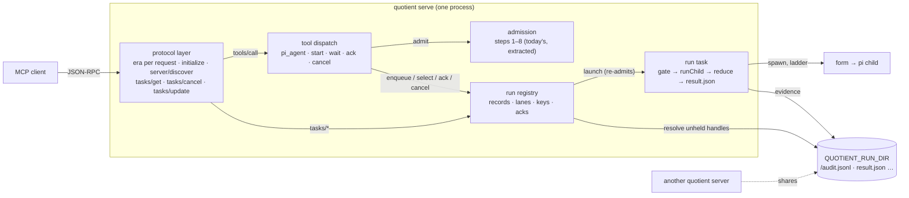
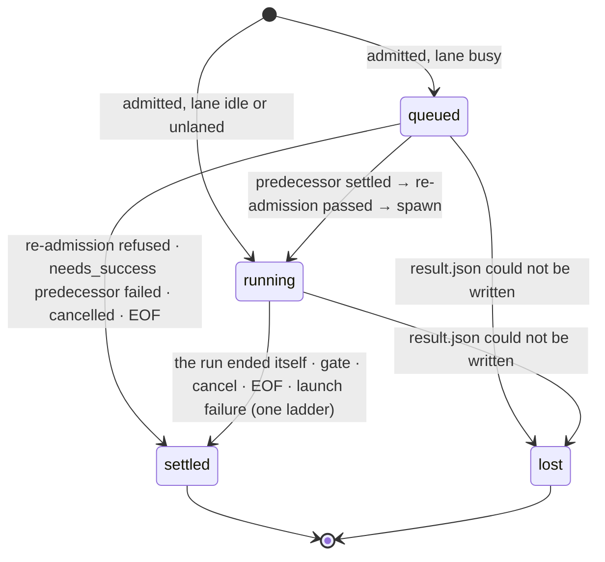
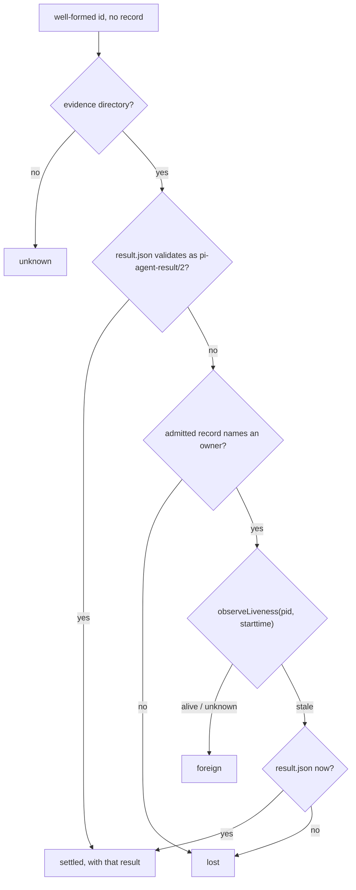
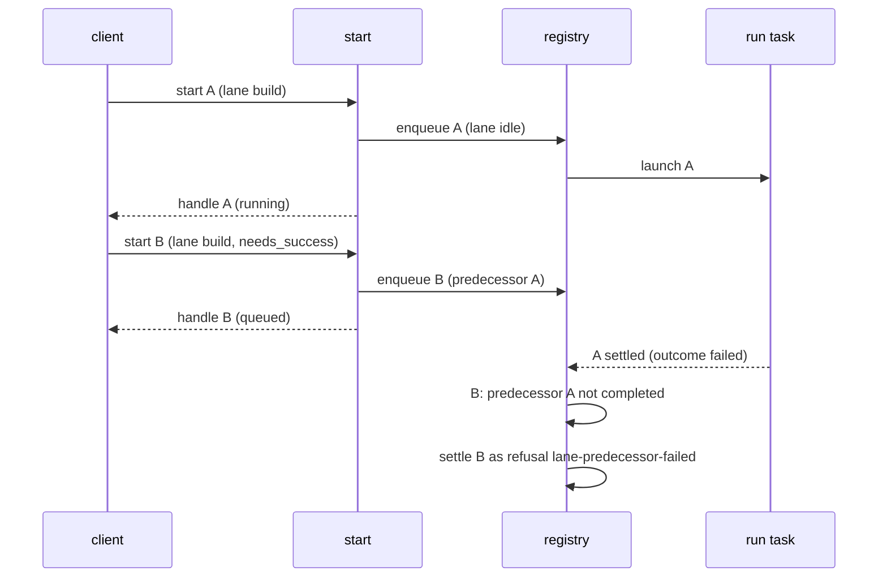
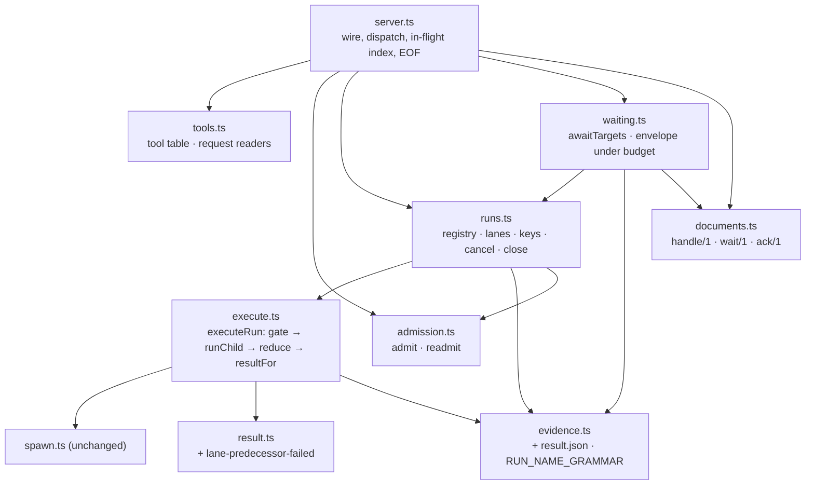
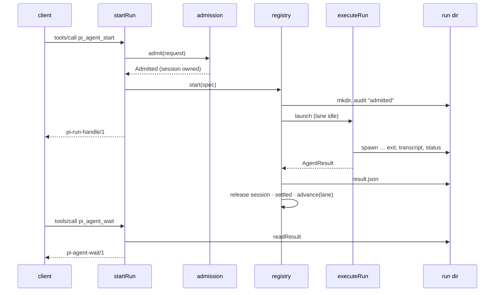

<!-- doctrine:section sec-1 -->
## 1. Design Problem

quotient answers every `pi_agent` call only when the run behind it has ended. MCP clients decide whether two tool calls may overlap from the tool's annotations, and a tool without `readOnlyHint: true` is run one call at a time. `pi_agent` can start write-capable runs, so it cannot honestly declare that hint, and today two delegated runs sent in one client message execute strictly one after the other (EVD-001: Claude Code, quotient 0.5.0, two `read` runs serial without the hint and overlapping within 4 ms with it). A blocking call is also bounded by the client's patience: Codex abandons a tool call after 60 s by default (EVD-003), and Claude Code's stdio idle timeout is 30 minutes (EVD-002).

This slice separates *starting* a run from *waiting* for it, in two ways that share one run model:

- **Bespoke tools**, for every client. A start answers at once with a handle; a wait blocks on one or many handles, changes nothing, and is the only tool that declares `readOnlyHint`. Concurrency then no longer depends on how a client schedules calls: one wait over several handles covers several runs.
- **MCP tasks**, for clients that speak the 2026-07-28 protocol revision and declare the tasks extension (`io.modelcontextprotocol/tasks`). `pi_agent` answers such a client with a task at once, and the client polls `tasks/get`. Serving that revision means quotient now speaks two protocol *eras*: the stateless 2026-07-28 revision ("modern", every request carries its version in `_meta`) beside today's `initialize` handshake at 2025-06-18 ("legacy"), which Codex and older clients keep using.

The same run machinery gives *lanes*, an opt-in way to have runs execute strictly one after another in start order.

### Current and target behaviour

| | today | after this slice |
|---|---|---|
| protocol | legacy only: `initialize` at 2025-06-18 | legacy unchanged, plus modern 2026-07-28 served statelessly, chosen per request by its `_meta` (sec-2) |
| tools | `pi_agent` | `pi_agent` (kept), `pi_agent_start`, `pi_agent_wait`, `pi_agent_ack`, `pi_agent_cancel` |
| `pi_agent`'s answer | `pi-agent-result/2` when the run ends | the same, unless the request declares the tasks extension: then a task at once |
| a run's lifetime | the call that started it | the server process; the call that started it may already have answered |
| concurrency | the client's choice; serial in practice | every unlaned run executes as soon as it is started; a wait over many handles is one call |
| ordering | none | a run started in a named lane executes after the lane's previous run settles |
| result storage | written to the caller only | also written atomically to the run's evidence directory as `result.json`, so a later wait or `tasks/get` (even after a restart, or from another server) can read it |
| cancellation | by the JSON-RPC request id; the cancelled call still answers | by request id with no reply (both eras), by handle (`pi_agent_cancel`), or by task (`tasks/cancel`) |
| client EOF | aborts every in-flight call | aborts every running run and drops every queued run |
| `pi-agent-result/2` | the answer | unchanged; one new refusal reason, `lane-predecessor-failed` |

What does not change: confinement, forms, approvals, profiles, the per-run gate and its maxima, session ownership rules, and accounting. A run executes exactly as a `pi_agent` run executes today; only who waits for it, and when, moves.

### Boundary

The diagram shows where the new parts sit. The protocol layer classifies each request by era and serves the methods only one era has; the run registry is the one new owner of state; tools and task methods are thin readers and writers over it; the run task is today's `callTool` tail, moved so it runs whether or not anyone is waiting.



Non-obvious edges: the registry, not the start call, launches a run (immediately when unlaned or the lane is idle, later otherwise), and launching re-runs admission against the policy current at that moment. Results are read from disk, not memory; the registry holds only compact records. Every quotient server a user runs shares one run directory, so a handle may name a run another live server owns; the registry resolves such a handle from disk and the owner's liveness (sec-3) rather than guessing.

### Governing decisions and evidence

No ADRs, policies, standards or specs exist in this repository. What binds this slice is the accepted decisions, the contracts in `docs/contract/`, and `docs/design.md` (rationale; the contract wins where they differ).

| source | how it binds |
|---|---|
| DEC-048 | the five tools and their arguments; start's idempotency `key`; no list tool |
| DEC-049 | run states, the handle, compact records, `result.json`, acknowledgement only by `pi_agent_ack`; blocking runs are owned |
| DEC-050 | lanes, `needs_success`, full re-admission at launch |
| DEC-053 | cancellation marks before awaiting; EOF; `notifications/cancelled` per tool |
| DEC-054 | only `pi_agent_wait` declares `readOnlyHint` |
| DEC-055, DEC-063 | both protocol eras in one process; each request's era from its own `_meta` |
| DEC-056, DEC-057, DEC-059, DEC-061 | `pi_agent` as a task; run state → task status; task lifetime fields; the task methods served and not served |
| DEC-058, DEC-068 | run documents are Tasks with quotient extras; `isError` per surface; unknown handles listed apart |
| DEC-060, DEC-070 | owned runs (blocking and task-created) are never implicit wait targets |
| DEC-062, DEC-069 | wait: selectors, `until`, 45 s default timeout, byte budget with the first result always whole |
| DEC-064, DEC-065 | no reply to a client-cancelled request; the cancel mark is intent, status follows the committed outcome |
| DEC-066, DEC-067 | the `admitted` record is the publication line; runs record their owning server |
| DEC-045 | docs: `docs/design.md` rationale, README pass, help per tool, contracts |
| EVD-001 | the scheduling probe the slice exists to answer |
| EVD-002, EVD-003 | Claude Code's and Codex's timeouts and tasks support, which set wait's default timeout and the help text |
| EVD-004 | the 2026-07-28 protocol and the tasks wire format, which sec-2 follows field for field |
| `docs/design.md` "One process per call" | revised by this slice (sec-8): runs no longer end before their call answers. Its reasons survive as the new invariant **nothing outlives the server; every run reaches the one termination ladder** |
| `docs/design.md` one termination ladder; client gone | binding and kept: cancel by handle or task and the queue drain hand the existing ladder a cause rather than adding a path |
| `docs/design.md` sessions: one owner, refuse rather than queue | binding and kept: lanes queue *runs*, never sessions; a queued run already owns its session |
| `pi-agent-result/2` invariants (only `completed` is final; no non-terminal document) | binding and kept: non-final states live in the wrapper documents and tasks, never in a result |
| shipped text cites no doctrine ids (`src/drift.test.ts`) | binding on every doc and help change |

Deferred, not designed here: listing acknowledged runs (IDE-004); a policy bound on runs in flight (IDE-005); recovering a task whose creation reply never arrived. quotient publishes the run and writes the `CreateTaskResult` in one synchronous step (sec-2), so no cancellation can fall between them; over stdio the reply then goes missing only if the client goes away, and EOF aborts the run. A client that retries anyway starts a second run: whatever the first one did before EOF stands (revisit with any non-stdio transport).

<!-- doctrine:section sec-2 -->
## 2. Protocol, Tools and Documents

This section is the whole wire surface: how a request is assigned an era, which methods each era has, the five tools, the task methods, and the documents they answer. Everything after it is how the server keeps those promises.

### Eras: one rule per request

There is no process-wide era. Each request is classified by its own `params._meta`, before anything else reads it:

| `params._meta` | era | outcome |
|---|---|---|
| no `io.modelcontextprotocol/protocolVersion` key | legacy | served exactly as today: no `resultType`, no gating on `initialize` |
| version `"2026-07-28"` and `io.modelcontextprotocol/clientCapabilities` an object | modern | served statelessly (below) |
| version present but not `"2026-07-28"` (unknown, or a legacy revision) | — | error `-32022`, `data: { supported: ["2026-07-28"], requested }` |
| version not a string; `clientCapabilities` missing or not an object | — | error `-32602` (the spec's rule for a malformed required field) |

A modern request after an `initialize` is still modern: the spec lets one process serve both eras at once, and `initialize` changes nothing a later request depends on. Classification is a pure function, `classifyEra(params) → { era: 'legacy' } | { era: 'modern', capabilities } | { error }`, so it is tested without a server.

### Methods by era

| method | legacy | modern |
|---|---|---|
| `initialize`, `notifications/initialized`, `ping` | as today (`initialize` answers `2025-06-18`) | not modern methods; served as legacy, since they carry no `_meta` |
| `server/discover` | — (no version: `-32602`) | answered (below) |
| `tools/list` | as today, plus each tool's `annotations` | the same tools, plus `resultType`, `ttlMs`, `cacheScope` |
| `tools/call` | as today | as today, plus `resultType`; `pi_agent` may answer a task |
| `tasks/get`, `tasks/cancel`, `tasks/update` | `-32601` (method not found): tasks exist only in the modern era | answered (below) |
| `notifications/cancelled` | cancels the named request; no reply to it (sec-6) | the same |

Every modern result carries `resultType` (`"complete"`, or `"task"` for a created task) and `_meta: { "io.modelcontextprotocol/serverInfo": { name, version } }`. Legacy results are byte-for-byte today's.

`server/discover` answers:

```json
{
  "resultType": "complete",
  "supportedVersions": ["2026-07-28"],
  "capabilities": { "tools": {}, "extensions": { "io.modelcontextprotocol/tasks": {} } },
  "instructions": "… the agent help section, as initialize's instructions today …",
  "_meta": { "io.modelcontextprotocol/serverInfo": { "name": "quotient", "version": "<package version>" } },
  "ttlMs": 0,
  "cacheScope": "private"
}
```

`supportedVersions` and `-32022`'s `supported` list only the modern revision. A client that sends a version in `_meta` is modern, and the spec forbids it to fall back to `initialize` on a recognised modern error; a legacy revision named there would only invite a retry this table refuses. Legacy clients never send a version, never see `-32022`, and reach `2025-06-18` through `initialize` as today. `tools/list` carries the same `ttlMs: 0` and `cacheScope: "private"`. The descriptions are rendered on every request from the policy as it reads now (`selfDescription` → `renderContext` → `policyView`), and they name local profile sources, capabilities and the launch directory: they are neither fixed nor fit to share. `ttlMs: 0` tells the client to re-fetch when it next needs the list, which costs one cheap local read.

### The tool table

| tool | arguments (beyond today's `pi_agent` set) | answers | annotations |
|---|---|---|---|
| `pi_agent` | `lane?`, `needs_success?` | `pi-agent-result/2`; a task when the request declares the tasks extension | `readOnlyHint: false`, `openWorldHint: true` |
| `pi_agent_start` | `lane?`, `needs_success?`, `key?` | `pi-run-handle/1`, or a `pi-agent-result/2` refusal | `readOnlyHint: false`, `openWorldHint: true` |
| `pi_agent_wait` | — own set: `runs?`, `lanes?`, `until?`, `timeout_s?`, `status_only?`, `budget_bytes?` | `pi-agent-wait/1` | `readOnlyHint: true` |
| `pi_agent_ack` | — own set: `runs` (required) | `pi-agent-ack/1` | `readOnlyHint: false`, `idempotentHint: true` |
| `pi_agent_cancel` | — own set: `runs` (required) | `pi-agent-wait/1` over its targets | `readOnlyHint: false`, `idempotentHint: true` |

"Today's `pi_agent` set" is `prompt`, `profile`, `cwd`, `session`, `tools`, `ceilings`, `transcript_budget_bytes`. `destructiveHint` is left at its default (true) on every non-read-only tool. Each `tools/list` entry gains an `annotations` object holding exactly the hints above, and its `description` is that tool's own help section (sec-8). The tools are the same in both eras.

New argument grammar:

- `lane`: a name in the session-id grammar the server already has (`SESSION_GRAMMAR`: 1–64 of `A-Za-z0-9._-`, alphanumeric at both ends), checked in the request reader and refused `request-invalid` otherwise. A lane name and a session id share a grammar, not a namespace.
- `needs_success`: boolean; valid only with `lane` (`request-invalid` otherwise, since an unlaned run has no predecessor).
- `key`: a string of 1–128 printable ASCII characters.
- `runs`: an array of task ids (a run's handle *is* its task id, sec-3); `lanes`: an array of lane names. Each id must match the run-name grammar (sec-3) or the request is `request-invalid`; this is also what keeps an id from naming a path outside the run dir.
- `until`: `"all"` (default) or `"any"`.
- `timeout_s`: a non-negative finite number; `0` means "answer now".
- `status_only`: boolean, default false.
- `budget_bytes`: a positive integer.

### Runs as tasks

`pi_agent` answers a task when, and only when, the request is modern and its `clientCapabilities.extensions` holds `io.modelcontextprotocol/tasks`. Otherwise it blocks and answers `pi-agent-result/2`, as today; the server never returns a task to a client that did not ask. The other four tools never answer tasks: they are the non-task path, for subagents and clients without the extension, and each already answers promptly or within its own timeout.

The run is started exactly as `pi_agent_start` starts one (sec-3), and its `admitted` record is written before the answer, so the task exists on disk before the client hears of it. Admission, publication and writing the `CreateTaskResult` happen in one synchronous step: no other input line — a `notifications/cancelled` included — is read between the run existing and its creation reply being sent. A refusal at admission is not a task: it answers the `pi-agent-result/2` refusal as a complete result, as today.

```json
{
  "resultType": "task",
  "taskId": "run-20261026T120301123Z-7-3f9a0c1d2e4b",
  "status": "working",
  "statusMessage": "running",
  "createdAt": "2026-10-26T12:03:01.123Z",
  "lastUpdatedAt": "2026-10-26T12:03:01.123Z",
  "ttlMs": null,
  "pollIntervalMs": 2000
}
```

`ttlMs` is `null` because the result lives as long as the evidence directory, which is the operator's to prune, not the server's. `createdAt` is the `admitted` audit record's `ts`; `lastUpdatedAt` is the latest audit record's `ts`, or when `result.json` was written. Both survive a restart because both are on disk.

**Status.** A task's status is derived from the run's committed outcome, never from a cancel mark (sec-6), so a terminal status never changes and a restarted server derives the same one:

| quotient state | `status` | `statusMessage` | `tasks/get` adds |
|---|---|---|---|
| `queued` | `working` | `queued in lane <lane> behind <predecessor>`, or `cancelling` once marked | — |
| `running` | `working` | `running`, or `cancelling` once marked | — |
| `foreign` (another live server owns it, sec-3) | `working` | `owned by another quotient server (pid <pid>)` | — |
| `settled`, result state `cancelled` | `cancelled` | the result's causes | — |
| `settled`, any other result state | `completed` | the result state | `result`: the CallToolResult a modern blocking `pi_agent` would have answered — `{ resultType: "complete", content: [{ type: "text", text: <pi-agent-result/2 JSON> }], isError }`, built by the same serialiser |
| `lost` (no result was recorded: the owner is confirmed dead, or `result.json` could not be written) | `failed` | `lost: inspect <dir>` | `error`: `{ code: -32603, message: "run lost: no result was recorded; inspect the evidence directory", data: { dir } }` |

A delegated run that failed is therefore a `completed` task whose result has `isError: true`: the task finished and produced the answer the blocking call would have given. `failed` is kept for the one case where no answer exists.

**Methods.**

- `tasks/get {taskId}` answers the Task plus the column above, `resultType: "complete"`. Never budgeted: the spec requires the whole result.
- `tasks/cancel {taskId}` marks the run, starts the termination ladder, and answers `{ resultType: "complete" }` at once without waiting for the run to end. On a terminal task, or one a foreign server owns, it is the same empty answer and changes nothing; cancellation is cooperative by the spec.
- `tasks/update {taskId, inputResponses}` answers `{ resultType: "complete" }` and does nothing: no run ever enters `input_required`.
- An unknown or malformed `taskId` in any of the three is `-32602`.
- Not served: `notifications/tasks`, `subscriptions/listen`, and multi round-trip requests. Polling at `pollIntervalMs` is the only way to follow a task.

### `isError`

Per surface:

- **Blocking `pi_agent`**, and the result inside a completed task: today's rule, `isError` is true for any result state other than `completed`. Callers need no migration.
- **Start, wait, ack and cancel**: `isError` is true only when the call itself was refused — a `request-invalid`, or start's admission refusal. A handle, a wait envelope or an ack answer is never an error because of the runs inside it.

### Run documents

Every document that describes a run is a Task with its field names verbatim — `taskId`, `status`, `statusMessage`, `createdAt`, `lastUpdatedAt`, `ttlMs`, `pollIntervalMs` — plus quotient's extras in snake_case: `lane`, `key`, `session`, `artifacts: { dir }`, and `state`, the finer quotient state that `status` collapses. A client that knows tasks reads the Task fields; the extras are quotient's.

`state` values: `queued`, `running`, `foreign`, `settled`, `lost` (sec-3 defines each).

### `pi-run-handle/1` — what start answers

```json
{
  "schema": "pi-run-handle/1",
  "taskId": "run-20261026T120301123Z-7-3f9a0c1d2e4b",
  "status": "working",
  "statusMessage": "queued in lane build behind run-20261026T120259870Z-6-0b1c2d3e4f5a",
  "createdAt": "2026-10-26T12:03:01.123Z",
  "lastUpdatedAt": "2026-10-26T12:03:01.123Z",
  "ttlMs": null,
  "pollIntervalMs": 2000,
  "state": "queued",
  "lane": "build",
  "key": "step-2",
  "session": "9c0f…32 hex…",
  "artifacts": { "dir": "/var/lib/quotient/runs/run-20261026T120301123Z-7-3f9a0c1d2e4b" }
}
```

`lane` and `key` are null when not given. `state` is `queued` or `running` at the moment of answering. The session is minted at start (it is owned from start, sec-3), so a caller can continue it once the run settles.

### `pi-agent-wait/1` — what wait and cancel answer

```json
{
  "schema": "pi-agent-wait/1",
  "until": "all",
  "timed_out": false,
  "truncated": false,
  "runs": [
    { "taskId": "run-…-3f9a0c1d2e4b", "status": "completed", "statusMessage": "completed", "state": "settled",
      "createdAt": "…", "lastUpdatedAt": "…", "ttlMs": null, "pollIntervalMs": 2000,
      "lane": "build", "key": null, "session": "…", "artifacts": { "dir": "…" },
      "status_only": false,
      "result": { "schema": "pi-agent-result/2", "state": "completed", "final": true, "…": "…" } },
    { "taskId": "run-…-77aa01bc9d10", "status": "working", "statusMessage": "queued in lane build behind run-…-3f9a0c1d2e4b", "state": "queued",
      "…": "…", "status_only": true, "result": null }
  ],
  "unknown": ["run-20261024T080000000Z-1-aaaaaaaaaaaa"]
}
```

`result` is the `pi-agent-result/2` object itself, not a CallToolResult or a string holding one: a wait caller reads the run's answer directly. `status_only` on an entry is true when results were not asked for, the entry is not settled, or the entry did not fit the byte budget; `truncated` is true when at least one settled entry was reduced to status for the budget (sec-5). `timed_out` is true when the wait's timeout passed before its `until` condition held. A result inside an entry is a complete, valid `pi-agent-result/2` — a refusal included (a queued run refused at launch, sec-4).

`unknown` lists the ids that are well formed but name no run: no record in this server and no evidence directory. They are not Tasks, for the same reason `tasks/get` answers them `-32602`; they are still reported, and `until` counts them as done.

### `pi-agent-ack/1` — what ack answers

```json
{
  "schema": "pi-agent-ack/1",
  "runs": [
    { "taskId": "run-…-3f9a0c1d2e4b", "acknowledged": true },
    { "taskId": "run-…-77aa01bc9d10", "acknowledged": false, "reason": "not-settled" }
  ]
}
```

Per-run reasons: `not-settled` (queued, running or foreign) and `unknown` (no record in this server). Acknowledging an already-acknowledged run answers `acknowledged: true` again. The request is validated whole (every id well formed) before any acknowledgement applies.

<!-- doctrine:section sec-3 -->
## 3. Run Lifecycle

A *run* is one admitted delegation: one session, one evidence directory, at most one pi child. Today a run exists only inside the `tools/call` that started it. Here it becomes a record the server holds for its whole life, and the call that started it is just its first observer. A run is created the same way whichever door it came through — `pi_agent_start`, blocking `pi_agent`, or `pi_agent` as a task — and only its *origin* differs.

### States

The registry holds four states for the runs it owns; `lost` is reached only when `result.json` cannot be written (below):



A refusal at admission creates no run: the caller gets a `pi-agent-result/2` refusal exactly as `pi_agent` answers one today, recorded in `attempts.jsonl`. Every transition into `settled` writes `result.json` (below), so *settled* means "a result document exists".

A handle the registry does not hold is resolved from disk into one of four further answers (below): `settled`, `foreign` (another live server owns it), `lost` (its owner is confirmed dead and left no result), or `unknown` (no evidence at all). Only `settled` and `lost` are terminal; sec-2 maps all of them onto task status.

Two flags ride beside the state and never change it: `cancelled` (an intent mark taken before any await, sec-6) and `acknowledged` (set only by `pi_agent_ack`, only once settled).

### The handle

A run's handle is its evidence directory's name, which `evidence.ts` already mints unique per run: `run-<UTC stamp>-<call-id slug>-<12 hex>`. The same string is the run's task id, in tasks and in every run document. It is opaque to clients, but the server validates every incoming id against that grammar (`RUN_NAME_GRAMMAR = /^run-[0-9TZ]+-[A-Za-z0-9_-]{1,32}-[0-9a-f]{12}$/`, exported from `evidence.ts` beside `runName`) before using it, so an id can never name a path outside `QUOTIENT_RUN_DIR`.

### The record

The registry holds one compact record per run for the server's life. It never holds a result document: a final answer is unbounded, and the assumption that holding them would be affordable (ASM-002) was invalidated.

```ts
type RunState = 'queued' | 'running' | 'settled' | 'lost';
type Origin = 'start' | 'blocking' | 'task';

type RunRecord = {
  readonly run: string;               // the handle, and the task id
  readonly layout: RunLayout;         // evidence paths
  readonly origin: Origin;            // which door it came through
  readonly lane: string | null;
  readonly predecessor: string | null; // the lane's previous run at enqueue
  readonly needsSuccess: boolean;
  readonly key: string | null;
  readonly argsDigest: string;        // sha256 of the canonical arguments, key excluded
  readonly session: string;
  readonly createdAt: string;         // the admitted record's ts
  updatedAt: string;                  // the latest audit record's ts, or the result.json write
  state: RunState;
  outcome: ResultState | null;        // the settled result's state, for needs_success and task status
  cancelled: boolean;
  acknowledged: boolean;
  readonly controller: AbortController; // the run's one abort trigger
  readonly settled: Promise<void>;    // resolves when result.json is written
  fallback: AgentResult | null;       // the blocking caller's answer when result.json could not be written
};
```

`outcome` keeps the facts lanes and task status need from the result without holding the result. A run is *owned* when its origin is `blocking` (its call is its observer) or `task` (its client polls `tasks/get`); owned runs are never implicit wait targets (sec-5).

### Start

The same steps serve all three origins; only the answer differs (sec-2).

1. Read the request (shape; `request-invalid` refusals as today).
2. **Key** (start only). When `key` is given and the registry already maps it: identical `argsDigest` → answer the original run's handle (its current state) and do nothing else; a different digest → refuse `request-invalid` (detail: the key was used with different arguments), so `pi-agent-result/2` gains no reason for it. Keys live for the server's life. A refused start records no key, so a retry re-admits.
3. **Admission**, today's steps 1–8 unchanged and in today's order, including the session lock (step 7), the child-view check (step 8) and the `attempts.jsonl` probe.
4. **Publish.** Allocate the evidence directory and write the run's first audit record, `admitted`: origin, lane, predecessor, `needs_success`, key, whether it launches now or queues, and the **owner** — this server's pid and kernel start time (field 22 of `/proc/<pid>/stat`, the identity `session.ts` already uses). If it cannot be written, the directory is discarded, the session acquired at step 3 is released, and the call refuses `audit-failed` — today's rule that a run whose audit cannot be written never starts. The record is written synchronously, the same way for queued and immediate runs.
5. Insert the record, append it to its lane, and either launch it now (unlaned, or the lane is idle) or leave it queued.
6. Answer: `pi-run-handle/1` (start), a `CreateTaskResult` (task), or await `settled` and answer the result (blocking).

Steps 1–5 are synchronous, so no other line is handled between admission and the record existing (sec-6 relies on this). Until step 5 inserts the record, the session belongs to the call: every refusal or exception before then releases it, as today's `finally` does. From step 5 it belongs to the registry, which releases it only at commit.

**The publication line.** Once the `admitted` record exists, the run has been promised to someone — a handle, a task id, a blocking caller — and its directory is never deleted. Every later failure becomes a settled result, never a disappearance.

### Launch and the run task

Launching starts the *run task*: today's `callTool` tail from the gate onwards, moved into its own async function so it runs to the end whether or not any call is waiting.

1. For a queued run only, **re-admission** (sec-4) against the policy and approvals current now. A refusal settles the run as that `pi-agent-result/2` refusal.
2. Create the gate (wall clock starts here, at launch, not at start).
3. `runChild`: the `spawn` record, spawn, capture, the one ladder, reap, drain, `exit` record. One change: a `spawn` record that cannot be written no longer discards the directory (the run was published at step 4 of start). It settles the run as an `audit-failed` refusal, written to `result.json` like any other settlement.
4. Reduce, write `transcript.md` and `status.json`, latch, `resultFor` — unchanged.
5. **Commit**: write `result.json` (the `pi-agent-result/2` document, pretty-printed) to a temporary file in the run directory and rename it into place, set `outcome` and `updatedAt`, release the session lock, mark the record `settled`, resolve `settled`, then let the lane advance.

The rename means a reader — this server, another one, or one started later — sees no `result.json` or a whole one, never a torn file. A `result.json` that cannot be written makes the run `lost` at that moment, in this server as after a restart: no result was ever recorded, so every reader — wait, `tasks/get`, another server — reports `lost` (Task `failed`), and the status cannot differ before and after the server ends. The session is still released and `settled` still resolves, so waiters wake. The one exception is a blocking `pi_agent` call, which answers once and is not a task: it gets today's answer, the small failed-arm document `failedResult('audit', [...causes, 'audit'], …)` held in `fallback`. The order in step 5 — file, then session release, then the state flip — means a waiter woken by `settled` always finds the file, and a session is never free while its run might still write.

### Collecting and acknowledging

Results are collected at least once: a wait returns a settled run's result every time it is targeted, so a lost wait reply loses nothing. `pi_agent_ack` marks settled runs acknowledged, which only removes them from the implicit selections a wait makes (sec-5); an acknowledged run stays addressable by id. Callers dedupe by id.

Owned runs never appear in an implicit selection but remain addressable by id: a blocking run's id is in its result's `artifacts.dir`, a task's is its `taskId`.

### Resolving a handle the registry does not hold

A well-formed id with no record — from before a restart, or from another server sharing `QUOTIENT_RUN_DIR` — is resolved on disk:



- `foreign` is not terminal: the owner may still settle the run. A wait re-reads foreign targets from disk every `pollIntervalMs` (sec-5), and a `result.json` that lands turns the target `settled`.
- The owner may publish its result and exit between the first read and the liveness check. So a `stale` owner is followed by a second read of `result.json`, and only its absence means `lost`: a dead owner can write nothing more, so the second read is final.
- `lost` requires positive evidence that no one can still write a result — the owner's pid is gone or reused (`stale`), or no owner was ever recorded (a directory from a release before this one, whose runs never write `result.json`). An unreadable pid table reads `unknown` and so `foreign`: never guess a run dead.
- A disk-resolved run is never acknowledged and cannot be acked (`not-settled` while foreign, `unknown` otherwise): acknowledgement is per server process.
- No server cancels another's run: `tasks/cancel` on a foreign run is an empty acknowledgement, and `pi_agent_cancel` reports it `foreign`.

### Invariants

- Every run that leaves `queued` or `running` writes `result.json`, atomically, before it is observable as `settled`.
- A published run's directory is never deleted by the server.
- A terminal status (`settled`, `lost`) never changes: it is derived only from `result.json` and the owner's confirmed death, both of which are permanent.
- Every running run reaches the one ladder; no stop path bypasses `runChild`'s termination.
- A session is owned from admission at start until the run's commit, so a queued run's session cannot be taken by another call.
- The registry holds no result payloads beyond the bounded `fallback`, which only a blocking caller reads; memory per run is the record above.
- Nothing outlives the server: EOF settles every record (sec-6).

<!-- doctrine:section sec-4 -->
## 4. Lanes

A lane makes runs execute strictly one after another, in the order they were started. Naming a lane is the only way to opt in; unlaned runs launch as soon as they are admitted. Lanes exist per server process and need no declaration: the first start that names a lane creates it.

### Rules

- **FIFO, one executing.** Each lane is an ordered list of handles. A run launches when it reaches the head of its lane, which happens when its predecessor settles.
- **Predecessor fixed at enqueue.** A run records the lane's last run at the moment it was started (`predecessor`, null for the first). Later cancellations do not re-link it.
- **Cancelled runs are skipped.** When the head settles, the lane advances past every run marked `cancelled` (their settlement is the cancel path's, sec-6) to the first unmarked run, and launches that.
- **`needs_success`.** Before launching a run with `needs_success: true`, the lane checks its predecessor's `outcome`. Anything but `completed` settles the run without launching, as a `pi-agent-result/2` refusal with reason `lane-predecessor-failed` (detail names the predecessor handle and its state), recorded the same way as a re-admission refusal below. Because that refusal is itself not `completed`, a following `needs_success` run refuses in turn: failure cascades down the lane until a run without `needs_success`. A predecessor that was cancelled while queued settled `cancelled`, so it counts as failed.

Example: three runs started in lane `build` — A (no flag), B and C (`needs_success`). A fails: B refuses `lane-predecessor-failed` naming A; C refuses naming B. Had C been started without the flag, C would launch after B's refusal.

### Re-admission at launch

A queued run was admitted against the policy, profiles and approvals as they stood at start; it may launch minutes later. Authority is judged when it is exercised and may only narrow while a run waits, so launching re-runs the full admission against what is current:

| step | at launch |
|---|---|
| 1–2 policy readable, `enabled` | re-read; refusal settles the run |
| 3 profile | the same profile name, re-resolved against the start-up snapshot and the *current* policy's pins (a changed pin refuses `profile-capability-mismatch`) |
| 4 root | the admitted root, re-checked against the current `roots` |
| 5 slot, form, approvals | re-selected from the current policy and approvals store for the admitted capability; a revoked approval refuses |
| 6 ceilings | the per-unit minimum of the admitted ceilings and the current maxima — never a refusal, only a narrowing |
| `tools` narrowing | the admitted tool list, re-checked against the profile |
| 7 session | not re-acquired: the run has owned it since start |
| 8 child view; ledger probe | re-checked |

Any refusal settles the run as that `pi-agent-result/2` refusal, recorded in the run's audit (a `refused` record carrying the reason) and in `attempts.jsonl`, the ledger of attempts that spawned nothing; the run's session lock is released. The run keeps its admitted root, session and capability throughout — re-admission can refuse a run but never moves it.

The ceilings rule reuses `clampCeilings` unchanged: the launch passes `min(admitted, current maxima)` per unit as the request, which by construction is never above a maximum.

### Sequence



### Why lanes do not conflict with session rules

Sessions refuse a second owner rather than queueing it. Lanes queue *runs*, each of which already owns its own session from start. A consequence: a lane cannot chain several runs on **one** session, because the second start finds the session owned by the first and refuses `session-busy`. To continue a conversation, start the next run after the previous one settles. Sec-9 lists this as an explicit limit.

<!-- doctrine:section sec-5 -->
## 5. Waiting

`pi_agent_wait` blocks until a set of runs reaches a condition or a timeout passes, then reports every target. It changes no state anyone can observe — not acknowledgement, not lanes, not keys — which is what lets it declare `readOnlyHint: true` honestly. It is the non-task way to wait; a task client polls `tasks/get` instead.

### Selecting targets

| `runs` | `lanes` | targets |
|---|---|---|
| omitted | omitted | every unacknowledged run this server started through `pi_agent_start` |
| given | omitted | exactly the named runs |
| omitted | given | each named lane's unacknowledged `pi_agent_start` runs, as of the wait's arrival |
| given | given | both, deduplicated |

One rule covers both implicit selections: they pick only runs whose origin is `start` and that are not yet acknowledged. Owned runs — started by a blocking `pi_agent` or as a task — are never implicit targets, since their caller collects them another way and never acks them; they are still ordered by their lane (sec-4). Named runs are always reported, whatever their origin or acknowledgement; ids the registry does not hold are resolved on disk (sec-3), and ids that resolve to nothing go to the envelope's `unknown` list. An empty array selects nothing from that selector. A lane's membership is a snapshot taken when the wait arrives: a run started into the lane during the wait is not a target. Order: named runs in the order given, then lanes' runs lane by lane in start order, duplicates dropped at their first position.

With no selectors, `timeout_s: 0` and `status_only: true`, a wait is the listing tool: it answers at once with the state of every started run the caller has not acknowledged.

### The condition and the timeout

A target is *done* when it is `settled`, `lost` or `unknown`; `queued`, `running` and `foreign` are not. `until: "all"` (default) returns when every target is done; `until: "any"` when at least one is. A wait with no targets returns at once.

`timeout_s` defaults to `WAIT_TIMEOUT_DEFAULT_S = 45`, and any value is capped at the policy's `maxima.wall_clock_s` as read when the wait arrives (no maximum → `WAIT_TIMEOUT_MAX_S = 900`). 45 s sits inside Codex's default 60 s tool timeout with margin, and far inside Claude Code's 30-minute idle window (EVD-002, EVD-003). When the timeout passes first, the wait answers with every target in its current state and `timed_out: true`; the caller waits again.

Live records contribute their `settled` promise; there is no polling for them. Foreign targets have no promise in this process, so the wait re-reads each from disk every `pollIntervalMs` (2 s) until it resolves `settled` or `lost`; this is the only polling, and it exists only while a foreign target is waited on.

```ts
async function awaitTargets(targets: Target[], until: 'all' | 'any', timeoutMs: number, signal: AbortSignal): Promise<boolean /* timed out */>
```

`signal` is the wait call's own: `notifications/cancelled` naming the wait ends it early and it answers nothing (sec-6), and EOF ends it with the server.

### The byte budget

A wait over many settled runs could return many full transcripts. The results it includes are bounded:

- `budget_bytes` defaults to `WAIT_BUDGET_DEFAULT = 65536` and is capped at `WAIT_BUDGET_MAX = 1048576`; a larger request is clamped silently (a report bound, as the transcript budget is, not a spend bound).
- The budget counts the serialised bytes of the `result` objects included. The envelope's own fields, the Task fields of each entry and the `unknown` list are not counted: each is small and there is one per target.
- Entries are laid out in target order. A settled entry's result is read from `result.json` and included if the running total stays within the budget; otherwise the entry is emitted status-only (`status_only: true`, `result: null`) and `truncated` is set. Later, smaller results may still fit.
- **The first settled entry's result is always included whole**, even when it alone exceeds the budget. So any result can be collected by waiting on its run alone, and every wait that finds a settled run makes progress. One answer can therefore exceed the budget by at most that one result; the contract says so.
- `status_only: true` on the request makes every entry status-only.

A caller that sees `truncated` waits again on the status-only ids; results are collected at least once (sec-3), so nothing is lost.

### The loop help teaches

```
ids = [start(...).taskId, start(...).taskId, start(...).taskId]
loop:
  w = wait(runs: ids, until: "any")          # default timeout_s 45
  for entry in w.runs where entry.state is settled and entry.result is present:
    use entry.result
  ack(runs: those entries' ids)
  for entry in w.runs where entry.state is lost:
    report entry.artifacts.dir                # no result exists; inspect the evidence
  ids = ids minus acknowledged, minus lost, minus w.unknown
  until ids is empty
```

Acknowledging after use, not on receipt, is what makes a lost reply harmless: an unacked run is returned again. A client with the tasks extension needs none of this: it calls `pi_agent` and polls `tasks/get` at the task's `pollIntervalMs`.

<!-- doctrine:section sec-6 -->
## 6. Cancellation and Shutdown

Every stop still goes through `runChild`'s one ladder; this slice adds addresses for a stop, not new ways to stop. Two rules hold throughout:

- **Mark first, await second.** The hazard is a lane advancing into its next run while a sweep is in progress, so every cancelling path marks all its targets before it awaits anything.
- **The mark is intent, not outcome.** A mark stops a lane from launching the run and hands a running run to the ladder; it never decides what the run reports. A run that completes before the ladder reaches it reports `completed`. Status — the run document's and the task's — comes only from `result.json` (sec-2, sec-3), so it never changes once terminal and reads the same after a restart.

### `pi_agent_cancel`

1. Validate every id (`request-invalid` otherwise).
2. Synchronously, for each target with a record: set `cancelled`. From this point no lane will launch it.
3. For each marked running run: `controller.abort('cancelled')` — the ladder, cause `cancelled`, exactly as `notifications/cancelled` drives today.
4. For each marked queued run: write a `cancelled` audit record, then settle it without launching through the failed arm — `failedResult('cancelled', ['cancelled'], session, emptyStatus, layout)`, state `cancelled` — by the one commit every settlement uses (sec-3): `result.json`, then session release, then the state flip.
5. Await every marked target's `settled`, then answer `pi-agent-wait/1` over all targets (results included, within the default budget), each reporting what it actually ended as. Targets already settled or lost are reported as they are; foreign targets are reported `foreign` and not awaited (no server cancels another's run, sec-3); unknown ids go to `unknown`.

Step 2 completes before any await, so when a running target settles and its lane looks for the next run, every run this call targets is already marked and is skipped.

### `tasks/cancel`

Steps 1–4 above for its one task, then the empty acknowledgement at once — it does not await the run's end. The client learns the outcome from `tasks/get`: `cancelled` if the ladder stopped the run, or whatever the run reached first. A terminal or foreign task gets the same empty acknowledgement and nothing changes; an unknown id is `-32602`. Answering before the run settles keeps the input reader free: a cancel never holds up the lines behind it.

### `notifications/cancelled`

The notification names a request id. From the moment it is read, **that request gets no reply**, in either era: the 2026-07-28 stdio transport forbids any further message for it, and 2025-06-18 asks the same. A reply already written stands. The outcome is not lost: the run's result is still written to `result.json`. It reads `cancelled` when the cancellation was the first termination cause; an earlier cause (a gate timeout, an audit failure) keeps precedence, as it does today.

What else it does depends on the request it names:

| request | effect beyond silence |
|---|---|
| blocking `pi_agent` | cancels its run, as today: mark, then the ladder with cause `cancelled` |
| `pi_agent` answered as a task | none: the request already answered with its `CreateTaskResult`, so the notification names a completed request and is ignored. `tasks/cancel` cancels a task |
| `pi_agent_start` | none in practice: start's admission and record creation are synchronous (sec-3), so by the time a notification is read the run exists or the start refused. The run stands; a client finds it again by `key` or by a selector-less wait |
| `pi_agent_wait` | ends that wait; its runs are untouched |
| `pi_agent_ack`, `pi_agent_cancel`, `tasks/*` | none: each is effectively synchronous, and a cancel already in progress completes |

The in-flight index keeps a per-call `AbortController` (today's) and gains a per-call `silenced` flag, set by the notification. The reply gate checks `silenced` beside `closed`: it is the one place a reply is suppressed, whichever tool the call ran. Each tool decides what its call's abort means: blocking `pi_agent` forwards it to its run's controller, wait resolves early, the rest ignore it.

The operator switch (the policy's `enabled` turned off at a gate tick) is not a client cancellation: its runs settle `cancelled` with cause `switch`, and their calls answer as today.

### Client EOF and shutdown signals

EOF on stdin, a failed input, SIGTERM and SIGINT remain one trigger: the client is gone.

1. Set `closed` on the server context — no new line is admitted, and no lane advances from here (the launch path checks `closed` first).
2. For every running run: `controller.abort('eof')`.
3. For every queued run: write a `dropped` audit record, then settle it without launching (failed arm, cause `eof`, state `incomplete`) by the one commit (sec-3).
4. Await every record's `settled` and every in-flight call's `done`. No replies are written.

Writing `result.json` for dropped and aborted runs is what lets a later server, or another one sharing the run directory, report them as `settled` rather than `lost`. Task runs are swept like any other: a task client that reconnects to a new server finds its task terminal, with whatever outcome the ladder committed — `incomplete` with cause `eof` unless an earlier cause won.

### Why not settle queued runs one by one, or keep them across EOF

Sequential cancel (abort one, await, then the next) lets a lane launch a target between steps — the race this section exists to close. Surviving EOF would need a run that outlives the server, which the governing invariant forbids: no client is left to observe it, and nothing would stop it. Tasks do not change this: a task is a durable *handle* on a result, not a promise that the work outlives the process.

<!-- doctrine:section sec-7 -->
## 7. Code Structure

`callTool` in `src/server/server.ts` today does four jobs in one function: read the request, admit it, run it, and answer. This slice separates them, because start, launch, re-admission and wait each need a different subset. The rule throughout: move today's code, do not write a second copy of it.

### Modules



| module | responsibility | state |
|---|---|---|
| `tools.ts` (new) | the five tool definitions (name, input schema, annotations, help section) and their pure request readers; `PI_AGENT_TOOL` and `readAgentRequest` move here from `server.ts` | none |
| `admission.ts` (new) | steps 1–8 and the ledger probe, moved out of `callTool`; `readmit` re-runs them for a queued run | none (reads policy, approvals, session store) |
| `execute.ts` (new) | one run from gate to result document: today's `callTool` tail | none beyond one run |
| `runs.ts` (new) | the registry: records, lanes, keys, acknowledgement, marks; launch, cancel, close | **the only new long-lived state** |
| `waiting.ts` (new) | waiting over targets and building the budgeted envelope | none |
| `documents.ts` (new) | schema tokens, builders and validators for the three wrapper documents | none |
| `server.ts` | wire framing, dispatch by tool name, the in-flight call index, EOF | context only |

`runs.ts` does not import `server.ts`; it receives its launch function, so its tests drive lanes, marks and keys with a fake run task and no processes.

### Signatures

```ts
// admission.ts
export type Admitted = {
  request: AgentRequest;           // as read, for the key digest and re-admission
  root: string; profile: Profile; form: Form; formSource: FormSource;
  ceilings: Maxima; tools: string[];
  session: SessionAcquisition & { ok: true };
  policyDigest: string; runDir: string;
  transcriptBudget: number | undefined;
};
export type Refused = { ok: false; reason: string; detail: string };
export type AdmissionContext = { startup: Startup & { ok: true }; locations: Locations; launchDir: string };

export function admit(request: AgentRequest, context: AdmissionContext, callId: CallId): { ok: true; admitted: Admitted } | Refused;
export function readmit(admitted: Admitted, context: AdmissionContext, callId: CallId): { ok: true; admitted: Admitted } | Refused;
```

Both are built on one private `authorise(inputs, context, callId)` that runs steps 1–6 and the `tools` narrowing over explicit inputs — profile name, root, requested ceilings, requested tools — and one private `checkLaunchable` for step 8 and the probe. `admit` is `authorise` → `acquireSession` → `checkLaunchable`; `readmit` is `authorise` over the admitted root and `min(admitted.ceilings, current maxima)` → `checkLaunchable`. Every refusal is appended to `attempts.jsonl` where it is decided, as today.

```ts
// execute.ts
export function executeRun(admitted: Admitted, layout: RunLayout, signal: AbortSignal, deps: ExecuteDeps): Promise<AgentResult>;
type ExecuteDeps = { env: Env; graceMs: number; gateIdleMs: number; diagnostics: Writable; profileDigest: string; helpDigest: string };
```

It owns the gate (created first, closed in `finally`), `runChild`, the reduction, `writeRunFiles`, the latch and `resultFor` — the lines `server.ts:352-475` hold today. It does not release the session; the registry does, after `result.json`.

```ts
// runs.ts
export type StartSpec = { admitted: Admitted; lane: string | null; needsSuccess: boolean; key: string | null; argsDigest: string; owned: boolean; callId: CallId };
export type Registry = {
  start(spec: StartSpec): { ok: true; record: RunRecord } | Refused;   // admitted record, lane placement, maybe launch
  findKey(key: string): RunRecord | undefined;
  get(run: string): RunRecord | undefined;
  unacknowledged(): RunRecord[];                 // non-owned, in start order
  lane(name: string): RunRecord[];               // in start order
  ack(runs: string[]): AckEntry[];
  cancel(runs: string[]): Promise<void>;         // mark all, then ladder / settle queued
  close(): Promise<void>;                        // EOF: closing, abort running, drop queued, await all
};
export function createRegistry(deps: { launch: (record: RunRecord, admitted: Admitted) => Promise<AgentResult>; ... }): Registry;
```

`launch` is `readmit` (queued runs only) then `executeRun`; the registry wraps it with the commit (sec-3) and lane advancement. Lane advancement is one private function, `advance(lane)`, called from commit and nowhere else, which checks `closed`, skips marked runs, applies `needs_success`, and launches the head.

```ts
// waiting.ts
export function resolveTargets(registry: Registry, selectors: WaitSelectors, runDir: string): Target[];
export function awaitTargets(targets: Target[], until: Until, timeoutMs: number, signal: AbortSignal): Promise<boolean>;
export function waitEnvelope(targets: Target[], options: { until: Until; timedOut: boolean; statusOnly: boolean; budgetBytes: number }): WaitDocument;
```

`waitEnvelope` reads each settled target's result (`readResult(layout)` or the record's `fallback`) and lays entries out under the budget; it is pure apart from that read, and `pi_agent_cancel` reuses it for its answer.

```ts
// evidence.ts additions
export const RUN_NAME_GRAMMAR: RegExp;
export function layoutFor(runDir: string, run: string): RunLayout;      // a known handle's paths
export function writeResult(layout: RunLayout, document: AgentResult): boolean;
export function readResult(layout: RunLayout): { kind: 'settled'; document: AgentResult } | { kind: 'lost' } | { kind: 'unknown' };
```

`RUN_EVIDENCE_FILES` gains `result: 'result.json'` and `RunLayout` gains `result`, so `childEnv`'s evidence scrub and the child-view check cover the new file without a second list. `AuditKind` gains `admitted`, `refused`, `cancelled` and `dropped`. The `artifacts` map in `pi-agent-result/2` is unchanged.

### Tool handlers in `server.ts`

```ts
const HANDLERS: Record<ToolName, (args: unknown, call: CallContext) => Promise<ToolResult>> = {
  pi_agent: blockingRun,     // start(owned) → await settled → result/2; call abort → registry.cancel([run])
  pi_agent_start: startRun,  // key lookup → admit → registry.start → handle/1
  pi_agent_wait: waitRuns,   // resolveTargets → awaitTargets(call signal) → waitEnvelope
  pi_agent_ack: ackRuns,
  pi_agent_cancel: cancelRuns,
};
```

`blockingRun` and `startRun` share one private `admitAndStart(request, owned)` so `pi_agent` is start plus wait in-process — there is one run path. The `tools/call` arm, its in-flight index keyed by request id, and its reply gating on `closed` stay as they are; the EOF sweep becomes `closed = true`, abort in-flight calls, `await registry.close()`, await calls.

### Data flow of one started run



<!-- doctrine:section sec-8 -->
## 8. Documentation

Shipped text must match behaviour and cite no doctrine ids (`src/drift.test.ts` enforces the latter).

### `docs/design.md`

- Opening paragraph: "a stdio MCP server with one tool" becomes a server whose tools start, wait for, acknowledge and cancel runs, with `pi_agent` as the blocking form of start-and-wait.
- "One process per call, one root per call" becomes **"One process per run, one root per run"**. Every run starts a fresh pi process; a run may outlive the call that started it but never the server. The reasons are kept: no long-lived delegate to drift or leak context, nothing that holds resources after its client has gone (EOF settles every run). Add the reason the split exists: clients overlap calls only for tools that declare themselves read-only, so waiting is the read-only half.
- "One termination ladder": cancellation by handle and the EOF queue drain are new triggers on the same ladder; queued runs never reach a process and settle without one.
- "Sessions": a session is owned from start until the run settles, so a queued run holds its session; lanes queue runs, never sessions.
- "Profiles are live authority": a queued run is re-admitted at launch against the policy and approvals current then; it can be refused, never widened.
- A new short section, "Lanes", stating FIFO, one executing, `needs_success`, and that lanes are per process.

### Contracts

- `docs/contract/pi-agent-result-2.md`: the EOF paragraph covers queued runs (dropped, settled `incomplete` with cause `eof`, `result.json` written); the refusals table gains `lane-predecessor-failed`; a note that a run started by `pi_agent_start` may carry a refusal as its settled result when re-admission refuses it at launch; the `result.json` file beside the other evidence. Shape unchanged, version unchanged.
- `docs/contract/pi-run-handle-1.md` (new): the handle document, fields, and the handle's grammar and opacity.
- `docs/contract/pi-agent-wait-1.md` (new): the envelope, entry states, selection, `until`, timeout, budget and truncation, and its use as `pi_agent_cancel`'s answer. `pi-agent-ack/1` is specified in the same file (one small document, always read together).

### Help

- `help/tool.md` stays `pi_agent`'s description, plus one sentence: for several runs at once, use `pi_agent_start` and `pi_agent_wait`.
- New sections `tool-start`, `tool-wait`, `tool-ack`, `tool-cancel` (files `help/tool-start.md` …), each the `description` of its tool. `HELP_SECTIONS` and `SOURCES` in `src/help/help.ts` gain them; `quotient help <section>` and operator overrides work for them as for every section.
- `help/agent.md` (the `initialize` instructions): a short "Running several at once" block — start, wait in a loop with `timeout_s` below the client's tool timeout, ack what was used; lanes for ordered steps.
- `help/orchestrate.md`: a "Concurrency and lanes" section — when to fan out, when to queue in a lane, why judgement between steps means not queueing ahead (use `needs_success` only for mechanical chains), and that file-disjointness between concurrent writers stays the orchestrator's job.

### README

A full pass, not a patch: the opening line and "Delegating from your agent" describe the five tools; a tool table; a "Running several at once" subsection with the wait loop; lanes and `needs_success`; client timeout guidance for waits beside the existing advice to raise Codex's tool timeout. The value of Claude Code's MCP tool timeout is to be confirmed before the help text states it.

<!-- doctrine:section sec-9 -->
## 9. Code Impact, Verification and Risks

### Code-impact commitments

| path | change |
|---|---|
| `src/server/server.ts` | dispatch by tool name; `tools/list` lists five tools with annotations; `callTool` replaced by handlers; context gains the registry; EOF sweep closes the registry |
| `src/server/tools.ts` (new) | tool table and request readers (moved and extended) |
| `src/server/admission.ts` (new) | `admit`, `readmit` (moved from `callTool`) |
| `src/server/execute.ts` (new) | `executeRun` (moved from `callTool`) |
| `src/server/runs.ts` (new) | the registry |
| `src/server/waiting.ts` (new) | target resolution, waiting, budgeted envelope |
| `src/server/documents.ts` (new) | `pi-run-handle/1`, `pi-agent-wait/1`, `pi-agent-ack/1` builders and validators |
| `src/server/evidence.ts` | `result.json` in the layout; `RUN_NAME_GRAMMAR`, `layoutFor`, `writeResult`, `readResult`; new audit kinds |
| `src/server/result.ts` | refusal reason `lane-predecessor-failed`; reachability text for `eof` and `cancelled` |
| `src/help/help.ts`, `help/*.md` | four new tool sections; agent and orchestrate text |
| `docs/design.md`, `docs/contract/*.md`, `README.md` | per sec-8 |
| `src/server/server.test.ts`, `src/help/help.test.ts` | one-tool assertions become five-tool assertions |
| `src/server/runs.test.ts`, `waiting.test.ts`, `documents.test.ts`, `admission.test.ts` (new) | per verification below |

`spawn.ts`, `session.ts`, `gate.ts`, `policy.ts`, `profiles.ts`, `forms.ts`, `approvals.ts` and `childview.ts` are not changed.

### Verification alignment

Existing suites are the regression net for the moves: every current `server.test.ts` and `spawn.test.ts` case drives `pi_agent` and must pass unchanged in substance, which shows the blocking path is start plus wait with no behavioural drift.

Key new test cases, by title:

- **Tools.** `tools/list` lists exactly five tools, each with name, description, input schema and the annotations of sec-2, and only `pi_agent_wait` declares `readOnlyHint: true`.
- **Start.** start answers a handle at once while the run is still running; a refused start answers a result/2 refusal with `isError: true` and creates no run; a repeated start with the same key and arguments returns the same handle and launches nothing; the same key with other arguments is `request-invalid`; an unwritable `admitted` record refuses `audit-failed` and leaves no directory.
- **Settlement.** every settled run has a `result.json` that validates as result/2 and equals what wait returns; the session is free only after `result.json` exists; an unwritable `result.json` settles `audit_failed` and wait still answers.
- **Wait.** two runs started back to back overlap in time and one wait returns both (the concurrency claim, with stub children that sleep); `until: any` returns on the first settlement; the timeout reports running targets with `timed_out: true`; a selector-less wait returns unacknowledged non-owned runs only; a lane selector snapshots membership at arrival; a handle with no record resolves to settled / lost / unknown from disk; a malformed handle is `request-invalid`; the budget reduces entries to status-only and sets `truncated`; `notifications/cancelled` on a wait ends it and leaves its runs running; wait changes no acknowledgement.
- **Ack.** acks only settled runs; `not-settled` and `unknown` per entry; a malformed handle anywhere applies none.
- **Lanes.** runs in one lane never overlap and execute in start order; unlaned runs are unaffected by a busy lane; `needs_success` refuses `lane-predecessor-failed` after a failed predecessor and cascades; a run without the flag launches after a failed predecessor; a queued run launches under a policy edited while it waited (narrowed ceilings applied; a disabled policy, revoked approval or removed root refuses at launch); wall clock counts from launch.
- **Cancel.** cancelling a running run ends it `cancelled` through the ladder; cancelling a queued run settles it `cancelled` without a process and releases its session; cancelling the running head and the queued tail of a lane in one call launches neither queued run (the mark-before-await race).
- **EOF.** EOF aborts running runs (cause `eof`), drops queued runs with a `dropped` audit record and `result.json`, writes no replies, and no child outlives `serve`.
- **Documents.** validators accept every document the server emits in the suites above and reject each malformed variant.
- **Help and drift.** each tool's description is its help section; new shipped text cites no doctrine ids.

### Risks and explicit limits

- **No bound on runs in flight.** Concurrency multiplies spend; per-run maxima still bound each run. A policy bound is deferred (IDE-005).
- **One session per lane step.** A lane cannot chain runs on one session (sec-4); continuing a conversation means starting after the previous run settles.
- **Records grow for the server's life.** Records are compact and payloads live on disk, so growth is per run started, not per byte answered. Listing or pruning acknowledged runs is deferred (IDE-004).
- **At-least-once delivery.** A caller that never acks sees settled runs in every selector-less wait. Help teaches ack-after-use.
- **Clients that ignore annotations** still serialise waits; the multi-handle wait keeps concurrency available to them in one call.
- **Start is effectively uncancellable** by `notifications/cancelled` (sec-6); a client that cancels a start finds the run by key or listing.
- **A start-up-refused server** (profiles or help did not load) refuses every start and `pi_agent` as `profile-invalid`, as today; wait, ack and cancel still answer, over no runs.
- **Claude Code's tool timeout** value is unconfirmed; help text must not state a number until it is.

