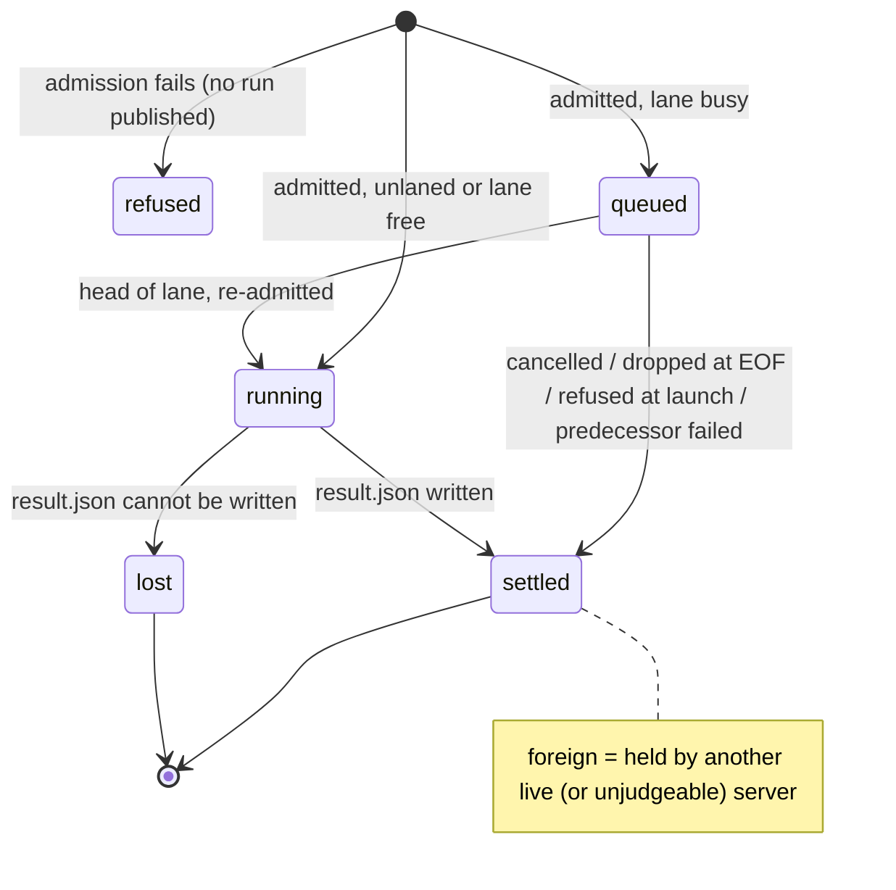

# SPEC-002: MCP server

<!-- Reference forms: `lib:reference/glossary.md` § reference forms. -->

## Overview

The `quotient` process run bare: a stdio MCP server, one per client, that turns
tool calls into pi runs and answers with documents about them. It is the one
container of the system (SPEC-001). Every other tech spec is a component of it:

```
                    ┌──────────────────── quotient (this container) ────────────────────┐
 MCP client ──stdio─┤ wire (eras, tasks) → tools → admission ─→ registry/lanes → execute ├─→ form ─→ pi
                    │                         │ SPEC-003         │                │        │   SPEC-004
                    │                 config, profiles, help     wait/ack/cancel  gate     │
                    │                        SPEC-005            views ← disk ←── evidence │
                    └────────────────────────────────────────────────────────────────────┘
 the same binary's verbs (reduce, help, allow, revoke): SPEC-006
```

This spec owns the shared mechanism: the wire and its two protocol eras, the
five tools, the run registry and lanes, wait / ack / cancel, MCP tasks, the
spawn and its one termination ladder, sessions, the evidence and audit split,
results on disk, the accounting gate and the reducer. It does not own the
admission steps (SPEC-003), what a form must guarantee (SPEC-004), where
configuration lives or what a profile is (SPEC-005), or the CLI verbs
(SPEC-006).

Posture: retrospective. Everything described here is shipped unless marked
*planned*.

## Responsibilities

- Serve MCP over LF-framed JSON-RPC on stdio, classifying each request's
  protocol era from its own `_meta`.
- Expose five tools — `pi_agent`, `pi_agent_start`, `pi_agent_wait`,
  `pi_agent_ack`, `pi_agent_cancel` — and answer MCP tasks for `pi_agent`.
- Publish each admitted run as a registry record and an evidence directory;
  order laned runs; re-admit queued runs at launch through SPEC-003.
- Launch each run through its form, enforce its limits retrospectively, and
  stop it through one termination ladder.
- Write each settled run's result to disk atomically and answer for any run,
  live or not, from one view.
- Reduce pi's event stream into the transcript and status every result
  carries.

## Mechanism

### Wire and eras

A request carrying `io.modelcontextprotocol/protocolVersion` in its
`params._meta` is modern (2026-07-28): stateless, no handshake, every result
carries `resultType`, and it may reach `server/discover` and `tasks/*`. A
request without it is legacy (2025-06-18 `initialize` era), served as before.
An unsupported version is `-32022` naming the supported one; malformed
`_meta` is `-32602`. There is no process-wide era (DEC-055, DEC-063).

A `tools/call` always answers a tool result carrying a document; a verdict
about a delegate is never a JSON-RPC error. `isError` is true only for a
refused call — and, for `pi_agent`, whenever the result's state is not
`completed` (DEC-052, DEC-058). A request the client cancels gets no reply in
either era (DEC-064).

The server's own instructions (legacy `initialize`, modern `server/discover`)
and each tool's description are help sections, resolved through SPEC-005.

### Tools

| tool | answers | read-only |
|---|---|---|
| `pi_agent` | `pi-agent-result/2` when the run settles; a task to a request declaring the tasks extension (DEC-056) | no |
| `pi_agent_start` | `pi-run-handle/1` at once; `key` makes a retried start idempotent for the server's life | no |
| `pi_agent_wait` | `pi-agent-wait/1`; changes nothing | yes (DEC-054) |
| `pi_agent_ack` | `pi-agent-ack/1` | no |
| `pi_agent_cancel` | `pi-agent-wait/1` over the cancelled runs | no |

Start and wait are separate because a client overlaps calls only to a tool
marked read-only, and a start of write-capable runs cannot honestly be one
(DEC-048, DEC-054). Every tool's refusal is the same `pi-agent-result/2`
refusal, told apart by `schema`.

### Run lifecycle



- **Publication line.** The `admitted` audit record, written before the call
  answers, publishes the run: from then its directory is never deleted and
  every ending is a result, never a disappearance (DEC-066). It records the
  owner — pid, start time, host, boot and namespaces (DEC-067).
- **Registry.** One compact record per run for the server's life, keyed by the
  run's evidence-directory name (its handle and task id). It holds state and
  causes, never a result (DEC-049).
- **Lanes.** Per-server FIFO queues, created by naming them. One run executes
  per lane; a cancelled run is skipped; `needs_success` refuses
  `lane-predecessor-failed` when the predecessor did not complete, and the
  refusal cascades. A queued run is re-admitted at launch: it may be refused
  or narrowed, never widened or moved (DEC-050).
- **Sessions.** Owned from start until settled by one `O_EXCL` lock file
  shared across servers on one session home; bound to the first root and
  capability; stale owners reclaimed by atomic replacement under a claim,
  and an undecidable owner refuses rather than reclaims.
- **Views.** One function answers "what is run X": the live record, else its
  evidence directory — `settled` if a result reads, `lost` only on positive
  evidence (a `lost` record, an owner confirmed dead, or no owner recorded),
  `foreign` otherwise; *unknown* and *unreadable* are not states and are listed
  apart (DEC-067, DEC-068).

### Wait, ack, cancel, tasks

- **Wait** is pure: selection by `runs` and/or `lanes`, `until` all or any,
  a server-side timeout (default 45 s, capped at the policy's wall clock or
  900 s), and a byte budget over included results, the first settled result
  always whole (DEC-062, DEC-069). Implicit selections take only unacknowledged
  `pi_agent_start` runs; runs created by `pi_agent` (blocking or task) are
  owned by their caller and reached only by name (DEC-060, DEC-070).
- **Ack** removes a settled or lost run this server holds from implicit
  selections; nothing else.
- **Cancel** marks every target before awaiting any, so no lane launches a
  marked run; the mark is intent, and the status is whatever the committed
  outcome is (DEC-053, DEC-065). No server cancels another's run.
- **Tasks**: `tasks/get` and `tasks/cancel` are served, `tasks/update` is an
  empty no-op; task notifications, subscriptions and MRTR are not implemented
  (DEC-061). State maps to Task status by one table (DEC-057); tasks carry
  `ttlMs: null` and `pollIntervalMs: 2000` (DEC-059).

### Spawn and the termination ladder

The run's form is launched with the active session directory as its one
positional argument, then pi's argv verbatim; an unconfined form is pi itself
(the invocation is form-1's, SPEC-004). The prompt travels on the child's
stdin; stdout is the event stream, stderr kept apart. The child leads its own
process group.

Every stop — client cancel, `pi_agent_cancel`, `tasks/cancel`, EOF or a
signal, a failed evidence write, a crossed limit, the wall clock, the
operator's switch — hands one ladder a cause: SIGTERM to the group, 2 s grace,
SIGKILL, reap, drain, audit. A queued run has no process and settles without
launching. Shutdown (stdin EOF, SIGTERM, SIGINT) stops reading, aborts every
running run with cause `eof`, drops every queued run, and writes no further
replies.

### The gate and the reducer

The reducer (`src/reduce/reduce.ts`) is pure: pi `--mode json` lines in,
budgeted transcript and `pi-run-status/3` out, one request count per provider
send, unmeasured and unknown never silently zero. The server and `quotient
reduce` share it.

The gate reads the reducer's accumulator on every counting record and on an
idle poll of about one second, evaluating in order: ceilings (requests,
per-request context, cost) against the admission snapshot; the wall clock;
the switch (policy re-read — unreadable or `enabled: false` stops the run);
accounting validity. The first crossing fires once into the ladder. One
predicate derives the verdict (`resultFor`), and `termination` is always the
first cause.

### Evidence

Two sinks, kept apart: `attempts.jsonl` for attempts that spawned nothing
(refused calls, runs refused at launch), and one directory per admitted run
holding `events.jsonl`, `stderr.log`, `transcript.md`, `status.json`,
`audit.jsonl` and `result.json`. The audit opens with `admitted`, then `spawn`
before launch, then any `abort` and the `exit`; a run that never launched
records `refused`, `cancelled` or `dropped`; `lost` records that `result.json`
could not be written. `result.json` is written to a temp file and renamed.

## Contracts

| contract | fixes |
|---|---|
| `docs/contract/pi-agent-result-2.md` | the result document: fields, states, terminations, refusals, usage and context accounting |
| `docs/contract/pi-run-handle-1.md` | the run document every surface shares; states; state→Task status table; handle and key grammar |
| `docs/contract/pi-agent-wait-1.md` | wait and cancel answers: selection, condition, timeout, byte budget |
| `docs/contract/pi-agent-ack-1.md` | ack verdicts and reasons |

The contracts are normative and checked against the code by drift tests; this
spec cites them and does not restate their tables. Compatibility rule, common
to all four: renaming, removing or retyping a field, making a non-nullable
field nullable, or changing a meaning table mints a new version and the old
contract stays alongside. Adding a refusal reason or an ack reason is allowed
within a version, and consumers must read an unknown one as its arm's generic
meaning. Defaults and caps may change without a version.

## Concerns

- **Untrusted delegate.** The evidence directory and other sessions must be
  unreachable from inside a run; the server relies on the form for that and
  checks the child's view before launch (SPEC-003).
- **Durability over memory.** Status is derived from disk so it reads the same
  after the server ends. Cost: a dead owner on another host or pid namespace
  leaves its runs reading `foreign` indefinitely (RSK-003).
- **Client patience.** A blocking `pi_agent` is bounded by the client's
  tool-call timeout (Codex 60 s by default; Claude Code's stdio idle timeout,
  30 min, RSK-002). Start + wait exists so no single call need outlast either.
- **Spend.** Each run is bounded; their number is not (IDE-005).
- **Shared servers.** Waits that name no runs, and acknowledgement, are per
  server: callers sharing one see each other's runs (no caller identity on
  stdio).

## Hypotheses

- MCP clients overlap tool calls only for tools marked read-only; the
  start/wait split depends on it.
- pi reports per-request usage on each assistant `message_end`; retrospective
  enforcement and context accounting depend on it. Whether pi replays
  history as new `message_end`s on session resume is unestablished.
- Clients keep stdin open while they want replies; EOF is the only "client
  gone" signal on stdio.

## Decisions

The decisions that shape this container are SL-004's DEC-048..070 (concurrent
tools, registry, lanes, wait, documents, cancellation, eras, tasks, publication
line, ownership, budget, implicit selection). Older decisions — the
cause→state table, sessions, tools narrowing, the launch command, signals —
predate this repository: module headers cite them by ids from the repository
quotient was extracted from, which do not resolve here. Their substance is
in the contracts and `docs/design.md`. Local stances recorded here:

- One process per run, one root per run; continuity is pi's session file.
- One termination ladder; no second shutdown path.
- Results live on disk; the registry holds no result.

## Open items

Deliberately left open; each must land additively within the current
contract versions or mint a new version explicitly.

- **IMP-013 — refusals that point to help.** A refusal may come to name the
  help section that resolves it. Text in `refusal.detail` needs no version; a
  new field on the refusal is an additive change to `pi-agent-result/2` that
  this spec permits only if consumers' unknown-field handling is confirmed
  (ISS-006).
- **IDE-007 — in-flight observability.** A running run's document may gain
  progress fields (requests, context peak, cost so far, elapsed). Fields on
  `pi-run-handle/1` are normative, so additions need a schema decision;
  live data in a wait answer competes with results for the byte budget.
- **IDE-005 — runs in flight.** No bound is a stated non-guarantee, not a
  requirement; a policy bound, if added, belongs to SPEC-003's admission.
- **IDE-004, IDE-006** — listing delivered runs in a wait, and a
  deterministic drain on EOF, are open ideas this design does not foreclose.
