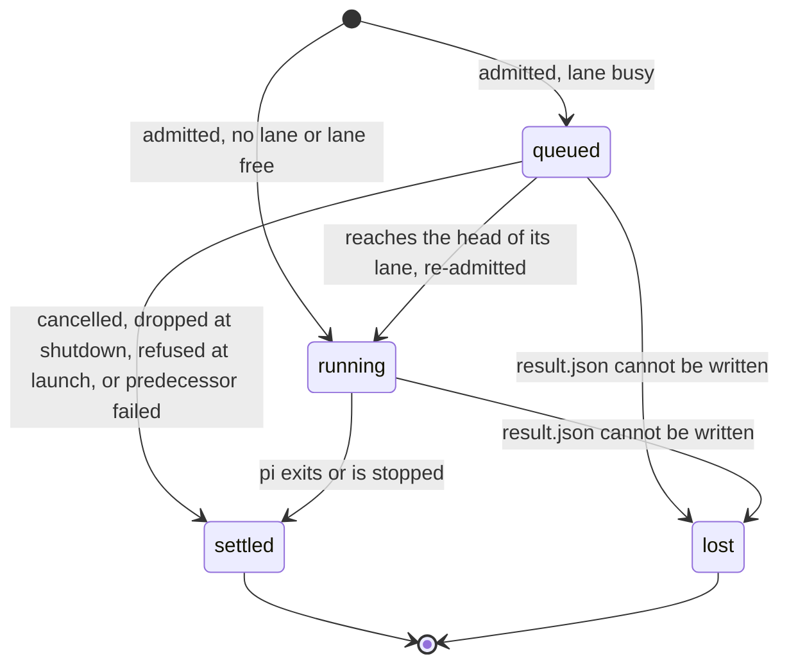

```text
`SPEC-002` — MCP server
mcp-server · active · tech
tags: mcp, runs, results
category: server
c4 level: container
parent: SPEC-001
responsibilities:
  - Serve MCP over LF-framed JSON-RPC on stdio, classifying each request's protocol era from its own _meta.
  - Expose the five tools (pi_agent, pi_agent_start, pi_agent_wait, pi_agent_ack, pi_agent_cancel) and answer MCP tasks for pi_agent.
  - Publish each admitted run as a registry record and an evidence directory, order laned runs, and re-admit queued runs at launch.
  - Launch each run through its form, enforce its limits retrospectively, and stop it through one termination ladder.
  - Write each settled run's result to disk atomically and answer for any run, live or not, from one view.
  - Reduce pi's event stream into the transcript and status every result carries.
sources:
  - typescript src/server/server.ts
  - typescript src/server/protocol.ts
  - typescript src/server/tools.ts
  - typescript src/server/runs.ts
  - typescript src/server/waiting.ts
  - typescript src/server/views.ts
  - typescript src/server/documents.ts
  - typescript src/server/execute.ts
  - typescript src/server/spawn.ts
  - typescript src/server/session.ts
  - typescript src/server/evidence.ts
  - typescript src/server/result.ts
  - typescript src/server/gate.ts
  - typescript src/reduce/reduce.ts
  - markdown docs/contract/pi-agent-result-2.md
  - markdown docs/contract/pi-run-handle-1.md
  - markdown docs/contract/pi-agent-wait-1.md
  - markdown docs/contract/pi-agent-ack-1.md

```

# SPEC-002: MCP server

<!-- Reference forms: `lib:reference/glossary.md` § reference forms. -->

## Overview

The `quotient` process run bare: a stdio MCP server, one per client, that turns
tool calls into pi runs and answers with documents about them. It is the one
container of the system (SPEC-001). Every other tech spec is a component of it:

```
                    ┌──────────────────── quotient (this container) ────────────────────┐
 MCP client ──stdio─┤ wire (eras, tasks) → tools → admission ─→ registry/lanes → execute ├─→ form ─→ pi
                    │                         │ SPEC-003         │                │        │   SPEC-004
                    │                 config, profiles, help     wait/ack/cancel  gate     │
                    │                        SPEC-005            views ← disk ←── evidence │
                    └────────────────────────────────────────────────────────────────────┘
 the same binary's verbs (reduce, help, allow, revoke): SPEC-006
```

This spec owns the shared mechanism: the wire and its two protocol eras, the
five tools, the run registry and lanes, wait / ack / cancel, MCP tasks, the
spawn and its one termination ladder, sessions, the evidence and audit split,
results on disk, the accounting gate and the reducer. It does not own the
admission steps (SPEC-003), what a form must guarantee (SPEC-004), where
configuration lives or what a profile is (SPEC-005), or the CLI verbs
(SPEC-006).

Posture: retrospective. Everything described here is shipped unless marked
*planned*.

Terms this spec adds to PRD-001 §1:

- **Era**: which revision of MCP a request speaks. Each request is judged on
  its own, so one server can serve old and new clients at once.
- **Registry**: the server's in-memory index of the runs it started.
- **Termination ladder**: the one sequence that stops a running run (signal,
  grace, kill, audit).
- **Gate**: the check that stops a run when it crosses a limit.
- **Foreign**: a run started by another server, or an earlier process, that
  may still be running.

## Responsibilities

- Serve MCP over LF-framed JSON-RPC on stdio, classifying each request's
  protocol era from its own `_meta`.
- Expose five tools — `pi_agent`, `pi_agent_start`, `pi_agent_wait`,
  `pi_agent_ack`, `pi_agent_cancel` — and answer MCP tasks for `pi_agent`.
- Publish each admitted run as a registry record and an evidence directory;
  order laned runs; re-admit queued runs at launch through SPEC-003.
- Launch each run through its form, enforce its limits retrospectively, and
  stop it through one termination ladder.
- Write each settled run's result to disk atomically and answer for any run,
  live or not, from one view.
- Reduce pi's event stream into the transcript and status every result
  carries.

## Mechanism

### Wire and eras

Each request's era is read from its `params._meta`, in this order:

1. No `_meta` object, or no `io.modelcontextprotocol/protocolVersion` key in
   it: **legacy** (the 2025-06-18 `initialize` era), served as before.
2. A version that is not a string: `-32602`.
3. A string other than `2026-07-28`: `-32022`, naming the supported version.
4. Client capabilities in `_meta` that are not an object: `-32602`.
5. Otherwise **modern** (2026-07-28): stateless, no handshake, every result
   carries `resultType`, and it may reach `server/discover` and `tasks/*`.

There is no process-wide era (DEC-055, DEC-063).

A `tools/call` that is answered with a tool result carries one versioned
document; a verdict about a delegate is never a JSON-RPC error. `isError` is
true only for a refused call — and, for `pi_agent`, whenever the result's
state is not `completed` (DEC-052, DEC-058). Two requests are answered
otherwise: a `pi_agent` request declaring the tasks extension is answered with
a task, and a request the client cancels, or that arrives once shutdown has
begun, gets no reply in either era (DEC-064).

The server's own instructions (legacy `initialize`, modern `server/discover`)
and each tool's description are help sections, resolved through SPEC-005.

### Tools

| tool | answers | read-only |
|---|---|---|
| `pi_agent` | `pi-agent-result/2` when the run settles; a task to a request declaring the tasks extension (DEC-056) | no |
| `pi_agent_start` | `pi-run-handle/1` at once; `key` makes a retried start idempotent for the server's life | no |
| `pi_agent_wait` | `pi-agent-wait/1`; changes nothing | yes (DEC-054) |
| `pi_agent_ack` | `pi-agent-ack/1` | no |
| `pi_agent_cancel` | `pi-agent-wait/1` over the cancelled runs | no |

Start and wait are separate because a client overlaps calls only to a tool
marked read-only, and a start of write-capable runs cannot honestly be one
(DEC-048, DEC-054). Every tool's refusal is the same `pi-agent-result/2`
refusal, told apart by `schema`.

### Run lifecycle

The lifecycle of a run, as the server that started it holds it:



A call refused at admission publishes no run and has no state. `settled`
means a `result.json` exists; the result inside it may be completed, failed,
incomplete, cancelled or refused. A server reading a run it does not hold
sees `settled`, `lost` or `foreign` instead (Views, below).

- **Publication line.** The `admitted` audit record, written before the call
  answers, publishes the run: from then its directory is never deleted and
  every ending is a result, never a disappearance (DEC-066). It records the
  owner — pid, start time, host, boot and namespaces (DEC-067).
- **Registry.** One compact record per run for the server's life, keyed by the
  run's evidence-directory name (its handle and task id). It holds state and
  causes, never a result (DEC-049).
- **Lanes.** Per-server FIFO queues, created by naming them. One run executes
  per lane. A run's predecessor is the run started before it in the lane.
  `needs_success` refuses `lane-predecessor-failed` when the predecessor did
  not complete, and the refusal cascades. A cancelled queued run never
  launches but stays its successor's predecessor, so a `needs_success`
  successor of a cancelled run refuses. A queued run is re-admitted at launch:
  it may be refused or narrowed, never widened or moved (DEC-050).
- **Sessions.** Owned from start until settled by one `O_EXCL` lock file
  shared across servers on one session home; bound to the first root and
  capability; stale owners reclaimed by atomic replacement under a claim,
  and an undecidable owner refuses rather than reclaims.
- **Views.** One function answers "what is run X": the live record, else its
  evidence directory — `settled` if a result reads, `lost` only on positive
  evidence (a `lost` record, an owner confirmed dead, or no owner recorded),
  `foreign` otherwise; *unknown* and *unreadable* are not states and are listed
  apart (DEC-067, DEC-068).

### Wait, ack, cancel, tasks

- **Wait** is pure: selection by `runs` and/or `lanes`, `until` all or any,
  a server-side timeout (default 45 s, capped at the policy's wall clock or
  900 s), and a byte budget over included results, the first settled result
  always whole (DEC-062, DEC-069). Implicit selections take only unacknowledged
  `pi_agent_start` runs; runs created by `pi_agent` (blocking or task) are
  owned by their caller and reached only by name (DEC-060, DEC-070).
- **Ack** removes a settled or lost run this server holds from implicit
  selections; nothing else.
- **Cancel** marks every target before awaiting any, so no lane launches a
  marked run; the mark is intent, and the status is whatever the committed
  outcome is (DEC-053, DEC-065). No server cancels another's run.
- **Tasks**: `tasks/get` and `tasks/cancel` are served, `tasks/update` is an
  empty no-op; task notifications, subscriptions and MRTR are not implemented
  (DEC-061). State maps to Task status by one table (DEC-057); tasks carry
  `ttlMs: null` and `pollIntervalMs: 2000` (DEC-059).

### Spawn and the termination ladder

The run's form is launched with the active session directory as its one
positional argument, then pi's argv verbatim; an unconfined form is pi itself
(the invocation is form-1's, SPEC-004). The prompt travels on the child's
stdin; stdout is the event stream, stderr kept apart. The child leads its own
process group.

Every stop — client cancel, `pi_agent_cancel`, `tasks/cancel`, EOF or a
signal, a failed evidence write, a crossed limit, the wall clock, the
operator's switch — hands one ladder a cause: SIGTERM to the group, 2 s grace,
SIGKILL, reap, drain, audit. A queued run has no process and settles without
launching. Shutdown (stdin EOF, SIGTERM, SIGINT) stops reading, aborts every
running run with cause `eof`, drops every queued run, and writes no further
replies.

### The gate and the reducer

The reducer (`src/reduce/reduce.ts`) is pure: pi `--mode json` lines in,
budgeted transcript and `pi-run-status/3` out, one request count per provider
send, unmeasured and unknown never silently zero. The server and `quotient
reduce` share it.

The gate reads the reducer's accumulator on every counting record and on an
idle poll of about one second, evaluating in order: ceilings (requests,
per-request context, cost) against the admission snapshot; the wall clock;
the switch (policy re-read — unreadable or `enabled: false` stops the run);
accounting validity. The first crossing fires once into the ladder. One
predicate derives the verdict (`resultFor`), and `termination` is always the
first cause.

### Evidence

Two sinks: `attempts.jsonl`, one ledger of refusals, and one directory per
published run holding `events.jsonl`, `stderr.log`, `transcript.md`,
`status.json`, `audit.jsonl` and `result.json`. Which an ending reaches
depends on whether the run was published:

| ending | attempts ledger | run directory |
|---|---|---|
| refused at admission (no run published) | yes | none exists |
| refused at launch, or `lane-predecessor-failed` | yes | `refused` audit record and a refused `result.json` |
| `spawn` record unwritable (`audit-failed`, nothing launched) | yes | a refused `result.json`; no `refused` audit record, since the audit is what failed |
| queued run cancelled, or dropped at shutdown | no | `cancelled` / `dropped` record and a `result.json` |
| launched run | no | `admitted`, `spawn`, any `abort`, `exit`, `result.json` |

`lost` records that `result.json` could not be written. `result.json` is
written to a temp file and renamed. A refusal the ledger cannot take is still
answered; the failure is reported on stderr.

## Contracts

| contract | fixes |
|---|---|
| `docs/contract/pi-agent-result-2.md` | the result document: fields, states, terminations, refusals, usage and context accounting |
| `docs/contract/pi-run-handle-1.md` | the run document every surface shares; states; state→Task status table; handle and key grammar |
| `docs/contract/pi-agent-wait-1.md` | wait and cancel answers: selection, condition, timeout, byte budget |
| `docs/contract/pi-agent-ack-1.md` | ack verdicts and reasons |

The contracts are normative and checked against the code by drift tests; this
spec cites them and does not restate their tables. Compatibility rule, common
to all four: renaming, removing or retyping a field, making a non-nullable
field nullable, or changing a meaning table mints a new version and the old
contract stays alongside. Adding a refusal reason or an ack reason is allowed
within a version, and consumers must read an unknown one as its arm's generic
meaning. Defaults and caps may change without a version.

## Concerns

- **Untrusted delegate.** The evidence directory and other sessions must be
  unreachable from inside a run; the server relies on the form for that and
  checks the child's view before launch (SPEC-003).
- **Durability over memory.** Status is derived from disk so it reads the same
  after the server ends. Costs: a dead owner on another host or pid namespace
  leaves its runs reading `foreign` indefinitely (RSK-003); and when the run
  directory itself becomes unwritable, so that neither `result.json` nor the
  `lost` record lands, the owner reports `lost` while other servers read
  `foreign` until the owner is confirmed dead.
- **Process-group escape.** The ladder signals the form's process group. A
  form that moves processes out of it escapes cancellation and shutdown;
  `form-1` does not yet forbid that (SPEC-004, ISS-004).
- **Client patience.** A blocking `pi_agent` is bounded by the client's
  tool-call timeout (Codex 60 s by default; Claude Code's stdio idle timeout,
  30 min, RSK-002). Start + wait exists so no single call need outlast either.
- **Spend.** Each run is bounded; their number is not (IDE-005).
- **Shared servers.** Waits that name no runs, and acknowledgement, are per
  server: callers sharing one see each other's runs (no caller identity on
  stdio).

## Hypotheses

- MCP clients overlap tool calls only for tools marked read-only; the
  start/wait split depends on it.
- pi reports per-request usage on each assistant `message_end`; retrospective
  enforcement and context accounting depend on it. Whether pi replays
  history as new `message_end`s on session resume is unestablished.
- Clients keep stdin open while they want replies; EOF is the only "client
  gone" signal on stdio.

## Decisions

The decisions that shape this container are SL-004's DEC-048..070 (concurrent
tools, registry, lanes, wait, documents, cancellation, eras, tasks, publication
line, ownership, budget, implicit selection). Older decisions — the
cause→state table, sessions, tools narrowing, the launch command, signals —
predate this repository: module headers cite them by ids from the repository
quotient was extracted from, which do not resolve here. Their substance is
in the contracts and `docs/design.md`. Local stances recorded here:

- One process per run, one root per run; continuity is pi's session file.
- One termination ladder; no second shutdown path.
- Results live on disk; the registry holds no result.

## Open items

Deliberately left open; each must land additively within the current
contract versions or mint a new version explicitly.

- **IMP-013 — refusals that point to help.** A refusal may come to name the
  help section that resolves it. Text in `refusal.detail` needs no version; a
  new field on the refusal is an additive change to `pi-agent-result/2` that
  this spec permits only if consumers' unknown-field handling is confirmed
  (ISS-006).
- **IDE-007 — in-flight observability.** A running run's document may gain
  progress fields (requests, context peak, cost so far, elapsed). Fields on
  `pi-run-handle/1` are normative, so additions need a schema decision;
  live data in a wait answer competes with results for the byte budget.
- **IDE-005 — runs in flight.** No bound is a stated non-guarantee, not a
  requirement; a policy bound, if added, belongs to SPEC-003's admission.
- **IDE-004, IDE-006** — listing delivered runs in a wait, and a
  deterministic drain on EOF, are open ideas this design does not foreclose.

## Requirements

### FR-001 (REQ-016) — Protocol era is decided per request

protocol-era-is-decided-per-request · functional · pending

Each request's protocol era is classified from its own params._meta, in order: no _meta object or no protocolVersion key is the legacy initialize era; a version that is not a string is -32602; a string other than 2026-07-28 is -32022 naming the supported one; client capabilities that are not an object are -32602; otherwise the request is modern. No era state is kept per process.

acceptance criteria:
  - A legacy request and a modern request on the same server are each answered in their own era.
  - A request naming an unsupported protocol version is answered -32022 with the supported version in its data.
  - Every modern-era result carries resultType.
  - A request whose _meta is null or not an object is served as legacy.
  - A request declaring 2026-07-28 without an object of client capabilities is answered -32602.

### FR-002 (REQ-017) — pi_agent answers a task only to a request declaring the tasks extension

pi-agent-answers-a-task-only-to-a-request-declaring-the-tasks-extension · functional · pending

pi_agent answers with an MCP task only when that same request declares the io.modelcontextprotocol/tasks extension in its _meta; every other request blocks and answers pi-agent-result/2. tasks/get and tasks/cancel are served, tasks/update is an empty no-op.

acceptance criteria:
  - A modern request declaring tasks receives a CreateTaskResult whose taskId is the run's handle.
  - A declaration on an earlier request or at initialize does not make a later request a task request.
  - An admission refusal answers the pi-agent-result/2 refusal, not a task.

### FR-003 (REQ-018) — Verdicts are tool results, never protocol errors

verdicts-are-tool-results-never-protocol-errors · functional · pending

Every tools/call answered with an MCP tool result carries a single text item that is a versioned JSON document; a refusal or a failed run is never a JSON-RPC error. isError is true for a refusal from any tool, and for pi_agent whenever the result's state is not completed. A pi_agent request declaring the tasks extension is answered with a task instead, and a request the client cancelled, or that arrives after shutdown begins, gets no reply.

acceptance criteria:
  - A refused call from each of the five tools answers a pi-agent-result/2 refusal with isError true.
  - A handle, wait answer or ack answer is never isError because of the runs it describes.
  - Only protocol faults (unknown method, unparsable line, malformed _meta) are JSON-RPC errors.

### FR-004 (REQ-019) — Only the wait tool is marked read-only

only-the-wait-tool-is-marked-read-only · functional · pending

pi_agent_wait declares readOnlyHint true and changes no observable state (acknowledgement, lanes, keys, runs); every other tool declares readOnlyHint false.

acceptance criteria:
  - tools/list shows readOnlyHint true for pi_agent_wait alone.
  - A wait leaves acknowledgement, lane order, keys and runs unchanged; its only possible record is an attempts-ledger line for a request-invalid refusal.

### FR-005 (REQ-020) — A keyed start is idempotent for the server's life

a-keyed-start-is-idempotent-for-the-servers-life · functional · pending

pi_agent_start with a key the server holds answers the original run's handle when the request digest is equal, and refuses request-invalid when it differs; a key is recorded only when its start publishes a run. The digest is taken over the request as written, normalised as the run-handle contract's The key section defines (object keys sorted, cwd resolved lexically against the launch directory, an omitted needs_success read as false, empty ceilings read as none, tools as a sorted set, key left out); it does not expand policy or profile defaults or resolve symlinks.

acceptance criteria:
  - A start retried with the same key and arguments answers the same taskId and admits nothing.
  - The same key with different arguments is refused request-invalid.
  - A refused keyed start records no key, so its retry is admitted afresh.
  - Two starts differing only in key order, an omitted versus false needs_success, or tool order and duplicates are equal; an omitted tools list and an explicit one are not.

### FR-006 (REQ-021) — Lanes execute in start order and re-admit at launch

lanes-execute-in-start-order-and-re-admit-at-launch · functional · pending

Runs in one lane launch one at a time in start order; a cancelled queued run never launches but remains its successor's predecessor; needs_success refuses lane-predecessor-failed when the predecessor did not complete, cascading; a queued run is re-admitted against the current policy and approvals at launch and may be refused or narrowed but keeps its root, session and capability.

acceptance criteria:
  - A laned run does not launch before its predecessor in the lane has settled.
  - In a lane A, B, C, cancelling queued B means B never launches and a needs_success C refuses even when A completes.
  - A needs_success run whose predecessor did not complete settles as a lane-predecessor-failed refusal without launching, whether the predecessor failed before or after the start.
  - A queued run whose policy maxima were lowered while it waited runs under the lowered ceilings; one whose profile is no longer allowed settles as a refusal at launch.

### FR-007 (REQ-022) — Wait selects, blocks and budgets as pi-agent-wait/1 defines

wait-selects-blocks-and-budgets-as-pi-agent-wait1-defines · functional · pending

pi_agent_wait selects targets by runs and/or lanes (implicit selections take only unacknowledged pi_agent_start runs), blocks until all or any are done or a timeout passes (default 45 s, capped at the policy's wall-clock maximum or 900 s), and includes results within budget_bytes, the first readable settled result always whole.

acceptance criteria:
  - timed_out is computed from the same states the entries report.
  - A result that alone exceeds the budget is included when it is the first readable settled result.
  - A run started by pi_agent is never an implicit wait target, but is reported when named.

### FR-008 (REQ-023) — Cancel marks every target before awaiting any

cancel-marks-every-target-before-awaiting-any · functional · pending

pi_agent_cancel and tasks/cancel mark each held run before awaiting any ending, so no lane launches a marked run; the mark is intent, and the reported status is the committed outcome. A foreign run is reported, never cancelled.

acceptance criteria:
  - Cancelling a running run and the queued run behind it in one call never launches the queued run.
  - A run that completed before the ladder reached it reports completed.
  - A foreign target is reported foreign and not awaited.

### NF-001 (REQ-024) — One termination ladder for every stop

one-termination-ladder-for-every-stop · quality · pending

Every stop of a running run passes one sequence — SIGTERM to the run's process group, a 2 s grace, SIGKILL to the group, reap, drain, audit — with the trigger's cause; the child leads its own process group so signals reach every process that stays in that group and nothing outside it. Keeping the delegate in the group is the form's obligation (SPEC-004).

acceptance criteria:
  - Cancellation, EOF, a crossed ceiling, the wall clock, the switch and an evidence failure each stop the run through the same ladder and record their cause.
  - A child that ignores SIGTERM is killed after the grace.
  - No signal from a run's ladder reaches the server or another run.

### NF-002 (REQ-054) — Shutdown settles every run and replies to nothing

shutdown-settles-every-run-and-replies-to-nothing · quality · pending

On stdin EOF, a failed input, SIGTERM or SIGINT the server stops reading, aborts every running run with cause eof, settles every queued run without launching, writes no further replies, and still writes each run's result.json.

acceptance criteria:
  - After EOF no child process of the server remains.
  - Each run aborted or dropped by shutdown has a result.json whose causes include eof, unless an earlier cause took precedence.
  - No reply is written after shutdown begins, including to requests already read.

### NF-003 (REQ-055) — Results live on disk and terminal states never change

results-live-on-disk-and-terminal-states-never-change · quality · pending

Each settled run's result.json is written atomically (temp file then rename) and the registry holds no result. A run not held in memory is resolved from disk: settled when a result reads, lost only on a published lost record, a confirmed-dead owner or no recorded owner, foreign otherwise; unknown and unreadable ids are reported apart. When neither result.json nor the lost record can be written, the owner reports lost while other servers read foreign until the owner is confirmed dead.

acceptance criteria:
  - A reader never observes a partial result.json.
  - A run whose owner is alive or cannot be judged reads foreign, never lost.
  - A run reported settled by one server reads settled from any server sharing the run directory, after the first has exited.

### NF-004 (REQ-056) — The admitted record is the publication line

the-admitted-record-is-the-publication-line · quality · pending

A run is published by its admitted audit record, written before the call answers; if it cannot be written the call refuses audit-failed and nothing is published. After publication the run directory is never deleted and every ending settles as a result. A spawn record is written before launch, or nothing launches.

acceptance criteria:
  - An unwritable admitted record refuses audit-failed with no handle.
  - An unwritable spawn record launches nothing and settles the run as an audit-failed refusal in its directory.
  - A refusal before publication is appended to attempts.jsonl and creates no run directory; a refusal after publication is appended to attempts.jsonl and also settles the run as a refused result in its directory.

### NF-005 (REQ-057) — Limits are evaluated even when the stream is quiet

limits-are-evaluated-even-when-the-stream-is-quiet · quality · pending

The gate evaluates ceilings against the admission snapshot, then the wall clock, then the switch, then accounting validity, on every counting record and on an idle poll of about one second; the first crossing fires once into the termination ladder with a cause naming the unit, its reading and its bound.

acceptance criteria:
  - A child that emits nothing is stopped by the wall clock within about a second of the deadline.
  - An unreadable or disabled policy at a gate tick stops a running run with cause switch.
  - The usage the gate judges and the usage the result reports come from one accumulator.

### NF-006 (REQ-058) — One reducer for server and CLI

one-reducer-for-server-and-cli · quality · pending

The reducer is a pure function from pi --mode json lines to a budgeted transcript and pi-run-status/3; the server and quotient reduce call the same function, and a missing or invalid usage value is reported as unmeasured or unknown, never as zero.

acceptance criteria:
  - The reducer performs no I/O.
  - The final assistant answer is always present and last in the transcript; budget elision cuts from the middle.
  - Missing usage increments the documented unmeasured counters rather than adding zero.
